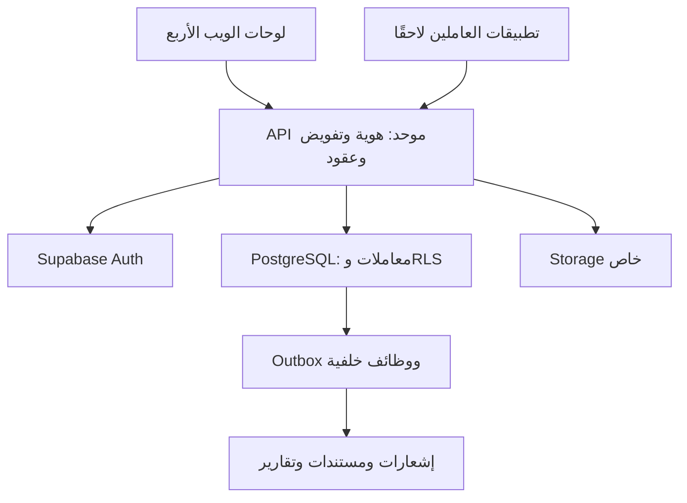
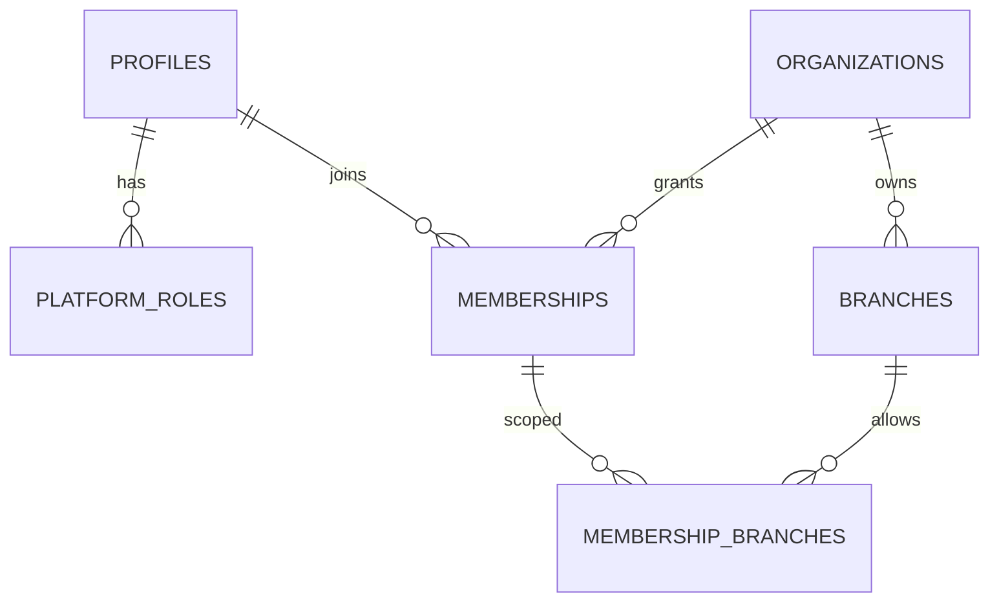
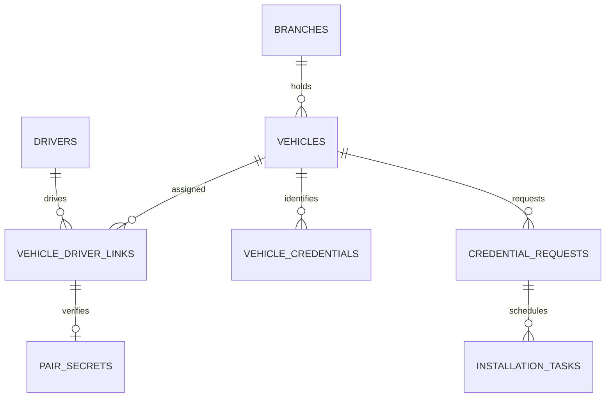
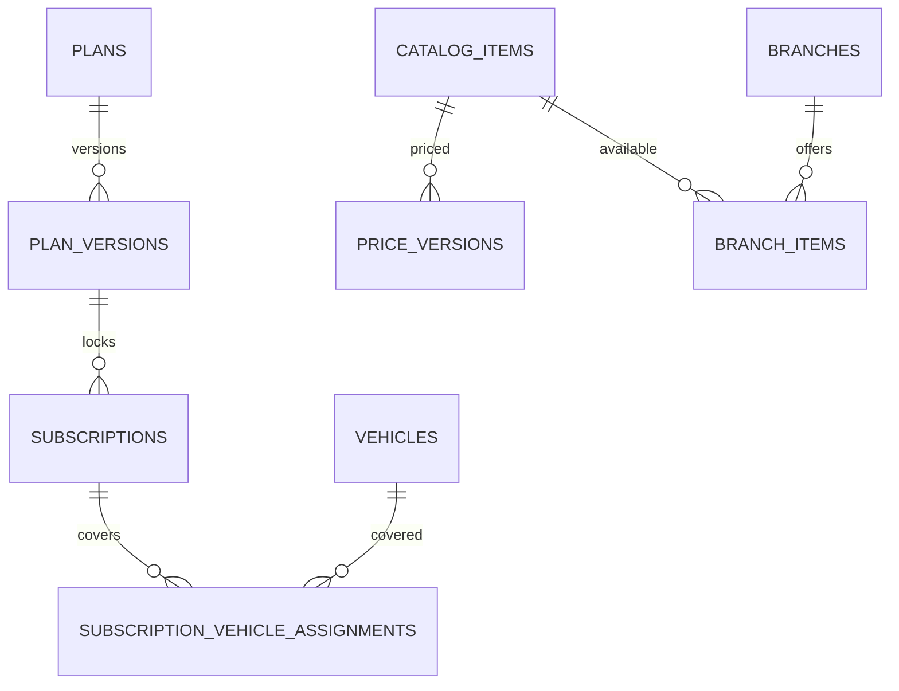
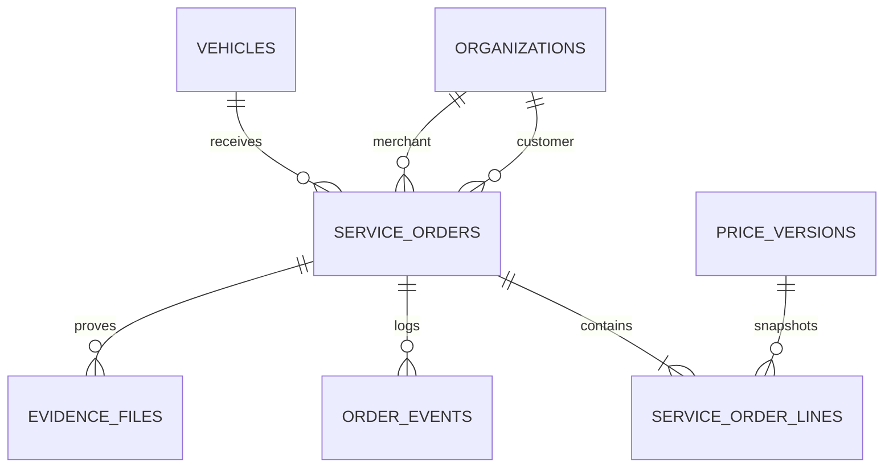
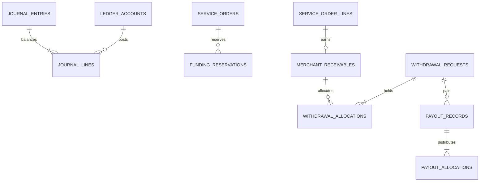
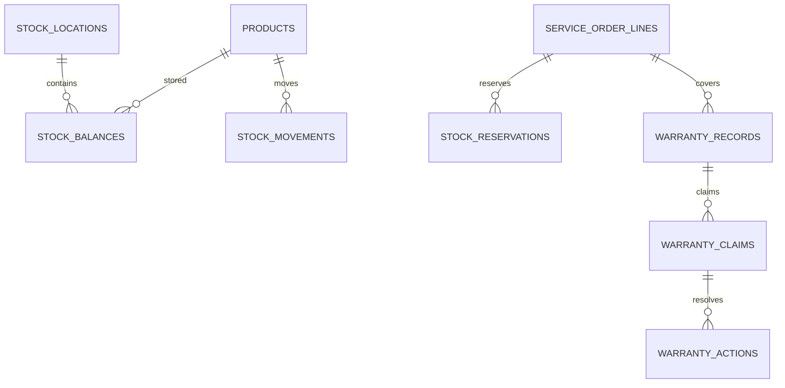
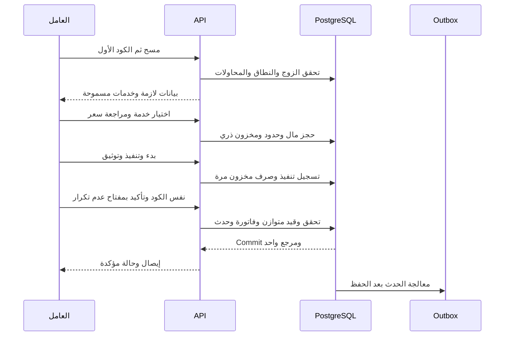

# Pertomax EG — المرجع الهندسي الشامل للبناء

الإصدار 3.0 — 14 أكتوبر 2026 — مرجع تصميم وتنفيذ يُرفع إلى Replit.

## اقرأ هذا أولًا

هذه وثيقة مواصفات وليست ادعاءً بأن المشروع مكتمل، وليست ملف SQL للتطبيق المباشر. تجمع المواصفات الأصلية كاملة في الملحق، وتضيف تصميمًا هندسيًا مترابطًا وقاموس بيانات وخطة قبول. لا تحتوي كلمات مرور أو مفاتيح أو بريد المالك الشخصي. وجود اسم جدول هنا لا يعني أنه موجود في قاعدة البيانات الحالية.

**حجية القرارات:** تعليمات المالك الأحدث، ثم قواعد هذه النسخة في الترتيب والهوية وحالة التنفيذ، ثم القرارات D01–D22 من الإصدار 2، ثم المواصفات التفصيلية الأصلية. تفاصيل P01–P20 إعدادات تصميم افتراضية موثقة قابلة للمراجعة. الإضافات الهندسية في قاموس البيانات وعقود API مقترحات تنفيذ وليست قرارات تجارية جديدة.

**تجاوزات صريحة للملاحق القديمة:** لا إنشاء مشروع جديد؛ نكمل المشروع الحالي. لا Clerk للدخول؛ Supabase Auth هو الهوية الحالية. اللوحات تُستكمل بالترتيب، والتطبيقات بعد جميع اللوحات واختبار ترابطها. بند المخزون الأساسي والضمان داخل الإصدار الأول يتقدم على وصفهما كتوسعات في المرجع القديم للمحطات. أي بند قديم «يحتاج حسمًا» تغطيه قرارات الإصدار 2 يعتبر محسومًا وفقها. بنود الإطلاق الواقعية التي لم تُزود قيمها تظل معلقة.

## فهرس المرجع

1. حدود المشروع والحالة المثبتة.
2. قواعد المنتج والأسعار.
3. العمارة والأدوات والبيئات.
4. التصميم المشترك للواجهات.
5. اللوحات الأربع وتفاصيل أقسامها.
6. الأدوار والعزل.
7. قاموس البيانات التفصيلي.
8. مخططات العلاقات.
9. دورة الخدمات والمالية والمخزون.
10. عقود API والأخطاء.
11. التقارير والإشعارات والملفات.
12. التطبيقات المؤجلة.
13. الترحيلات والأمان والتشغيل.
14. خطة البناء والاختبار والقبول.
15. بوابات الإطلاق وتعليمات Replit.
16. ملحق المواصفات الأصلية الكامل مع سجل التعارضات.

## 1. حدود المشروع والحالة المثبتة

| البند | الوجهة الوحيدة المسموحة |
|---|---|
| Replit | Pertomax EG — repl ID: d4419414-241c-4bc9-9716-0d42d533d1e8 |
| GitHub | pertomaxeg-svg/petro-web |
| Supabase | msvgzsfzrqlrfpstthhe |
| عنوان الخدمة | https://msvgzsfzrqlrfpstthhe.supabase.co |
| العملة/السوق | EGP — مصر |
| اللغة/الوقت | العربية RTL؛ الأحداث UTC والعرض وقواعد اليوم Africa/Cairo |
| الإنتاج | خارج Replit؛ الوجهة النهائية تحتاج اعتمادًا، لا استخدام VPS لمشروع آخر |

لا تغيير remote أو قاعدة بديلة أو ربط مشترك أو مشروع Replit آخر. Replit للتطوير، Free حسب اختيار المالك؛ لا ترقية مدفوعة ولا نشر تلقائي.

### الحالة حتى آخر تقرير مستلم

الدليل هنا تقارير Replit وصور المالك، وليس فحصًا حيًا جديدًا للكود أو القاعدة أثناء إعداد هذه الوثيقة.

- اتصال PostgreSQL مع TLS واختبارات إنشاء/تعديل/حذف معزولة نجحت سابقًا؛ لا تكررها بلا سبب جديد.
- تسجيل الدخول باسم المستخدم وكلمة المرور عبر Supabase Auth. البريد للتأكيد والاستعادة، لا Google في تطبيق المنصة.
- بريد SMTP عبر Brevo ضُبط من المالك، ووصل رابط التسجيل وانتهى إلى مساحة الحساب؛ اختبار استعادة كلمة المرور الكامل لم يثبت بعد.
- مالك نشط ومؤكد، دور owner واحد وسجل تهيئة واحد؛ سرّا التهيئة حُذفا وbootstrap-status أعاد available:false حسب التقرير.
- /admin ظاهر للمالك في صورة المالك؛ اختبار مستخدم مسجل غير مالك لا يزال مطلوبًا. رفض API دون جلسة 401 لا يكفي وحده لإثبات كل الصلاحيات.
- توجد 10 جداول petro_* في public وجدول واحد في petro_private وفق التقرير. الأسماء المؤكدة تشمل petro_profiles وpetro_platform_roles وpetro_organizations وpetro_branches وpetro_memberships وpetro_membership_branches. توجد بنية للباقات وإصداراتها وتدقيق ودعوات بحسب التقرير؛ أسماء بقية الجداول تُستخرج من كتالوج القاعدة ولا تُخمن.
- الترحيلات لا تعيد بناء كل الموجود؛ lib/db/src/schema/index.ts لا يعرّف جداول Drizzle. هذه فجوة DB-01 وليست سببًا لإعادة إنشاء القاعدة.
- لا دليل على تنفيذ المحافظ والمركبات والشرائح والكتالوج والمخزون والتسويات والدعم كاملًا.
- آخر رفع مؤكد بالتقرير: فرع pertomax-central-admin-review عند abf29a53ecb101a1f64350cfbe7c5d29bf585e6d. main كان 2ad582e21e0a844ac898b08624bf31e79187fde6. أُرسل أمر لاحق لمراجعة ودمج الفرع؛ نتيجته لم تصل عند كتابة المرجع. تحقق من HEAD الحالي قبل العمل، ولا تعِد الدمج أو ترجع لنسخة قديمة.

## 2. قواعد المنتج الثابتة

| المجال | القاعدة |
|---|---|
| الحسابات | إدارة مركزية، شركة، محطة، مقدم خدمات؛ الفروع داخل كل جهة وليست جهة جديدة |
| الشركة | شحن مسبق بتحويل بنكي واعتماد مالية؛ خدمات الأسطول من رصيدها |
| الباقات | 500 / 750 / 1000 جنيه للمركبة سنويًا؛ الأدمن يدير المميزات والأسعار بنسخ محفوظة |
| NFC | 100 جنيه سعر إصدار مبدئي؛ رسوم التركيب والانتقال والاستبدال تحتاج قرارًا مستقلًا |
| المحطة | تنضم مجانًا، بلا عمولات؛ وقود وغسيل وزيوت وبطاريات وفلاتر وقطع استهلاكية وغيرها |
| مقدم الخدمات | لا وقود؛ 5000 جنيه سنويًا لكل فرع افتراضيًا، تخصيص السعر من الأدمن؛ بلا عمولات |
| التسوية | شهرية؛ تخصيص كل محطة من الأدمن. تخصيص مقدم الخدمات إعداد مقترح لا يُفعل تلقائيًا |
| الدفع | QR أو NFC ثم نفس كود الزوج سائق/مركبة ذي 4 أرقام قبل الخدمة وبعدها |
| السائق | سجل تشغيلي، لا حساب دخول ولا تطبيق سائق |
| التطبيقات | عامل الوقود، الغسيل، الزيوت والقطع، إصدار وتركيب البطاقات؛ آخر مرحلة |
| التمويل | حساب رئيسي وحسابات فروع؛ المركبة حدود استهلاك وليست محفظة إضافية |
| الأسعار | وقود من الأدمن؛ خدمات ومنتجات الجهة تعتمد مركزيًا؛ السعر يثبت وقت الحجز |
| الاشتراك | انتهاء يمنع عمليات جديدة ولا يصادر الأموال أو يمنع عرض السجلات والسحب المستحق |
| الإيراد | اشتراكات الشركات ومقدمي الخدمات والرسوم المعتمدة، لا عمولة خدمات افتراضية |

مميزات الباقات ليست مستنبطة من السعر؛ لا يفترض التنفيذ عدد فروع أو مستخدمين أو تقارير لكل باقة ما لم يُذكر في المواصفات أو يعتمد المالك جدول المميزات. لا نسبة ضريبة مفترضة ولا حساب بنكي وهمي في الإنتاج.

## 3. العمارة والأدوات

### النمط

تطبيق خلفي واحد مقسم إلى وحدات وظيفية، وواجهة ويب واحدة ذات أربع مساحات صلاحيات. لا microservices مبكرة، ولا أربع نسخ مستقلة من منطق الدفع. التطبيقات اللاحقة تستخدم نفس عقود الخدمات.

| الأداة | الاستخدام | الوضع |
|---|---|---|
| Replit | تحرير وتشغيل ومعاينة تطوير | مستخدم فعليًا؛ لا استضافة إنتاج معتمدة |
| GitHub | مصدر الكود والترحيلات والتوثيق وPR | مستودع قائم؛ لا مفاتيح أو مرفقات محادثة شخصية |
| TypeScript + pnpm | أنواع وعقود وبناء | مذكوران في نتائج التنفيذ؛ تثبيت الإصدارات الفعلية من lockfile |
| واجهة الويب الحالية | إعادة استخدام إطار ومكونات المشروع | افحص package.json؛ لا تغيير framework دون حاجة وقرار |
| Node.js API الحالي | مصادقة وتفويض وأوامر الأعمال | استكمال القائم؛ إطار الخادم وإصداره يتحققان من الكود |
| Supabase Auth | الهوية والجلسات والتأكيد والاستعادة | قائم؛ مصدر الهوية الوحيد |
| Supabase PostgreSQL | بيانات وقيود ودفتر وحجز | قائم؛ migrations مطلوبة لكل تعديل |
| supabase-js | عميل Auth وواجهات Supabase | موجود وفق التقرير |
| PostgreSQL driver | اتصال خادمي TLS | قائم؛ مكتبة الاتصال وإعداد pool من الكود |
| Supabase Storage | مستندات وإيصالات وصور | تصميم مطلوب؛ تنفيذ السياسات يُتحقق قبل الاستخدام |
| Brevo SMTP | نقل بريد Auth | ضُبط يدويًا؛ لا مفاتيح في المستند |
| React Native + Expo development builds | تطبيقات العمال وNFC لاحقًا | اقتراح الإصدار 2؛ اختيار المكتبات بعد اختبار الأجهزة |
| Playwright / إطار اختبار TS الحالي | اختبارات واجهات وتكامل | مقترح حسب ما هو مثبت؛ لا تثبيت أدوات متكررة |
| PostgreSQL tests / pgTAP عند الحاجة | قيود وRLS وتزامن | مقترح؛ لا تعتمد المرور بمستخدم postgres لإثبات العزل |
| OpenAPI + أنواع مولدة | عقود بين الويب وAPI والتطبيقات | توليد عقود موجود بالتقارير؛ حافظ على الأداة الحالية |
| وظائف خلفية + Outbox | بريد وتصدير ومطابقة وتنبيهات | مطلوب؛ scheduler واحد مخول وقابل للرصد |
| Drizzle | اختياري حسب استعمال المشروع الحقيقي | لا تُعد بناء طبقة البيانات لمجرد ملف فارغ |
| PDF / CSV / XLSX | إيصالات وتصدير واستيراد | اختيار المكتبات وفق العربية والترخيص والتوافق |

### وحدات الكود المطلوبة

identity، organizations، access، subscriptions، fleet، credentials، catalog، pricing، orders، finance، settlements، inventory، warranties، approvals، documents، reports، support، notifications، settings.

كل وحدة تملك قواعدها وأوامرها واختباراتها. finance وحدها ترحّل الدفتر. orders يستدعي أوامر التمويل داخل المعاملة نفسها. التقارير قراءة مشتقة ولا تعيد تنفيذ المنطق المالي. قاعدة البيانات مصدر الحقيقة، وRealtime إن استُعمل لتحديث العرض ليس إثبات دفع.

لا تُنقل ملفات المشروع لتطابق شجرة افتراضية؛ توضع الوحدات في الهيكل القائم artifacts/ وlib/ وscripts/ حيث يلائم الكود، مع توثيق مساراتها الحقيقية.

## 4. نظام تصميم الواجهات

### هيكل مشترك

قائمة جانبية RTL، شريط علوي باسم المساحة والجهة والفرع المختار، بحث داخل القسم، إشعارات، حساب وخروج. مسار تنقل، عنوان واضح، وصف قصير، إجراء رئيسي واحد، فلاتر محفوظة، جدول بترقيم صفحات وفرز، صفحة تفاصيل بتبويبات وسجل زمني. اختيار فرع لا يغير الصلاحية؛ الخادم يتحقق دائمًا.

الهوية المرئية تستكمل الأخضر الداكن والخلفيات الهادئة الظاهرة في التطبيق. الألوان والتباعد والخطوط رموز مشتركة، لا نسخ CSS منفصلة لكل لوحة. الأرقام واللوحات ومرجع العملية تعرض باتجاه مناسب داخل RTL. جداول المالية تعرض الجنيه والقرش بوضوح، ولا أرقام وهمية في المؤشرات.

### كل صفحة يجب أن تغطي

تحميل، فارغة، بيانات، خطأ قابل لإعادة المحاولة، منع صلاحية، لا اتصال، عملية قيد الإرسال، نجاح مؤكد، تعارض تعديل. الحالة الفارغة للأدمن: «لم تُضف جهات بعد» مع زر الإنشاء للمخول، ولا عبارة توحي بفقدان صلاحية المالك. تحميل HTTP 200 لا يعني نجاح كل البيانات.

نماذج: تحقق حقل ومجموع حقول من الخادم، حفظ مسودة عند الحاجة، تأكيد إجراءات مالية مع ملخص، سبب إلزامي للرفض/الإيقاف/التصحيح. منع إرسال مكرر، مع اعتماد الخادم على idempotency وليس الزر فقط. حفظ تغيير مفتوح يحتاج تنبيه قبل المغادرة.

إتاحة: لوحة مفاتيح، focus ظاهر، labels، أخطاء نصية، تباين مناسب، عدم الاعتماد على اللون وحده. الهاتف يعرض بطاقات أو جدول قابل للتمرير دون إخفاء الإجمالي والحالة. عرض النوافذ الحساسة لا يكشف أسرارًا أو أكوادًا.

### قالب تفاصيل موحد

ملخص وهوية وحالة، معلومات أساسية، علاقات (جهة/فرع/مركبة)، مستندات، عمليات/مالية إن وجدت، طلبات وموافقات، سجل زمني، إجراءات مخولة. كل ارتباط يفتح السجل الأصلي حسب صلاحية المشاهد وليس نسخة منفصلة.

## 5. اللوحات الأربع

الحقول المشتركة للجهة: الاسم التجاري والقانوني والكود والنوع وحالة الاعتماد والتشغيل وبيانات الاتصال والعنوان ومستندات المنشأة وبيانات الضرائب عند اعتمادها وحسابات البنك بنسخ. الفرع: كود واسم وعنوان ومحافظة وموقع وساعات ومسؤول وخدمات وحالة ونشر بالشبكة. حقول التسجيل القانونية لا تُعلن إلزامية قبل تحديد متطلبات المالك.

### 5.1 الإدارة المركزية — اكتمالها أولًا

| ID | القسم والشاشات | الإجراءات والعلاقات | قبول القسم |
|---|---|---|---|
| ADM01 | الرئيسية والمؤشرات | الجهات حسب النوع والحالة، الاشتراكات، الطلبات، الأموال المحجوزة والمستحقات والاستثناءات | كل رقم قابل للتتبع لتقريره؛ لا خلط رصيد الشركة بإيراد المنصة |
| ADM02 | مركز الموافقات | انضمام، تحديث بيانات/بنك، أسعار، شحن، اشتراك، NFC، رد، سحب، جرد | قرار وسبب وفاعل ووقت؛ الاعتماد مرتبط بالطلب ومراجعة نسخته |
| ADM03 | الشركات والفروع | إضافة/تعديل/اعتماد/تعليق، المسؤولون والأسطول والباقة والمحافظ والسجلات | الفرع لا ينفصل عن الشركة ولا ينقل تاريخ المال |
| ADM04 | المحطات والفروع | ملفات وخدمات الوقود وغيره، العاملون والمستحقات وسياسة التسوية | لا رسوم اشتراك أو عمولات افتراضية |
| ADM05 | مقدمو الخدمات والفروع | نفس الإدارة مع اشتراك لكل فرع وأسعار خاصة | منع الوقود خادميًا؛ انتهاء فرع لا يوقف السحب |
| ADM06 | المستخدمون والأدوار | موظفو الإدارة والجهات، دعوات وتعيين فروع وتعطيل | لا تصعيد ذاتي؛ لا فقد آخر مالك نشط دون مسار نقل ملكية مخول |
| ADM07 | الباقات والنسخ | خطط الشركات، حقوق كل نسخة، أسعار المقدم، تخصيص وتجديد وتغطية مركبات | تعديل الخطة لا يغير اشتراكًا قائمًا |
| ADM08 | الخدمات والكتالوج | تصنيفات وماركات ووحدات ومنتجات وتوافق وغسيل وأجرة عمل | اعتماد تعريف المنتج مستقل عن السعر، وحفظ تاريخ البيع |
| ADM09 | الأسعار | أنواع الوقود ونسخه، أسعار المنتجات والخدمات والمواعيد والضرائب | منع تداخل أسعار بلا أولوية؛ السعر من الخادم |
| ADM10 | المركبات والسائقون | قراءة وإدارة مخولة لسجل المركبة والربط والقيود والعداد والصيانة | طلب شريحة أثناء الإضافة، دون إنشاء Auth للسائق |
| ADM11 | البطاقات والتركيب | مخزون الشرائح، طلب إصدار/استبدال، تكليف ومواعيد وإثبات وتفعيل | لا بطاقة فعالة لمركبتين؛ استبدال يحفظ التاريخ |
| ADM12 | أوامر الخدمة | كل العمليات وفلاتر الأقسام وتفاصيل السطور والعامل والصور والاستثناءات | التنفيذ والدفع والتسوية حالات مستقلة |
| ADM13 | التمويل والشحن | حسابات الشركة وفروعها، تحويلات، اعتماد التحويل البنكي وإثباته | اعتماد مكرر لا يضاعف المال؛ منع التكرار البنكي |
| ADM14 | دفتر الحركات والمطابقة | قيود متوازنة، كشف حساب، فرق الرصيد، تسويات مراجعة | لا تعديل قيود مرحّلة؛ تصحيح بقيد عكسي |
| ADM15 | السحب والتسويات | أهلية المستحقات وقطع الفترة واعتماد وسداد جزئي/كامل وإيصالات | المستحق لا يحجز مرتين؛ «مسدد» نتيجة قيد دفع |
| ADM16 | الردود والنزاعات | رد خدمة جزئي/كامل، استرداد رصيد الشركة، اعتراض | لا رد أكبر من المدفوع المتبقي؛ لا إعادة مخزون تلقائية |
| ADM17 | المخزون والضمان | متابعة الاستلام والنقل والجرد والفحص والمطالبة والاستبدال | لا مخزون سالب، لا شراء خفي في استبدال ضمان |
| ADM18 | الفواتير والمستندات | مستندات خدمة واشتراك وشحن وتسوية ورد، قوالب وإصدارات | بيانات تاريخية ثابتة، PDF قابل لإعادة التوليد |
| ADM19 | التقارير والتصدير | تشغيل ومالية وأقسام وفروع وشركات وعاملين وتدقيق | تطابق إجماليات التقارير مع الدفتر والسطور |
| ADM20 | الدعم والإشعارات | تذاكر ورسائل ومرفقات وتصعيد وقوالب وتفضيلات | فصل الملاحظات الداخلية عن رد العميل |
| ADM21 | الإعدادات والحوكمة | سياسة الحسابات، حدود، قواعد توثيق، إصدارات ضرائب، بنوك، تسوية، مهلات | إعداد مؤرخ ومدقق، لا تعديل سري للأثر المالي السابق |
| ADM22 | صحة التشغيل والتدقيق | jobs، outbox، فشل ملفات، محاولات مرفوضة، نشاط إداري | لا أسرار في السجلات؛ معالجة فشل قابلة للتتبع |

المؤشرات والإعدادات والصفحات الإدارية تبنى فوق الخدمات المشتركة الحقيقية حتى لو لم تُبنَ واجهات الشركات بعد. لا يتم إعلان اكتمال الإدارة مع أزرار غير فعالة أو صفحات «قريبًا» في نطاقها المعتمد.

### 5.2 الشركة وفروعها

| ID | القسم | تفاصيل التنفيذ |
|---|---|---|
| COM01 | الرئيسية | إجمالي التمويل دون ازدواج، رئيسي/فروع، متاح ومحجوز، استهلاك الأقسام، تنبيه اشتراك ووثائق |
| COM02 | الشركة والفروع | معلومات ومستندات واعتماد تحديثات، مسؤولون وحسابات وفروع مسندة |
| COM03 | المستخدمون | مدير، مالي، أسطول، فرع، مراجع؛ إنشاء/دعوة/إيقاف وتعيين نطاق |
| COM04 | الباقات والاشتراكات | مقارنة حقوق النسخ، طلب/تجديد/ترقية، عدد وتغطية مركبات وتواريخ وإثبات |
| COM05 | المركبات | قائمة وتفاصيل، لوحة وصورة ونوع وماركة وموديل وشاسيه وكود داخلي وفرع وحالة؛ استيراد |
| COM06 | السائقون والربط | سجلات وربط مؤرخ وكود الزوج وتغيير مخول؛ لا عرض كود محفوظ في كشف أو تصدير |
| COM07 | السياسات والحدود | مبلغ وكمية لكل عملية وفترة، أقسام وأيام وساعات وجهات مسموحة وقيود رحلة |
| COM08 | الوثائق والعداد والصيانة | انتهاء رخص/تأمين/فحص، قراءة وصورة وتصحيح بسبب، سجل صيانة وتذكير |
| COM09 | الشرائح وQR | طلب أثناء إضافة المركبة أو لاحقًا؛ إصدار/تركيب/استبدال/إيقاف وتكلفة وحالة |
| COM10 | الشحن والمحافظ | إثبات تحويل، مراجعة، كشف حساب، توزيع تمويل للفرع وإعادة غير المحجوز |
| COM11 | العمليات والفواتير | سجل موحد ولكل قسم، المركبة والسائق والعامل والجهة والمنتج والماركة والسعر والصور |
| COM12 | الرحلات والورديات | وفق حقوق الباقة؛ حد إضافي لا تمويل جديد؛ لا تتبع GPS حي مفترض |
| COM13 | الردود والدعم | اعتراض على عملية، طلب رد خدمة، طلب استرداد رصيد غير مستخدم بمسار مستقل |
| COM14 | التقارير والإشعارات | فروع/مركبات/سائقون/خدمات/عداد وكفاءة؛ تصدير مخول وتوقيت وفلاتر |

إضافة مركبة: بيانات ← الفرع ← الربط والضوابط ← اختيار وسيلة التعرف وطلب الشريحة الاختياري ← مراجعة وحفظ. فشل طلب الشريحة لا يخلق طلبًا يتيمًا أو مكررًا؛ تعرض نتيجة مستقلة مرتبطة بالمركبة. النقل بين الفروع يغيّر التمويل المستقبلي فقط.

### 5.3 المحطة وفروعها

| ID | القسم | تفاصيل التنفيذ |
|---|---|---|
| STA01 | الرئيسية والمنشأة والفروع | مؤشرات تشغيل ومستحقات، اعتماد بيانات وبنك، ساعات وخدمات وتوفر ونشر الشبكة |
| STA02 | الوقود | الأنواع المسموحة والسعر المركزي الساري، سجل مبالغ وليترات وعداد وعمليات العامل |
| STA03 | كتالوج المنتجات | ماركة وتصنيف ووحدة وSKU وباركود وصور ومواصفات وتوافق ومسلسل عند اللزوم |
| STA04 | الغسيل | أنواع وفئات مركبات وشمول وسعر وفروع وصور قبل/بعد ومتطلبات الخدمة |
| STA05 | الزيوت والقطع والعمل | زيت ولزوجة وكمية وقطع وبطاريات وفلاتر واستهلاكية، أجرة تركيب وباقات بمكونات |
| STA06 | الأسعار والاعتماد | تقديم نسخ ومواعيد سريان وطلبات استكمال/رفض؛ العامل لا يعدل السعر |
| STA07 | المخزون | استلام أساسي، متاح ومحجوز وتحت الفحص وتالف، نقل، جرد، تصحيحات ومرفقات |
| STA08 | العاملون والأجهزة | حسابات وفروع وخدمات وتكليف وإيقاف وسجل، ورديات اختيارية موثقة |
| STA09 | العمليات | قائمة مجمعة ولكل قسم، تفاصيل الشركة والمركبة والسائق والعامل والسطور والمال |
| STA10 | المالية والسحب | المستحق والمؤهل والمحجوز والمدفوع، كشف وحجز طلب ومراجعة وإثبات تحويل |
| STA11 | الفواتير والردود والضمان | مستندات لكل عملية، مراجعة رد، فحص مرتجع ومطالبة ضمان واستبدال |
| STA12 | التقارير والدعم | مبيعات حسب القسم والشركة والعامل والفرع، تذاكر وإشعارات وطلبات وسجل |
| STA13 | إصدار وتركيب البطاقات | مهام العامل المكلف وطلبات الشركة والمواعيد والتوثيق؛ لا تفعيل ذاتي بلا تكليف |

المحطة لا تُفرض عليها باقة مقدم خدمات عند إضافة الغسيل أو الزيت. حسابها المالي مستحقات وليس نسخة من أموال كل شركة. مخزون الوقود وقياس خزانات/مضخات آلي ليس تكاملًا ضمنيًا؛ تفاصيل كمية الوقود تأتي من التنفيذ المسجل إلى أن يعتمد تكامل منفصل.

### 5.4 مقدم الخدمات وفروعه

يعتمد STA01 وSTA03–STA12 حسب صلاحياته، مع قسم مستقل لاشتراكات الفروع وسعرها القياسي/المخصص ومدتها ومدفوعاتها وتجديدها. لا STA02 وقود، ولا مهام تركيب البطاقات افتراضيًا؛ التكليف لهذه الوظيفة ضمن منظومة الإصدار والمحطات والعمال المصرح لهم، وليس ميزة تلقائية لكل مقدم.

قائمة نهائية: الرئيسية، المنشأة، الفروع، الموظفون، الكتالوج، الغسيل، الزيوت والقطع وأجرة العمل، الأسعار، المخزون، الضمان، العمليات حسب القسم، الفواتير، المالية والسحب والتسويات، الاشتراكات، التقارير، الدعم والإشعارات والسجل. كل فرع له أهلية اشتراك مستقلة؛ المالي يستطيع طلب مستحقاته بعد انتهاء الاشتراك.

## 6. التفويض والأدوار

هوية المستخدم UUID من auth.users؛ username مُطبع وفريد للحسابات. ملف المستخدم لا يخزن كلمة المرور. البريد محصور في Auth وخدماته ويُحمى من الكشف عبر بحث أسماء المستخدمين.

| الدور | النطاق | أهم القيود |
|---|---|---|
| owner | المنصة دون عضوية شركة | لا تجاوز لتوازن المال أو تعديل التاريخ؛ نشاطه مدقق |
| admin_operations | جهات واعتمادات وتشغيل حسب التفويض | ليس اعتماد صرف بنكي تلقائيًا |
| admin_finance | شحن وتسوية ورد ومطابقة وفق تفويض | لا تعديل أكواد السائق أو أسعار غير مخولة |
| admin_catalog | كتالوج وأسعار بحسب التفويض | لا أموال ولا منح أدوار |
| support/auditor | تذاكر/قراءة محددة | إخفاء البنك والأسرار غير اللازمة |
| org_manager | الجهة وفروعها | لا حقوق جهة أخرى ولا منح صلاحية مركزية |
| branch_manager | الفروع المسندة | لا سحب مركزي منافس أو تحويل خارج التفويض |
| org_finance | تمويل الشركة أو مستحقات التاجر بحسب نوع الجهة | لا تأكيد قبض أو صرف المنصة بنفسه |
| fleet_manager | مركبات وسائقون وسياسات مخولة | لا اعتماد شحن |
| catalog/inventory staff | تقديم أصناف وأسعار/مخزون | لا اعتماد ذاتي مالي |
| worker | فرع وخدمة وتكليف | لا كشف كامل رصيد الشركة ولا تحرير سعر |

المصفوفة تطبق resource.action مع scope، مثل organizations.read، branches.manage، plans.publish، topups.approve، payouts.record، refunds.approve، credentials.activate، audit.read. الأسماء النهائية تطابق الموجودة في التطبيق؛ تُوثق خريطة المطابقة. فصل مقدم الطلب والمعتمد افتراضي في المالية؛ استثناء المالك منفردًا إن احتاجه التشغيل قرار مؤرخ ومدقق لا تجاوز صامت.

كل طلب يتحقق من الحساب النشط والدور والعضوية والفرع والجهة وحالة المورد. RLS لا يُستعاض عنه بإخفاء الأزرار. لا ثقة في org_id أو role المرسل من العميل. جداول الطرفين (الطلبات والفواتير) تسمح فقط للطرف المعني وبحقول ملائمة، ولا تمنح الوصول إلى كامل ملفات الطرف الآخر.

## 7. قاموس البيانات الهندسي

**تفسير:** الجداول التالية مخطط مستهدف مقترح. الأسماء المنطقية بلا بادئة تقابل petro_* بعد مطابقة DB-01. لا تنشئ profiles أو organizations جديدة إذا كانت petro_profiles وpetro_organizations موجودة. استخدم الموجود وأضف فقط الناقص بترحيل. الجداول الخاصة توضع في petro_private أو schema غير مكشوفة بعد مراجعة الأذونات. دفتر المال لا يقبل DML مباشرًا من المتصفح.

المشترك حيث ينطبق: id UUID PK، created_at/updated_at timestamptz، created_by UUID، version bigint للتعارض. جداول الربط يمكن أن تستخدم PK مركبًا، والأحداث المالية الثابتة لا تتطلب updated_at. FK تعني مفتاحًا أجنبيًا حقيقيًا، لا مجرد نص في JSON.

الأنواع: الأموال bigint بالقرش (EGP)، الكميات numeric(18,6)، السعر عالي الدقة numeric عند حساب الوقود قبل تحويل الإجمالي للقرش؛ لا float للمال. timestamps UTC؛ نطاقات السريان [from,to). JSONB للقطات التاريخية والمواصفات المرنة فقط، لا بدل FK أو رصيد أو صلاحية.

الأعمدة المبينة هي الحد الهندسي الأساسي؛ nullability وdefaults النهائية تُثبت في DDL أثناء DB-01/ترحيل الوحدة. المرجع لا يدّعي امتلاك dump كامل أو migrations جاهزة.

### الهوية والجهات

| الجدول المنطقي | الحقول الأساسية | العلاقات والقيود |
|---|---|---|
| `profiles` | user_id UUID PK/FK auth.users؛ username text؛ username_normalized text؛ display_name text؛ status text | UNIQUE username_normalized؛ لا كلمات مرور؛ مطابق petro_profiles الموجود |
| `platform_roles` | user_id FK profiles؛ role_key text؛ status؛ granted_by؛ granted_at | دور منصة لا عضوية جهة؛ UNIQUE نشط user/role؛ منع إزالة آخر مالك بلا مسار معتمد |
| `organizations` | kind company/station/provider؛ code؛ legal_name؛ display_name؛ approval_status؛ operational_status؛ contact؛ address | code فريد؛ فصل الاعتماد عن التشغيل؛ جدول petro_organizations قائم |
| `branches` | organization_id FK؛ code؛ name؛ address؛ governorate؛ latitude/longitude؛ hours JSONB؛ manager_user_id؛ status؛ published | UNIQUE organization/code وorganization/id لدعم FK المركب؛ الموقع ضمن حدود صحيحة |
| `memberships` | organization_id FK؛ user_id FK؛ status؛ scope_mode all_branches/assigned | UNIQUE organization/user؛ حالة الحساب والعضوية لازمتان |
| `membership_branches` | organization_id؛ membership_id FK؛ branch_id FK | FK مركبان يثبتان تطابق الجهة؛ UNIQUE membership/branch |
| `roles` | scope platform/organization؛ owner_org_id nullable؛ code؛ name؛ status | الأدوار المخصصة لا تمنح حقوقًا خارج الحد الأعلى للجهة |
| `permissions` | resource؛ action؛ description | UNIQUE resource/action؛ قاموس محكوم بالخادم |
| `role_permissions` | role_id FK؛ permission_id FK | PK مركب؛ تغييره مدقق ومخول |
| `membership_roles` | membership_id FK؛ role_id FK؛ scope_branch_id nullable | الدور مملوك للجهة أو قالب صالح؛ منع توسعة الفرع عبر التعيين |
| `invitations` | org_id؛ branch_scope؛ role_scope؛ recipient_lookup؛ token_hash؛ expires_at؛ accepted_at؛ status | رمز أحادي الاستخدام؛ لا دور منصة من دعوة جهة؛ إعادة استخدام الموجود إن وجد |
| `organization_documents` | org_id؛ branch_id nullable؛ document_type؛ file_id FK؛ expires_at؛ review_status | ملف خاص؛ FK مركب لنطاق الفرع؛ لا حذف سجل استعمال تاريخي |
| `bank_accounts` | org_id FK؛ label؛ status؛ current_version_id | لا تعديل بيانات نسخة بنك سابقة |
| `bank_account_versions` | bank_account_id FK؛ holder؛ bank_name؛ account_ref؛ masked_ref؛ approved_at؛ status | حماية بيانات الحساب، طلب السحب يرتبط بنسخة معتمدة |
| `onboarding_requests` | org_id FK nullable؛ applicant_user_id؛ proposed_kind؛ payload؛ status؛ review_id | منع إنشاء جهتين لنفس قبول الطلب عبر مفتاح فريد |
| `organization_change_requests` | org_id؛ branch_id nullable؛ change_type؛ before_version؛ proposed_payload؛ status | لا استبدال بنك طلب سحب قائم بصمت |

### الباقات

| الجدول المنطقي | الحقول الأساسية | العلاقات والقيود |
|---|---|---|
| `plans` | code؛ target_kind؛ name؛ status | الخطة تعريف؛ لا استعمال سعر حالي لإعادة حساب اشتراك قديم |
| `plan_versions` | plan_id FK؛ version_no؛ price_minor؛ currency؛ billing_basis vehicle/branch؛ cycle؛ entitlements JSONB؛ effective_from؛ status | UNIQUE plan/version؛ نسخه المنشورة ثابتة؛ لا اشتراك مدفوع للمحطات |
| `subscriptions` | org_id؛ branch_id nullable؛ plan_version_id FK؛ starts_at؛ ends_at؛ units؛ price_snapshot؛ status | شركة حسب مركبات؛ مقدم حسب فرع؛ ends>starts؛ منع تغطية متداخلة غير مبررة |
| `subscription_vehicle_assignments` | subscription_id FK؛ vehicle_id FK؛ starts_at؛ ends_at؛ status | المركبة والشركة متطابقتان؛ لا تجاوز وحدات التغطية بالتزامن |
| `pricing_overrides` | org_id؛ branch_id nullable؛ plan_id؛ price_minor؛ starts_at؛ ends_at؛ reason؛ approved_by | أولوية فرع ثم جهة ثم قياسي؛ النسخة تحفظ بالاشتراك |
| `subscription_payments` | subscription_id FK؛ receipt_allocation_id؛ amount_minor؛ status؛ journal_entry_id | أموال الاشتراك منفصلة عن شحن الخدمات؛ عدم تكرار الترحيل |
| `subscription_change_requests` | subscription_id؛ requested_version_id؛ requested_units؛ effective_at؛ quote_snapshot؛ status | تصميم إضافي للترقية والتجديد؛ سياسة proration تحتاج اعتمادًا لا حسابًا مخترعًا |

### الأسطول

| الجدول المنطقي | الحقول الأساسية | العلاقات والقيود |
|---|---|---|
| `vehicles` | company_org_id؛ branch_id؛ plate_original؛ plate_normalized؛ plate_region؛ chassis؛ internal_code؛ category؛ make؛ model؛ year؛ fuel_type_id؛ status | FK branch ضمن الشركة؛ سياسة تفرّد اللوحة حسب نطاق التسجيل المعتمد؛ لا كشف مركبة شركة أخرى |
| `drivers` | company_org_id؛ operational_code؛ name؛ contact؛ status | لا auth user إلزامي؛ UNIQUE company/code؛ أقل بيانات لازمة |
| `vehicle_driver_links` | company_org_id؛ vehicle_id FK؛ driver_id FK؛ starts_at؛ ends_at؛ status | المركبة والسائق من الشركة نفسها؛ زوج نشط غير مكرر |
| `vehicle_documents` | vehicle_id FK؛ type؛ file_id FK؛ expires_at؛ status | تنبيهات مؤرخة دون إرفاق وثائق عامة |
| `vehicle_policy_versions` | vehicle_id FK؛ version_no؛ valid_from؛ valid_to؛ policy_id FK؛ status | نسخ مؤرخة؛ يحتفظ الأمر بمرجع السياسة المستعملة |
| `usage_policies` | org_id؛ branch_id nullable؛ name؛ timezone؛ allowed_merchants_mode؛ status | إضافة تفصيلية لتطبيع القيود؛ فارغة لا تعني السماح العام ضمنيًا |
| `usage_policy_rules` | policy_id FK؛ scope vehicle/branch/trip؛ service_category_id nullable؛ period؛ max_minor nullable؛ max_quantity nullable؛ max_per_order؛ days؛ time_ranges | كل الحدود الواجبة تتقاطع؛ حجز+مدفوع داخل النافذة؛ لا جمع حدين كرصيد |
| `policy_allowed_merchants` | policy_id FK؛ merchant_org_id؛ branch_id nullable | FK النوع محطة/مقدم؛ UNIQUE policy/merchant/branch حسب null scope |
| `policy_allowed_items` | policy_id FK؛ category_id nullable؛ item_id nullable؛ effect allow/deny | قيد XOR للنطاق؛ أولوية رفض محددة لا تعارض صامت |
| `trips` | company_org_id؛ branch_id؛ vehicle_id؛ driver_link_id؛ code؛ starts_at؛ ends_at؛ budget_minor؛ status | حد الرحلة إضافة لقيود المركبة؛ لا يمول تلقائيًا |
| `vehicle_shifts` | vehicle_id؛ driver_link_id؛ starts_at؛ ends_at؛ status | تعارض الربط والوردية يعالج قبل التشغيل؛ شروط الباقة |
| `odometer_events` | vehicle_id؛ order_id nullable؛ reading numeric؛ occurred_at؛ proof_file_id؛ correction_of_id؛ reason | أحداث ثابتة؛ تصحيح مرتبط لا كتابة فوق القراءة السابقة |
| `maintenance_records` | vehicle_id؛ order_line_id nullable؛ category؛ odometer_event_id؛ next_date؛ next_odometer؛ notes | إضافة تربط الصيانة بالفاتورة؛ اقتراح الموعد لا ادعاء توصية مصنع |

### التعرف والتحقق

| الجدول المنطقي | الحقول الأساسية | العلاقات والقيود |
|---|---|---|
| `credential_requests` | company_org_id؛ vehicle_id؛ request_type issue/replace؛ previous_credential_id؛ quoted_fee_minor؛ payment_status؛ status | طلب قائم واحد من النوع لكل مركبة؛ الإصدار أثناء إضافة مركبة مدعوم |
| `credential_stock_units` | serial؛ tag_type؛ identifier_hash؛ batch_ref؛ custody_branch_id nullable؛ status | إضافة لإدارة مخزون الشرائح؛ لا تحتوي PIN؛ لا وحدة تالفة تصرف |
| `vehicle_credentials` | vehicle_id؛ stock_unit_id nullable؛ type NFC/QR؛ public_token_hash؛ status؛ activated_at؛ revoked_at | token فريد؛ لا ربط فعال للشريحة بأكثر من مركبة؛ QR/NFC وسائل تعريف فقط |
| `installation_tasks` | request_id FK؛ assigned_user_id؛ merchant_branch_id nullable؛ schedule؛ status؛ evidence_file_id | تكليف مصرح؛ لا تفعيل قبل مطابقة وإثبات وأهلية رسوم |
| `credential_bindings_history` | credential_id؛ vehicle_id؛ task_id؛ event؛ actor_id؛ occurred_at | append-only؛ الاستبدال يحفظ القديم والجديد |
| `pair_secrets` | driver_link_id FK؛ verifier؛ key_version؛ status؛ rotated_at | خاص؛ HMAC/حماية سرية خادمية مع حد محاولات؛ لا hash أربعة أرقام مكشوف للعميل |
| `verification_sessions` | driver_link_id؛ credential_id؛ worker_id؛ merchant_branch_id؛ order_id nullable؛ expires_at؛ state | خاص؛ مقيدة بالزوج والفرع والخدمة؛ لا تفويض عام reusable |
| `verification_attempts` | scope_fingerprint؛ action؛ attempted_at؛ outcome؛ blocked_until | خاص؛ لا تخزين الكود؛ حماية من توزيع التخمين على عمال أو IPs |
| `auth_rate_limits` | scope_fingerprint؛ window_start؛ attempts؛ blocked_until | خاص؛ إعادة استخدام محدد الدخول الدائم الموجود؛ لا تكرار جدول قائم |

### الكتالوج

| الجدول المنطقي | الحقول الأساسية | العلاقات والقيود |
|---|---|---|
| `categories` | parent_id self FK؛ code؛ name؛ service_domain؛ status | منع حلقات التصنيف؛ الوقود خاص بالمحطة |
| `brands` | name؛ normalized_name؛ status | تغيير الماركة لا يغير snapshot البيع |
| `units` | code؛ name؛ dimension؛ decimal_scale | تمييز لتر/قطعة/خدمة؛ لا جمع وحدات مختلفة |
| `catalog_items` | owner_org_id nullable؛ kind product/service/fuel؛ category_id؛ code؛ status | إضافة supertype مقترحة لضمان FK بدل item_ref حر؛ لا تنشأ إذا القائم يوفر بديلًا مكافئًا |
| `products` | item_id PK/FK؛ brand_id؛ unit_id؛ sku؛ barcode؛ attributes JSONB؛ serialized bool؛ stock_tracked bool | مالك الصنف عبر catalog_items؛ SKU فريد داخل مالكه |
| `services` | item_id PK/FK؛ service_type wash/labor/bundle؛ vehicle_category؛ description؛ status | الخدمة لا تخصم مخزونًا إلا بمكونات صريحة |
| `fuel_types` | item_id PK/FK؛ code؛ name؛ unit_id | تعريف مركزي؛ لا منتج وقود لمقدم خدمات |
| `price_versions` | item_id FK؛ merchant_org_id nullable؛ branch_id nullable؛ version_no؛ gross_minor؛ unit_price_decimal nullable؛ tax_profile_version_id؛ valid_from؛ valid_to؛ status | قيد عدم تداخل للنسخ المنشورة في النطاق؛ الوقود مركزي؛ سعر تاريخي ثابت |
| `branch_items` | merchant_org_id؛ branch_id؛ item_id FK؛ available؛ stock_location_id nullable | UNIQUE branch/item؛ التحقق من مالك الكتالوج وصلاحية الخدمة |
| `branch_service_capabilities` | branch_id؛ service_domain؛ status؛ hours_override | إضافة تمنع تشغيل خدمة غير مفعلة في الفرع |
| `service_components` | service_item_id؛ component_item_id؛ quantity؛ price_handling included/separate | منع دورات bundles وخصم المكون مرتين؛ تثبيت النسخة بالطلب |
| `vehicle_compatibility` | item_id؛ vehicle_category؛ make؛ model؛ year_from؛ year_to؛ constraints JSONB | ترشيح مقابل إلزام وفق السياسة؛ لا ادعاء مطابقة مصنع غير مثبتة |
| `service_documentation_rules` | service_domain؛ branch_id nullable؛ version_no؛ photos_before؛ photos_after؛ odometer_required؛ serial_required | استثناء مشرف بسبب؛ تثبيت القاعدة بالأمر |

### العمليات

| الجدول المنطقي | الحقول الأساسية | العلاقات والقيود |
|---|---|---|
| `service_orders` | customer_org_id؛ customer_branch_id؛ merchant_org_id؛ merchant_branch_id؛ vehicle_id؛ driver_link_id؛ worker_user_id؛ execution_status؛ payment_status؛ gross_minor؛ currency؛ snapshot؛ revision | FKs مركبة للنطاق؛ refs تاريخية لا تعتمد على الفرع الحالي للمركبة |
| `service_order_lines` | order_id؛ item_id؛ price_version_id؛ category_id؛ quantity؛ unit؛ net_minor؛ tax_minor؛ gross_minor؛ snapshot | مجموع السطور=الإجمالي؛ الاسم والماركة وسعر الوحدة وأجرة العمل محفوظة |
| `order_quotes` | verification_session_id؛ payload_hash؛ quote_version؛ totals؛ price_snapshot؛ expires_at | إضافة للتسعير قبل الحجز؛ ليس رصيدًا محجوزًا |
| `order_events` | order_id؛ event_type؛ actor_id؛ from_state؛ to_state؛ occurred_at؛ safe_metadata | append-only؛ لا PIN/token |
| `evidence_files` | order_id؛ order_line_id nullable؛ file_id؛ kind؛ captured_at؛ actor_id | المرفق يتبع الطرفين المصرح لهما؛ تحقق file registry |
| `delivery_records` | order_id؛ order_line_id؛ actual_quantity؛ actual_amount_minor؛ odometer_event_id؛ performed_by؛ occurred_at | إضافة لفصل التنفيذ عن الدفع؛ زيادة السعر تستلزم حجزًا معتمدًا قبل التنفيذ |

### المال

| الجدول المنطقي | الحقول الأساسية | العلاقات والقيود |
|---|---|---|
| `ledger_accounts` | owner_org_id nullable؛ branch_id nullable؛ account_type؛ currency؛ status | أنواع بنك/تمويل شركة/مستحق تاجر/إيراد/ضريبة/مديونية؛ لا محفظة مركبة |
| `journal_entries` | source_type؛ source_id؛ posting_key؛ occurred_at؛ status draft/posted/reversed؛ reverses_entry_id nullable | UNIQUE source/posting؛ القيد المرحل ثابت؛ عكس مرتبط |
| `journal_lines` | entry_id؛ account_id؛ side debit/credit؛ amount_minor؛ currency | amount>0؛ قيد عملة واحدة متوازن عند commit |
| `account_balances` | account_id PK/FK؛ debit_total_minor؛ credit_total_minor؛ version؛ last_entry_id | cache مشتق لا مصدر مستقل؛ تعدل فقط مع ترحيل القيد |
| `funding_reservations` | order_id؛ account_id؛ amount_minor؛ status؛ expires_at | حجز ليس قيد مصروف؛ unique الحجز الفعال؛ استهلاك/تحرير مرة واحدة |
| `policy_usage_reservations` | order_id؛ rule_id؛ window_start؛ window_end؛ amount_minor؛ quantity؛ status | قفل نطاق الاستهلاك لمنع تجاوز حدود متزامنة |
| `merchant_receivables` | order_line_id؛ merchant_account_id؛ earned_minor؛ refunded_minor؛ paid_minor؛ eligible_at؛ status | unpaid مشتق؛ المخصص النشط لا يتجاوز المؤهل؛ لا تعديل بلا أمر مالي |
| `topup_requests` | company_org_id؛ amount_minor؛ bank_receipt_id؛ status؛ submitted_by؛ approved_by؛ journal_entry_id | لا إضافة رصيد قبل تحقق مالي؛ قبول واحد للطلب |
| `bank_receipts` | platform_bank_account_id؛ bank_reference؛ received_at؛ amount_minor؛ proof_file_id؛ fingerprint؛ status | منع إعادة استخدام نفس التحويل؛ تخصيص جزئي مجموع≤قيمة الإيصال |
| `receipt_allocations` | receipt_id؛ purpose topup/subscription/credential؛ target_id؛ amount_minor؛ journal_entry_id | FK للغرض عبر subtype أو تحقق صارم؛ لا استعمال التحويل مرتين |
| `refund_requests` | order_id؛ requested_by؛ reason؛ status؛ approved_by؛ journal_entry_id | رد مرتبط بالأصل؛ لا موافقة ذاتية بلا تفويض |
| `refund_lines` | refund_id؛ order_line_id؛ quantity nullable؛ gross_minor؛ net_minor؛ tax_minor | المجموع≤المبلغ القابل للرد؛ كمية الرد ومخزون العودة مستقلان |
| `company_balance_return_requests` | company_org_id؛ funding_account_id؛ bank_version_id؛ amount_minor؛ reservation_ref؛ status | استرداد رصيد غير مستخدم مستقل عن refund خدمة؛ حجز يمنع إنفاقه |
| `company_fund_transfers` | company_org_id؛ from_account_id؛ to_account_id؛ amount_minor؛ journal_entry_id؛ status | إضافة لمراجع التحويل الداخلي؛ الحسابان للشركة نفسها؛ عدم تكرار |

### التسويات

| الجدول المنطقي | الحقول الأساسية | العلاقات والقيود |
|---|---|---|
| `settlement_policy_versions` | merchant_org_id؛ branch_id nullable؛ cycle؛ cutoff_rule؛ timezone؛ effective_from؛ version_no | شهري افتراضي؛ تخصيص محطة؛ حفظ النسخة المستعملة |
| `withdrawal_requests` | merchant_org_id؛ bank_version_id؛ policy_version_id؛ requested_minor؛ approved_minor؛ paid_minor؛ status | طلب مركزي؛ نسخة بنك ثابتة؛ دفع جزئي أو كامل بحسب السياسة |
| `withdrawal_allocations` | withdrawal_id؛ receivable_id؛ amount_minor؛ state reserved/paid/released | قفل المستحق؛ مجموع النشط≤المتبقي؛ لا uniqueness بديلًا للتحقق الجزئي |
| `payout_records` | withdrawal_id؛ amount_minor؛ bank_reference؛ paid_at؛ evidence_file_id؛ journal_entry_id؛ recorded_by | لا marked_paid بلا أثر مالي؛ مرجع صرف غير مكرر مع نطاق البنك |
| `payout_allocations` | payout_id؛ withdrawal_allocation_id؛ amount_minor | مجموعها=مبلغ السداد؛ لا تتجاوز تخصيص الطلب |
| `settlement_documents` | withdrawal_id؛ payout_id nullable؛ document_id؛ bank_snapshot؛ total_minor | إثبات سداد؛ ليس فاتورة بيع وقود جديدة |

### المخزون

| الجدول المنطقي | الحقول الأساسية | العلاقات والقيود |
|---|---|---|
| `stock_locations` | merchant_org_id؛ branch_id؛ kind sellable/quarantine/damaged/transit؛ code | فصل الصالح للبيع عن تحت الفحص؛ مصدر الفرع واضح |
| `stock_balances` | product_item_id؛ location_id؛ on_hand numeric؛ reserved numeric؛ version | PK product/location؛ القابل للبيع=on_hand-reserved؛ لا سالب |
| `stock_reservations` | order_line_id؛ product_item_id؛ location_id؛ quantity؛ status | حجز واحد فعال لكل مكون؛ خدمة bundle تفجر مكوناتها مرة |
| `stock_movements` | source_type؛ source_id؛ product_item_id؛ from_location_id nullable؛ to_location_id nullable؛ quantity؛ occurred_at؛ idempotency_ref | حركة ثابتة؛ quantity>0؛ لا update كمية ماضية |
| `serialized_units` | product_item_id؛ serial؛ current_location_id؛ status؛ sale_line_id nullable | serial فريد داخل المنتج/المصنع وفق السياسة؛ لا بيع نفس الوحدة مرتين |
| `stock_receipts` | branch_id؛ external_reference؛ file_id nullable؛ status؛ received_by؛ received_at | إضافة لاستلام أساسي لا حساب موردين كامل |
| `stock_receipt_lines` | receipt_id؛ product_item_id؛ quantity؛ inspected_quantity؛ destination_location_id | 0≤inspected≤received؛ ترحيل مخزون مرة واحدة |
| `stock_transfers` | merchant_org_id؛ from_branch_id؛ to_branch_id؛ status؛ dispatched_at؛ received_at | نقل داخل الجهة؛ transit يمنع إظهار الوحدات في فرعين |
| `stock_transfer_lines` | transfer_id؛ product_item_id؛ requested_quantity؛ sent_quantity؛ received_quantity؛ discrepancy_reason | معالجة فرق الاستلام دون اختلاق مخزون |
| `stock_counts` | location_id؛ started_at؛ cutoff_at؛ status؛ approved_by | snapshot أو قفل حركة أثناء الجرد وفق التنفيذ الموثق |
| `stock_count_lines` | count_id؛ product_item_id؛ expected_quantity؛ counted_quantity؛ difference | تثبيت وقت العد؛ الفرق ينتج طلب تسوية لا تعديل مباشر |
| `stock_adjustment_requests` | count_line_id nullable؛ product_item_id؛ location_id؛ delta_quantity؛ reason؛ status؛ approved_by | سجل واعتماد؛ حركة تصحيح لا حذف |

### المرتجعات والضمان

| الجدول المنطقي | الحقول الأساسية | العلاقات والقيود |
|---|---|---|
| `merchandise_returns` | order_id؛ merchant_org_id؛ status؛ received_at؛ reason | إرجاع مادي مستقل عن قيد الرد |
| `merchandise_return_lines` | return_id؛ order_line_id؛ unit_id nullable؛ quantity؛ inspection_status؛ destination_location_id | لا عودة للبيع قبل الفحص؛ لا زيادة كمية بمجرد رد مال |
| `warranty_terms_versions` | product_item_id؛ version_no؛ duration؛ conditions؛ status | شروط وقت البيع محفوظة؛ لا تطبيق تغيير رجعي |
| `warranty_records` | order_line_id؛ unit_id nullable؛ terms_version_id؛ starts_at؛ ends_at | يرتبط بالمبيع والمركبة عبر الطلب |
| `warranty_claims` | warranty_record_id؛ reason؛ proof_file_id؛ status؛ inspected_by؛ decision | قبول/رفض موثق؛ لا يقتطع مالًا تلقائيًا |
| `warranty_actions` | claim_id؛ action inspect/repair/replace/reject؛ replacement_unit_id nullable؛ stock_movement_id nullable؛ notes | الاستبدال بلا خصم جديد؛ فرق مدفوع أمر منفصل |

### المستندات

| الجدول المنطقي | الحقول الأساسية | العلاقات والقيود |
|---|---|---|
| `invoices` | doc_type؛ issuer_org_id nullable؛ recipient_org_id؛ order_id nullable؛ subscription_id nullable؛ number؛ issued_at؛ totals؛ snapshots؛ status | تمييز فاتورة/إيصال/إشعار دائن؛ مصدر قانوني يحدد قبل الإنتاج |
| `invoice_lines` | invoice_id؛ order_line_id nullable؛ description_snapshot؛ quantity؛ net_minor؛ tax_minor؛ gross_minor | أسماء وماركات ووحدات وضرائب ثابتة؛ لا قراءة الاسم الحي لتوليد القديم |
| `document_sequences` | issuer_scope؛ doc_type؛ fiscal_period؛ next_number | قفل تسلسل؛ uniqueness للسلسلة والرقم؛ الفجوات توثق وفق سياسة الفوترة |

### المساندة

| الجدول المنطقي | الحقول الأساسية | العلاقات والقيود |
|---|---|---|
| `approval_requests` | request_type؛ subject_type؛ subject_id؛ subject_version؛ status؛ assigned_to؛ submitted_by | ربط typed؛ لا اعتماد payload تغير بعد تقديمه |
| `approvals` | request_id؛ actor_id؛ decision؛ reason؛ decided_at | append-only؛ القرار ينتج أمر الوحدة المعنية لا update حر |
| `support_tickets` | org_id؛ branch_id nullable؛ order_id nullable؛ category؛ priority؛ status؛ assigned_to | نطاق المالك والأطراف المخولة؛ SLA إعداد |
| `ticket_messages` | ticket_id؛ author_user_id؛ body؛ visibility public/internal؛ file_id nullable | internal لا يصل لعميل عبر API أو export |
| `notifications` | recipient_user_id؛ event_id؛ category؛ title؛ safe_body؛ read_at؛ target_ref | لا أسرار أو أرصدة جهات أخرى؛ dedupe event/recipient/channel |
| `notification_preferences` | user_id؛ channel؛ category؛ enabled | إضافة؛ تنبيهات الأمان الإلزامية لا تُعطل دون سياسة |
| `outbox_events` | event_key؛ aggregate_type؛ aggregate_id؛ event_type؛ safe_payload؛ status؛ attempts؛ available_at؛ lease_until | خاص؛ unique event_key؛ يكتب مع commit؛ retry وdead-letter |
| `audit_events` | actor_id؛ action؛ entity_type؛ entity_id؛ org_scope؛ occurred_at؛ request_id؛ redacted_changes | append-only؛ لا passwords/PIN/secrets؛ وصول مدقق ومحدود |
| `import_jobs` | org_id؛ template_version؛ file_id؛ status؛ row_counts؛ preview_hash؛ requested_by | رفع ثم معاينة ثم تطبيق مخول؛ فحص مرة أخرى عند التطبيق |
| `import_rows` | job_id؛ row_number؛ normalized_data؛ errors؛ status | unique job/row؛ لا عرض أكواد في تصدير أخطاء عام |
| `export_jobs` | requested_by؛ org_scope؛ filters؛ format؛ status؛ file_id؛ expires_at | إعادة فحص الصلاحية وقت الإنشاء والتنزيل |
| `registered_devices` | worker_user_id؛ device_public_id؛ platform؛ allowed_branches؛ status؛ last_seen_at | لا تفويض من device ID وحده؛ بيانات أقل ولا GPS تتبع مفترض |

### الإعداد والتشغيل

| الجدول المنطقي | الحقول الأساسية | العلاقات والقيود |
|---|---|---|
| `platform_settings_versions` | key؛ version_no؛ scope؛ value JSONB؛ valid_from؛ approved_by | لا أسرار داخل هذا الجدول؛ سجل تغييرات وقواعد تحقق |
| `tax_profiles_versions` | code؛ version_no؛ rate_decimal؛ inclusive؛ rounding_rule؛ valid_from؛ valid_to؛ status | لا قيمة ضريبة افتراضية إنتاجية؛ نسخة بكل سطر مالي |
| `file_registry` | bucket؛ object_path؛ owner_org_id nullable؛ purpose؛ subject_ref؛ mime؛ size؛ checksum؛ status | unique bucket/path؛ الخاص افتراضي؛ ربط typed؛ فحص MIME والحجم |
| `reconciliation_runs` | kind؛ period_start؛ period_end؛ status؛ started_at؛ finished_at؛ summary | مطابقة دفتر/رصيد/مستحقات/سداد/مخزون بلا تعديل آلي أعمى |
| `reconciliation_findings` | run_id؛ subject_type؛ subject_id؛ expected؛ observed؛ severity؛ resolution_status | الفرق تذكرة معالجة؛ لا إخفاء الأثر بتعديل رصيد |
| `idempotency_records` | actor_scope؛ command؛ key؛ payload_hash؛ state؛ result_ref؛ expires_at | خاص؛ UNIQUE scope/command/key؛ ضمان دفع دائم أيضًا بقيود business unique |
| `job_runs` | job_type؛ scheduled_for؛ started_at؛ lease_until؛ state؛ attempts؛ safe_error | خاص؛ unique job/window؛ يمنع تكرار التنفيذ من عاملين |

### قواعد تربط القاموس كله

1. UNIQUE(id,organization_id) بالكيانات الأم ثم FK(organization_id,branch_id) من الطفل يمنع إدخال فرع من جهة أخرى؛ لا تكتفِ بفحص الواجهة.
2. kind للجهة يفحص داخل أوامر الخدمة والاشتراك والوقود؛ FK وحده لا يفرض نوع الجهة.
3. item_ref/source_ref/subject_ref العامة في المرجع القديم تحتاج catalog_items أو جداول فرعية أو trigger تحقق محكوم؛ لا مراجع نصية بلا تكامل مرجعي.
4. price_versions لا تتداخل لنفس النطاق المنشور؛ قاعدة أولوية موثقة: تخصيص فرع ثم جهة ثم عام إذا سمح نوع السعر. fuel مركزي. قبل الحجز يعاد التسعير خادميًا.
5. مجموع تخصيصات الدفع والسحب والرد والتحويل البنكي يراقب داخل transaction مع قفل السجل الأب؛ CHECK على صف واحد لا يحمي مجموع عدة صفوف.
6. حذف مالي/فاتورة/تدقيق RESTRICT؛ إيقاف وأرشفة للكيانات المستخدمة. التعامل مع طلب حذف بيانات شخصية يتطلب سياسة احتفاظ معتمدة ولا يمحو إثبات الحسابات.
7. لا تضمين PIN أو token في snapshots أو audit أو ملفات أو رسائل خطأ. الزوج لا يلتبس إذا كان للمركبة أكثر من سائق نشط؛ يمنع كود فعال مكرر داخل المركبة عبر بصمة سرية مفهرسة لا كشف الكود.
8. أسماء/ماركات/سعر/ضريبة/جهة/فرع/عامل وقت العملية محفوظة؛ FK يظل للتنقل والتحقق، snapshot لإعادة عرض التاريخ.
9. فهارس (org_id,branch_id,created_at,id)، (status,available_at)، (vehicle_id,occurred_at)، (account_id,entry_id)، token_hash وusername_normalized فريدة. cursor pagination في الدفاتر، لا تحميل الكل.
10. فترة احتفاظ idempotency لا تسمح بإعادة خصم قديم بعد الحذف: unique payment source على الدفتر/الأمر ضمان دائم مستقل.

## 8. مخططات العلاقات

هذه الرسوم توضح cardinality الأساسية؛ تفاصيل FK والقيود في القاموس. `o{` صفر أو أكثر، `||` واحد. ليست dump للقاعدة الحالية.

### هوية ونطاق

### أسطول وتعريف

### باقات وكتالوج

### خدمة وأطرافها

### مال وتسوية

### مخزون وضمان

## 9. دورات الأعمال المشتركة

### 9.1 التسجيل والاعتماد

Auth account confirmed لا يساوي جهة approved ولا اشتراك active. حساب جديد يصل pending access. طلب جهة draft → submitted → under_review → approved أو needs_changes/rejected. قبول الطلب ينشئ جهة/عضوية/فروع عبر معاملة قابلة لإعادة المحاولة. تعليق التشغيل لا يحذف تاريخًا أو رصيدًا. تحديث البنك يقدم نسخة ويعتمدها مخول.

### 9.2 الخدمة والدفع

قبل الكود لا كشف مال أو تفاصيل أسطول كاملة. جلسة التحقق قصيرة مرتبطة بالعامل والفرع والزوج والخدمة. الكود نفسه يعاد إدخاله في الدفع ولا يحفظ بالجهاز. تغيير الزوج أو إبطال البطاقة أثناء التنفيذ يُحال لمسار مراجعة لا يقبل تحققًا قديمًا عميانيًا.

الوقود: مبلغ ÷ سعر اللتر يعطي الكمية التقديرية؛ الفعلي يثبت قبل الدفع. لا يتم تنفيذ زيادة غير ممولة ثم محاولة فرضها على الشركة. المبلغ أقل يحرر الفائض. أكبر يستلزم إعادة الموافقة والحجز قبل زيادة التنفيذ. الغسيل يتطلب صورًا حسب القاعدة؛ الزيت قراءة عداد؛ القطع كميات وماركات ومسلسلات عند اللزوم.

### 9.3 محاور الحالات

| المحور | الحالات المستهدفة | القاعدة |
|---|---|---|
| التنفيذ | draft, reserved, in_progress, delivered, review_required, cancelled | delivered لا يعني paid؛ تنفيذ فعلي لا يلغى آليًا كمسودة |
| الدفع | unpaid, held, paid, partially_refunded, refunded | refunded له قيد عكسي؛ لا تعديل مبلغ paid |
| التسوية | not_eligible, eligible, reserved, partially_paid, paid, disputed | على المستحق/التخصيص؛ أمر مختلط قد تسوى سطوره جزئيًا |
| المخزون | unreserved, reserved, issued, returned_for_inspection, restocked, damaged | القطعة المركبة لا تعود تلقائيًا للمخزون بفشل الدفع |
| الشحن | draft, submitted, reviewing, approved, rejected, cancelled | approved ذري مع القيد؛ لا تكرار |
| السحب | submitted, reviewing, approved, partially_paid, paid, rejected, cancelled | الرفض يحرر الحجز غير المصروف؛ المدفوع لا يلغى |
| السعر | draft, submitted, approved_scheduled, active, rejected, retired | نشره لا يغير أسعار أوامر محجوزة |
| الاشتراك | pending_payment, scheduled, active, expired, suspended, cancelled | تغيّر الزمن لا يمحو المال؛ سياسة ترقية مستقلة |

هذه أسماء تقنية مقترحة؛ يتم mapping للحالات القائمة بدل إنشاء مرادفات متعددة. كل انتقال له actor وسبب وشروط قبلية وتأثير وحدث تدقيق. لا يسمح endpoint لتعديل status إلى أي قيمة من العميل.

### 9.4 الدفتر المالي

أموال الشركات أمانة/التزام في دفتر المنصة وليست إيرادًا بمجرد الشحن. دفتر الخدمة ينقل الالتزام من تمويل الشركة إلى مستحق التاجر دون عمولة. هذا تصميم دفتر تشغيلي، ولا يقرر المعالجة القانونية أو الضريبية النهائية بدل المختص.

| الحدث | مدين | دائن | الأثر |
|---|---|---|---|
| شحن 10000 | بنك/تسوية قبض 10000 | التزام تمويل الشركة 10000 | الرصيد=10000 |
| توزيع 3000 | التزام الرئيسي 3000 | التزام الفرع 3000 | الإجمالي لا يتغير |
| خدمة 600 | التزام تمويل الفرع 600 | مستحق التاجر 600 | رصيد الشركة=9400، التاجر=600 |
| رد 100 قبل التسوية | مستحق التاجر 100 | التزام تمويل الفرع 100 | الشركة=9500، المستحق=500 |
| تحويل تسوية 500 | مستحق التاجر 500 | البنك 500 | مستحق التاجر=0 |

الرسوم والضرائب غير موجودة في المثال؛ تضاف فقط وفق إعداد معتمد. اشتراك مدفوع قيد إيراد/إيراد مؤجل وضريبة حسب سياسة محاسبية معتمدة؛ ليس شحن محفظة. إيصال سداد التسوية ليس فاتورة خدمة جديدة.

صيغة التمويل: الرصيد الدفتري لحساب الالتزام = الدائن - المدين؛ المتاح = الرصيد الدفتري - الحجوزات النشطة. حسابات الأصول لها طبيعة مقابلة. لا يضاف رصيد vehicle إلى إجمالي الشركة. الدفتر هو الأصل؛ balances cache للمقارنة والأداء.

الرد بعد تسوية التاجر: لا خصم من مال غير موجود ولا سالب مخفي؛ ينشأ حساب مديونية تاجر أو تسوية مراجعة معتمدة، ويمكن مقاصته بمستحقات لاحقة وفق سياسة معلنة. رد خدمة ومرتجع قطعة عمليتان مترابطتان لكن مستقلتان. رد غير المستخدم للشركة يحجز الرصيد ويصرف للبنك المعتمد بعد مراجعة.

### 9.5 ذرية وتزامن

حجز الخدمة يقفل الأمر ثم حسابات التمويل بترتيب ثابت ثم عدادات الحدود ثم صفوف المخزون؛ جميع الأوامر تلتزم ترتيب قفل واحد. آخر قطعة أو آخر رصيد لا ينجح في عمليتين. لا مكالمة بريد/PDF داخل معاملة الأموال. Deadlock/serialization يعاد بمحاولات محدودة ومفتاح idempotency نفسه.

confirm يسترجع نفس مرجع الدفع إذا تم سابقًا وبصلاحية المشاهد، لا ينشئ دفعًا ثانيًا. payload مختلف مع نفس key يعاد conflict. قيد الدفتر وتحديث مشتقاته واستهلاك الحجز وإنشاء المستند المنطقي وoutbox كلها commit واحد؛ PDF لاحق. لا يُستخدم اتصال postgres واسع الصلاحية لمعاملة طلب مستخدم دون تحقق جلسة وتفويض صريح؛ سياق المستخدم transaction-local إن استُعمل ويُمسح تلقائيًا قبل إعادة الاتصال إلى pool.

### 9.6 السحب والتسوية

قطع الفترة حسب Africa/Cairo والسياسة المحفوظة → مستحق مؤهل → طلب مركزي بالجهة مع نسخة البنك → حجز تخصيصات → مراجعة واعتماد → تحويل بنكي خارج المنصة بواسطة المخول → تسجيل المرجع والإيصال → ترحيل دفع وتخصيص → ظهور «مسدد» أو «مسدد جزئيًا» للطرف نفسه. النظام لا يدعي تنفيذ حوالة بنكية آلية لمجرد تسجيلها.

تغيير البنك لاحقًا لا يعيد توجيه الطلب السابق. تسوية جزئية تبقي المتبقي محجوزًا أو تحرره بأمر واضح حسب السياسة. رفض أو إلغاء الطلب قبل الصرف يحرر حجوزه. نزاع تحويل بعد الصرف لا يحذف القيد.

### 9.7 المخزون والضمان

استلام موثق → صالح/تحت الفحص → حجز طلب → صرف عند التنفيذ → دفع لاحق. النقل: مخزن المصدر → transit → مقصد مع فحص فرق؛ لا احتساب في المخزنين. الجرد يولد فرقًا واعتمادًا وحركة تصحيح. المرتجع: استلام تحت الفحص ثم قرار صالح/تالف. الضمان: مطالبة → فحص → قرار → إصلاح/استبدال وربط الوحدتين؛ لا شراء من الشركة إلا إذا وافقت على فرق بعملية جديدة.

## 10. عقود الخدمات وAPI

مسارات مقترحة تُطابق API القائم. يستخدم كل أمر session مخولة وrequest_id وvalidation خادميًا. monetary commands تستلزم Idempotency-Key؛ تعديل كيان version/If-Match لمنع الكتابة فوق تعديل آخر. الأخطاء تحتوي code وmessage آمنة وrequest_id، لا SQL أو قيم أسرار. قائمة GET تتضمن pagination وفلاتر وتوقيت واضح.

| الوحدة | الأوامر الأساسية | القراءة والتكامل |
|---|---|---|
| Auth | login/logout/recover/reset؛ تعطيل مخول | me، roles، scopes؛ اسم مستخدم فقط، البريد لا يكشف |
| الجهات | createOrganization، submitChange، approveOnboarding، suspend | /organizations، /branches، تفاصيل وطلبات وتاريخ |
| الصلاحيات | invite، assignRole، assignBranches، revokeMembership | فحص صلاحيات وقائمة مستخدمين ضمن النطاق |
| الباقات | createPlanVersion، publishPlan، quoteSubscription، approvePayment، renew | كتالوج الباقات واشتراك الجهة وتغطية المركبات |
| الأسطول | createVehicle، transferVehicle، linkDriver، rotatePairCode، publishPolicy | سجل مركبة/سائق/حدود/صيانة؛ نسخة السياسة |
| NFC | requestCredential، assignInstaller، bind، activate، replace، revoke | حالة طلب ومهمة وتاريخ ربط |
| الكتالوج | createItem، submitItem، approveItem، submitPrice، approvePrice | أصناف معتمدة وأسعار فعالة وتوفر فرع |
| التشغيل | scanCredential، verifyPair، quoteOrder، reserveOrder، startService، recordDelivery، confirmPayment | getOrderStatus مرجع موحد؛ أوامر ممنوعة offline |
| الأموال | approveTopup، transferFunds، submitRefund، approveRefund، requestBalanceReturn | أرصدة وكشوف وقيود مخولة |
| التسوية | submitWithdrawal، approveWithdrawal، recordPayout، rejectWithdrawal | مستحقات مؤهلة وتخصيصات وإثبات وسداد |
| المخزون | receiveStock، transferStock، countStock، approveAdjustment، inspectReturn | حالة كمية وموقع ومسلسل ومراجع حركات |
| الضمان | submitClaim، inspectClaim، approveReplacement | تاريخ مطالبة وضمان وسطور بيع |
| المستندات | requestExport، generateDocument | تنزيل مخول بروابط مؤقتة؛ لا URL عام لإيصال بنك |
| الدعم | createTicket، reply، assign، close | رسائل خارجية/داخلية منفصلة |

مثال confirm: {order_id, code, expected_order_revision} مع Idempotency-Key. النجاح {order_id, payment_status, payment_reference, invoice_id, committed_at}. الكود لا يسجل في request logs. أسعار frontend مهملة لصالح price_version المعتمد. عند 409 يعرض العميل السبب وإجراء المراجعة، لا يكرر بلا نهاية.

أكواد الأخطاء: UNAUTHORIZED، FORBIDDEN، WRONG_BRANCH، ACCOUNT_DISABLED، ORG_SUSPENDED، SUBSCRIPTION_EXPIRED، VEHICLE_NOT_COVERED، INVALID_PAIR_CODE، RATE_LIMITED، CREDENTIAL_REVOKED، INSUFFICIENT_FUNDS، LIMIT_EXCEEDED، OUT_OF_STOCK، PRICE_CHANGED، ORDER_REVIEW_REQUIRED، IDEMPOTENCY_CONFLICT، VERSION_CONFLICT، DOCUMENT_NOT_READY. رد اسم مستخدم غير موجود وكلمة مرور خاطئة عام موحد لمنع enumeration.

## 11. التقارير والملفات والإشعارات

| التقرير | المصدر والمعادلة | نطاق الرؤية |
|---|---|---|
| رصيد الشركة | journal + active reservations | الشركة/فروعها المخولة ومالية المنصة |
| استهلاك الأقسام | سطور paid ناقص ردودها، لا إجمالي الفاتورة لكل قسم | شركة أو تاجر بحسب الطرف |
| مستحق التاجر | earned-refunded-paid مع فصل الحجوزات والأهلية | التاجر ومالية المنصة |
| إيراد المنصة | اشتراكات/رسوم معتمدة فقط | مالي مركزي مخول |
| وقود وكفاءة | ليترات وعداد صالح وفترة وسياسة واضحة | الأسطول؛ البيانات غير الكافية تعرض «غير متاح» |
| مبيعات المنتج/الماركة | snapshot سطور كمية وقيمة وتاريخ | التاجر؛ لا تغيّر أسماء قديمة |
| أداء العامل | عمليات منفذة ومؤكدة واستثناءات، لا أموال زائفة | مشرف مخول |
| اشتراكات | نسخ ومدفوعات وتواريخ وتغطية | المنصة/الجهة المعنية |
| مخزون | الحركات والموقع والمتاح والمحجوز والفحص | التاجر والمخول المركزي |
| تسوية ومطابقة | تخصيصات ودفعات وقيود وأدلة | مالي مركزي/تاجر ضمن نطاقه |

كل تقرير يظهر الفترة والفلاتر والمنطقة الزمنية ووقت التوليد؛ نفس الفلاتر في التصدير. لا export يعيد كل صفوف المؤسسة بمجرد تغيير معرف branch. حد CSV formula injection عند التصدير. XLSX imports بقالب مؤرخ ومعاينة، بيانات خاطئة لا تحفظ ضمنيًا.

المرفقات: private buckets للهوية/المنشأة والبنك والخدمات؛ public فقط أصول منشورة كالهوية وصور كتالوج معتمدة بعد فصلها عن الأصل الخاص. تحقق نوع وحجم وامتداد ومحتوى الملفات، أسماء عشوائية ومسارات نطاقية، حجر مؤقت قبل الاعتماد إن احتاج فحصًا. رابط تنزيل يصدر بعد التفويض ويكون محدود العمر؛ الإبطال يطبق على طلبات جديدة.

الإشعارات: اعتماد/رفض جهة، شحن، اشتراك قرب الانتهاء، طلب شريحة وتكليف، خدمة تمت/تحتاج مراجعة، طلب سحب/سداد، رد/ضمان، وثائق وصيانة، تذكرة. تُولد من event بعد commit؛ فشل البريد لا يفشل المال. بريد Auth من Supabase/SMTP؛ الرسائل التشغيلية لها قناة adapter منفصلة ولا يُفترض أن Auth يرسل كل نوع رسائل. SMS وWhatsApp وخرائط ليست تكاملات منفذة أو مجانية مفترضة.

## 12. التطبيقات — بعد قبول اللوحات

أربع واجهات وظيفية: الوقود، الغسيل، الزيت والقطع، إصدار وتركيب NFC. المشترك: login، اختيار فرع مسند، مسح، كود أول، بيانات محدودة، اختيار وتسعير، حجز، تنفيذ وإثبات، كود نهائي، إيصال، تاريخ وطلبات مساعدة. تطبيق الإصدار يتبع مهام تركيب بدل مسار خصم الخدمة العادي.

لا تطبيق سائق. لا دفع بلا إنترنت. انقطاع بعد إرسال تأكيد يعرض «نتحقق من النتيجة» ويستعلم نفس order/key. NFC وQR ليسا أسرارًا مقاومة للنسخ؛ الاختبار الميداني مطلوب، وإخفاء UID لا يغني عن التحقق. لا يعد Expo Go وحده إثبات توافق NFC؛ الأجهزة والمكتبات وبناء development تتحدد حين تأتي المرحلة.

## 13. الترحيلات والأمان والتشغيل

### DB-01: إصلاح قابلية إعادة إنشاء القاعدة

جرد قراءة فقط للأسماء والقيود والفهارس والدوال والمشغلات وRLS وgrants؛ مقارنة بالترحيلات؛ إعداد baseline يعيد الموجود في قاعدة اختبار فارغة ثم incremental migrations للنواقص. لا dump لبيانات شخصية ضمن git. لا تشغيل baseline على القاعدة الحالية دون خطة مطابقة تاريخ ترحيلات. تُنشأ خريطة: الاسم الفعلي → الاسم المنطقي → ملف الترحيل → API → صفحة → اختبار.

اختبار إعادة البناء على قاعدة اختبار معزولة معتمدة أو Postgres محلي مناسب؛ لا إنشاء مشروع مدفوع أو استعمال قاعدة مشروع آخر. migrations الناقصة تُراجع من schema diff؛ لا DROP/CREATE للجداول القائمة لتسهيل التطوير. قبل تعديل حي: مراجعة أثر ونسخة واستعادة مجربة وrollback مناسب؛ forward fix إذا كان الرجوع سيمحو معاملات أحدث.

### أمان خادمي

دور المستخدم من جداول مخولة، لا user_metadata أو body. RLS وgrants كلاهما مطلوب. Views يجب ألا تتجاوز عزلها؛ security_invoker حيث يدعم الإصدار أو بديل محدود. SECURITY DEFINER فقط لوظيفة ضيقة بمبرر، search_path ثابت وEXECUTE محدود وتحقق actor/scope. استدعاءات مستخدم عبر session verified؛ direct PostgreSQL admin لا يُقدّم كواجهة خام للمستخدم.

Cookies الآمنة بحسب التنفيذ الحالي، CSRF للأوامر المعتمدة على cookies، CORS محدد، إبطال حساب فعال في الطلبات التالية لا انتظار انتهاء JWT فقط، إلغاء جلسات عند الضرورة. حد الدخول الحالي 10/15 دقيقة وفق التقرير ويُراجع مع حماية brute-force موزعة؛ حد PIN الافتراضي 5/15 منفصل. لا تأكيد بريد تلقائي ولا إحياء bootstrap بعد وجود مالك.

Secrets: SUPABASE_DB_URL وAPI أسرار في الخادم فقط؛ publishable/anon المفتاح العام ليس إذن إدارة؛ service_role لا يدخل frontend. رمز bootstrap محذوف ولا يعاد إدخاله لهذه المهمة. مفتاح deploy خاص بالمستودع. لا نسخ قيم المستخدم من المحادثة إلى git. تدوير الأسرار التي كُشفت سابقًا بوابة قبل الإنتاج دون إعادة طباعة قيمها.

### jobs والمراقبة

انتهاء الاشتراكات، تنبيه تواريخ، تحرير حجز لم يبدأ، متابعة تنفيذ غير مؤكد، outbox، توليد PDF، export، مطابقة يومية، أهلية تسوية. لكل job lease وretry محدود وdead-letter ومرجع. تحرير draft المحجوز بعد 15 دقيقة افتراضيًا؛ in_progress لا يحرر ماليًا آليًا دون تقييم.

healthz للحياة، readiness لمكونات الخدمة المطلوبة. نجاح /auth/v1/settings يثبت Auth العام فقط، لا قراءة أو إنشاء جداول. سجلات JSON منقحة request_id وactor opaque وorder ومدة وerror code؛ لا cookies أو PIN أو secrets أو connection URI. مؤشرات: أخطاء دفع، اختلاف مطابقة، تأخر jobs، 401/403/429، deadlocks، انتهاء حجوزات، فشل بريد، مساحة ملفات.

الإطلاق يحتاج حدود performance واقعية بعد قياس بيانات ممثلة؛ لا ضمان قدرة آلاف الطلبات بلا اختبار. نسخة قاعدة وملفات وخطة استعادة وتدريب واختبار موثق، retention وRPO/RTO يعتمدهما المالك. نحتفظ بالكود والترحيلات والوثائق في GitHub؛ البريد والمرفقات الشخصية ليست مصدرًا برمجيًا.

## 14. ترتيب التنفيذ وبوابات القبول

**ترتيب لوحات إلزامي:** الإدارة المركزية كاملة → الشركة وفروعها → المحطات وفروعها → مقدمو الخدمات وفروعهم → اختبار مترابط → تطبيقات العاملين. أثناء الإدارة نبني جداول وخدمات النطاقات المشتركة الضرورية لها، ونختبرها بـAPI وبيانات اختبار معلنة حتى لو لم تُبنَ واجهة الطرف الآخر. «لوحة كاملة» لا تعني نظامًا جاهزًا للإطلاق قبل بقية الأطراف والتطبيقات.

| المرحلة | العمل | شرط الخروج |
|---|---|---|
| BASE | استلام المرجع، حسم نتيجة الدمج، DB-01، خريطة أسماء وحالة تنفيذ | إعادة بناء اختبارية ناجحة وصلاحيات واختبارات هوية دون كسر المالك |
| ADM-A | shell وRTL، جهات وفروع وعضويات وطلبات وأدوار | CRUD ودورات اعتماد وعزل كاملة |
| ADM-B | باقات ونسخ واشتراكات وأسعار وكتالوج | نسخة تاريخية وتغطية ومنع سعر غير معتمد |
| ADM-C | أسطول وسياسات وتعرف وطلبات وتركيب | خدمة التحقق والطلب والربط تعمل دون تطبيقات فعلية بعد |
| ADM-D | دفتر وتمويل وشحن وحدود وأوامر خدمة | معاملات مالية ذرية واختبارات تزامن وإعادة محاولة |
| ADM-E | سحب وتسوية ورد ومطابقة ومستندات | تتبع قيمة واحدة من الشحن إلى السداد والعكس |
| ADM-F | مخزون وضمان وتقارير ودعم وإشعارات وإعدادات وتدقيق | جميع ADM01–ADM22 مكتملة وفق acceptance؛ لا شاشات صورية |
| COM | جميع COM01–COM14 | شركة وفروع بصلاحيات فعلية ودورة أسطول وتمويل |
| STA | جميع STA01–STA13 | محطة مجانية وكل الأقسام وأدوار العامل والسحب مرتبطة |
| PRO | كل أقسام مقدم الخدمات | فرع مشترك وآخر منتهٍ، منع الوقود، كتالوج وغسيل ومالية |
| INTEGRATION | اختبار الأطراف والعمليات والمستندات | تطابق المال والحالات والملفات لكل طرف |
| APPS | أربعة تطبيقات وNFC/QR أجهزة | اختبارات أجهزة وشبكة وتكرار وتوثيق ميدانية |
| RELEASE | بيانات إطلاق ونسخ واستعادة ومراقبة ونشر مستقل | موافقة المالك ونجاح الاختبارات والقيم الحقيقية |

### مصفوفة اختبارات إلزامية

| ID | السيناريو | النجاح المطلوب |
|---|---|---|
| ACC01 | مستخدم بلا جلسة/مسجل بلا دور يطلب admin/API | منع؛ الوصول للـSPA وحده لا يكفي؛ لا بيانات في response |
| ACC02 | مالك بلا عضوية جهة | لوحة الإدارة والجهات المسموحة تعمل |
| ACC03 | تعطيل حساب بجلسة سابقة | الطلب المحمي التالي يرفض وفق ضمان الإبطال المحدد |
| ACC04 | شركة A بمعرف فرع/ملف/طلب B | رفض قراءة وكتابة وتصدير وتنزيل |
| ACC05 | موظف فرع يغيّر org_id/role/branch في request | رفض خادمي وقيد قاعدة يمنع العلاقة |
| ACC06 | دخول صحيح وخاطئ وخروج واستعادة | جلسة فعلية، رابط أحادي الاستخدام، بريد وصل؛ اختبار مجهول لا يكفي |
| SUB01 | تعديل خطة ثم قراءة اشتراك قديم | نفس النسخة والسعر والحقوق القديمة |
| SUB02 | انتهاء مع رصيد، مقدم بفرعين، محطة تقدم غسل | منع الجديد المنتهي فقط؛ حفظ رصيد/سحب؛ محطة بلا رسوم |
| PIN01 | مسح بدون كود، خطأ ومتكرر وزوج آخر | كشف محدود ورفض وحد محاولات دائم |
| PIN02 | كود واحد أولًا وآخرًا، تغيير زوج أثناء التنفيذ | نجاح الصحيح، تحويل المتغير للمراجعة |
| NFC01 | ربط مكرر واستبدال يفشل قبل الجاهزية | لا ازدواج ولا إبطال قديم مبكر |
| FIN01 | اعتماد إيصال شحن مرتين وبواسطة عاملين | قيد واحد فقط |
| FIN02 | شحن10000 توزيع3000 خدمة600 رد100 سداد500 | شركة9500 ومستحق0 وقيود متوازنة |
| FIN03 | طلبان يتجاوزان المال/حد المركبة | لا سالب ولا تجاوز مجموع المدفوع والمحجوز |
| FIN04 | فشل قبل commit وبعد commit وإعادة confirm | rollback كامل أو نفس المرجع المدفوع؛ لا خصم ثانٍ |
| FIN05 | نفس idempotency مع payload مختلف | 409 دون تغيير |
| FIN06 | PDF أو بريد فشل بعد الدفع | الدفع ثابت وإعادة مستند/إشعار ممكنة |
| PAY01 | طلبا سحب على مستحق واحد | حجز مرة أو تخصيص مضبوط بلا تجاوز |
| PAY02 | سداد جزئي ثم كامل وتكرار البنك | حالة صحيحة وإثبات مخول ومنع التكرار |
| REF01 | رد جزئي متكرر/رد بعد تسوية | لا تجاوز المدفوع، مديونية واضحة، قيد عكسي |
| STK01 | آخر قطعة يتنافس عليها طلبان | حجز ناجح واحد فقط |
| STK02 | تركيب قطعة ثم فشل الدفع | مصروفة ومراجعة، لا ترجع للبيع تلقائيًا |
| STK03 | نقل وجرد ومرتجع غير صالح | لا احتساب مزدوج؛ فرق مدقق؛ quarantine |
| WAR01 | استبدال ضمان | ربط القديم والجديد؛ لا خصم شراء خفي |
| DOC01 | تغيير منتج/عامل/بنك بعد العملية | المستند القديم ثابت ونسخة البنك محفوظة |
| REP01 | فاتورة متعددة الأقسام ورد جزئي | مجموع التقارير يساوي السطور الصافية دون تكرار |
| IMP01 | استيراد به أخطاء أو تغيرت الصلاحيات | preview وأخطاء ثم تطبيق مخول وفق السياسة |
| OPS01 | restore قاعدة اختبارية | بيانات وRLS وملفات وعقود تعمل بعد الاستعادة |

### تعريف اكتمال القسم

مواصفة وواجهة بكل الحالات + جداول وترحيل قابل للإعادة + API وعقود + تفويض وRLS + تحقق حقول + سجل تدقيق + ربط بالأقسام الأخرى + اختبارات النجاح والفشل والتزامن عند الحاجة + تقرير وcommit مرفوع. لا mock في الإنتاج ولا مؤشرات ثابتة. المستند والواجهة يعكسان حالة التنفيذ الفعلية.

### تعريف اكتمال اللوحة

كل أقسامها ضمن النطاق مقبولة، لا زر معطل بلا سبب وظيفي، تنقل وفلاتر وتصدير حيث مطلوب، اختبارات desktop/mobile RTL، اختبار أدوارها ونطاق فروعها، وتصالح المجاميع. بوابة القبول تتضمن walkthrough للمالك، والقيود المتبقية مسجلة بوضوح. لا ننتقل لواجهة اللوحة التالية لتجنب إنهاء قسم صعب في الحالية.

## 15. بوابات الإطلاق وتعليمات الاستلام في Replit

### بوابات القيم غير المتاحة

بيانات منشأة المنصة والبنوك ومصدر المستندات والضرائب ونسبها وشمولها وترقيمها وأي تكامل فاتورة رسمي؛ مميزات كل باقة غير المفصلة؛ سياسة تكلفة الترقية الجزئية؛ رسوم التركيب/الاستبدال؛ النطاق وبريد نطاق موثق بدل Gmail قبل إطلاق جاد؛ أجهزة وشرائح NFC؛ الاستضافة النهائية والنسخ والاستعادة والمراقبة؛ حدود الاحتفاظ والمخولون. لا يمنع نقص قيمة إنتاجية بناء واجهة الإعداد، لكنه يمنع الادعاء بأنها جاهزة لإصدار مستند قانوني أو تشغيل مال حقيقي.

تفاصيل التكاملات الخارجية (SMS، WhatsApp، خرائط، مضخات، محاسبة موردين، GPS حي، ربط دفع بنكي آلي) خارج الالتزام الافتراضي؛ لا تُبنى أو تُشترى دون طلب. أسعار اشتراك الخدمات المدفوعة والإصدارات التقنية تتحقق عند الاختيار ولا تُفترض.

### أمر استلام هذا الملف

اقرأ هذا المرجع كاملًا مع ملاحقه، ثم افحص المستودع والقاعدة المعتمدين قراءة فقط. سجل خريطة المطابقة بين المتطلبات والملفات والجداول الفعلية، ونتيجة مهمة الدمج الجارية قبل أي تعديل. لا تعِد تنفيذ Auth أو تهيئة المالك أو الربط. لا تنشئ كل الجداول دفعة واحدة ولا تطبق هذه الوثيقة كـSQL. حدد أول مهمة ناقصة في BASE/DB-01 ومعيار قبولها وأثرها وخطة اختبارها. توقف بتقرير مختصر للمراجعة قبل بدء مهمة جديدة.

لكل خطوة: هدف واحد مترابط، ملفات متأثرة، migrations incremental، اختبارات meaningful، توثيق الحالة، فحص أسرار، رفع عادي إلى المستودع المعتمد، SHA محلي/بعيد. لا تغيير مشاريع أخرى، لا force، لا نشر، ولا paid model. إذا طلبت مكتبة أو لوحة إذنًا اذكر السبب المحدد ولا تعِد طلب أسرار ثبت وجودها بلا دليل جديد.

### مصادر تقنية للتحقق عند التنفيذ

- https://supabase.com/docs/guides/database/postgres/row-level-security — RLS وgrants وعزل العرض.
- https://supabase.com/docs/guides/database/functions — وظائف قاعدة البيانات وحدود الامتيازات.
- https://www.postgresql.org/docs/current/explicit-locking.html — تنظيم الأقفال والتزامن.
- https://supabase.com/docs/guides/storage/security/access-control — وصول الملفات حسب سياسات التخزين.
- https://supabase.com/docs/guides/auth/auth-smtp — بريد Auth وSMTP.
- https://docs.expo.dev/develop/development-builds/introduction/ — مرجع تصميم التطبيقات الأصلي؛ يعاد التحقق حين يبدأ تنفيذها.

تمت مراجعة أول أربعة مراجع أثناء إعداد النسخة. تصميم الجداول والمسارات واللوحات والمالية الوارد هنا تصميم خاص بالمشروع مستمد من مواصفاته، وليس نقلًا من هذه المراجع أو ادعاءً بضمان مزود الخدمة.

## 16. الملحق الكامل — المواصفات الأصلية إصدار 2

**الغرض:** الحفاظ على جميع التفاصيل التي دُوّنت سابقًا كي لا تضيع أثناء تلخيص الهندسة. يحتوي المرجع الأصلي على master ومقدم الخدمات والشركة وتطبيقات العمال والمالية والمخزون والتصميم التقني والقبول والقرارات وتفاصيل الإدارة والمحطات.

**سجل فض التعارض:**

| الموضع القديم | التطبيق في إصدار 3 |
|---|---|
| اسم بترواب في العناوين | اسم المرجع التاريخي؛ اسم المشروع الحالي Pertomax EG |
| إنشاء مشروع مستقل جديد | المشروع موجود؛ استكماله فقط |
| ترتيب مرحلة التطبيقات قبل التقارير | ملغى؛ التطبيقات بعد اكتمال جميع اللوحات واختبارها |
| مخزون/ضمان كتوسعة في stations | D21 وP14 يثبتان الأساسي والضمان في الإصدار الأول؛ المشتريات الكاملة لاحقًا |
| أسئلة تخص كود/QR/تسوية/باقة سبق حسمها | قرارات 07-decisions والمقدمة أعلى من السؤال القديم |
| أسماء جداول عامة | mapping إلى petro_* الموجودة؛ لا إنشاء نسخ موازية |
| وصف التقنية كاقتراح فقط | حالة التنفيذ في القسم1 تحدد القائم؛ لا استبدال قائم دون مبرر |
| أي تقدير سابق 100% | اكتمال مواصفات ليس اكتمال تطبيق؛ القبول باختبارات وأدلة |

---

# بترواب — حزمة المواصفات الكاملة قبل البناء

الإصدار 2.0 — 13 أكتوبر 2026.

تحتوي هذه النسخة الجامعة على المواصفات والسياسات والتصميم التقني وخطة التنفيذ والقبول. ملفات الإصدار 2.0 تتقدم على ملاحظات الحسم القديمة في وثيقتي المرجع الإداري والمحطات. هذه مواصفات وليست كودًا منفذًا أو اختبارات تشغيل ناجحة.

---

<!-- Source: 00-master.md -->

# بترواب — المواصفات الموحدة قبل البناء

الإصدار 2.0 — 13 أكتوبر 2026. السوق مصر، العملة EGP، الواجهة عربية RTL. هذه حزمة تصميم ومواصفات، وليست تطبيقًا منفذًا أو تدقيقًا قانونيًا أو إثباتًا لعمل أجهزة NFC.

## ترتيب الملفات وحجيتها

1. هذا الملف وسياسات `07-decisions.md` هما المرجع الأعلى للقرارات الحالية.
2. `01-providers.md`: مقدم الخدمات وفروعه.
3. `02-company.md`: الشركة وفروعها.
4. `03-worker-apps.md`: تطبيقات العاملين الأربعة.
5. `04-finance-stock.md`: دفتر الحركات والتسويات والمخزون والضمان.
6. `05-data-api.md`: التصميم التقني، الجداول والصلاحيات وعقود الخدمات.
7. `06-build-acceptance.md`: مراحل البناء واختبارات القبول.
8. وثيقتا الإدارة والمحطات داخل `references` توفران تفاصيل الأقسام؛ أي «يحتاج حسمًا» عالجته الملفات الحالية يُستبدل بالقرار الحالي. المرجع القديم لا يتغلب على الإصدار 2.0.

## المعتمد

- أربع لوحات: أدمن، شركة، محطة، مقدم خدمات؛ الفروع نطاقات داخل الجهة.
- المحطات مجانية بلا عمولة، وتشمل الوقود والغسيل والزيوت والقطع.
- مقدم الخدمات بلا وقود، باشتراك افتراضي 5,000 جنيه سنويًا لكل فرع، قابل للتخصيص من الأدمن حسب الجهة.
- باقات الشركات: 500/750/1,000 جنيه للمركبة سنويًا. NFC مبدئيًا 100 جنيه. الباقات وأسعارها ومميزاتها قابلة للإدارة مع الاحتفاظ بنسخة كل اشتراك.
- شحن الشركات بتحويل بنكي مع اعتماد المالية، وخصم الخدمات من الرصيد المشحون.
- التسوية شهرية؛ تخصيص الدورية للمحطات من الأدمن. طلب سحب ثم اعتماد وتحويل وإثبات يظهر للجهة.
- NFC وQR يحددان المركبة. كود واحد من 4 أرقام مرتبط بالسائق والمركبة يُدخل قبل فتح الخدمة وبعد التنفيذ للدفع.
- لا تطبيق للسائق. أربعة تطبيقات وظيفية للعاملين: وقود، غسيل، زيوت وقطع، إصدار وتركيب.
- سعر الوقود من الأدمن. أسعار المنتجات والخدمات من الجهة باعتماد الإدارة.
- الأسعار المعروضة للعميل والعامل إجمالي شامل؛ تظهر مكونات الضريبة في التفاصيل بعد ضبطها فعليًا.
- انتهاء الاشتراك لا يمس الرصيد أو البيانات؛ يوقف العمليات الجديدة التي تحتاج اشتراكًا، ويتيح الاطلاع والتجديد.

## النطاق المختار باستعمال التفويض

المخزون الأساسي والمرتجعات والضمان ضمن الإصدار الأول. الموردون ودورة الشراء والدائنون ومحاسبة التكاليف المتقدمة مرحلة لاحقة. هناك شاشة استلام مخزون أساسية بمرجع ومرفق، لكنها ليست نظام حسابات موردين كاملًا.

## قرارات التصميم الافتراضية

هذه إعدادات أولية قابلة للتخصيص وليست معلومات مستخرجة من النظام الأصلي:

- سحب مركزي للجهة، مع تفصيل الفروع؛ مسؤول الفرع يرفع طلبًا داخليًا للمدير، ولا ينشئ سحبًا ينافس الطلب المركزي.
- استكمال العملية الجارية إذا حُجزت أثناء اشتراك نشط ثم انتهى أثناء التنفيذ، ما لم يوقف الحساب لأسباب أمنية تستلزم المراجعة.
- السعر يثبت عند حجز العملية. تغيير محتوياتها بعد ذلك يستلزم إعادة تسعير وحجز وإعادة موافقة قبل التنفيذ.
- حجز المسودة قبل بدء التنفيذ مدته الافتراضية 15 دقيقة؛ التنفيذ الجاري لا يُلغى آليًا بمجرد انتهاء الوقت، بل يدخل قائمة متابعة.
- QR بطاقة/ملصق بمعرف عشوائي قابل للإبطال، دون كود سري أو بيانات مالية، ويحتاج الكود المشترك للمركبة والسائق.
- إثبات الغسيل قبل وبعد، وقراءة العداد للوقود وتغيير الزيت؛ الاستثناء بطلب مشرف وسبب مسجل، وليس تجاوزًا مفتوحًا للعامل.
- رد الرصيد غير المستخدم للشركة يمر بطلب استرداد ومراجعة مالية. هذا مسار مستقل عن رد قيمة خدمة.
- iOS في تصميم الواجهات؛ اختبار واعتماد أجهزة NFC الفعلية بوابة مستقلة. Android أول بيئة اختبار مقترحة، وليس قرار شراء أجهزة.

## الصفحات العامة والكيانات

صفحة تعريف بالمنصة، الخدمات، الباقات، شبكة الجهات، طلب التسجيل، الدخول، الاستعادة، الدعم والسياسات. شبكة الجهات تعرض فقط الفروع المنشورة المعتمدة. لا تكشف رصيدًا أو مركبة أو أسعارًا خاصة بجهة أخرى.

الشركة ومقدم الخدمات والمحطة جهات مستقلة لها فروع ومستخدمون. المحطة لا تتحول إلى مقدم خدمات مدفوع عند تقديم الغسيل. لا تُكرر الجهة لإنشاء فرع. العامل والموظف حساب دخول؛ السائق سجل تشغيلي لا يحتاج حساب دخول في الإصدار الأول.

## نموذج العلاقة المالية

المحفظة الرئيسية للشركة ومَحافظ فروعها حسابات تمويل منفصلة داخل المجموعة. تحويل الرصيد بينها حركة داخلية. المركبة لها حدود ومخصصات استخدام، ولا تُنشأ محفظة مالية مكررة لها. إجمالي أموال الشركة مجموع حسابات تمويلها مرة واحدة. مستحقات المحطة أو مقدم الخدمات دفتر مستقل.

## قاعدة النطاق والإلغاء

لا حذف صلب لسجل مالي مكتمل. إيقاف جهة أو فرع أو مركبة أو موظف لا يمحو التاريخ ولا يصادر الأموال. صلاحيات الحساب، اعتماد الجهة، اشتراك الشركة، خدمة الفرع وحدود المركبة تُراجع في الخادم. نتيجة نجاح قديمة في التطبيق لا تكفي لعملية جديدة.

## الربط بين الحسابات

| الحدث | الشركة | الجهة المنفذة | الأدمن |
|---|---|---|---|
| شحن معتمد | رصيد وإيصال شحن | لا أثر | قبض موثق وحركة مقابلة |
| توزيع على فرع | تحويل داخلي | لا أثر | سجل تدقيق |
| بدء خدمة | حجز تمويل | حجز مخزون إن لزم | عملية قابلة للمتابعة |
| إتمام دفع | خصم وفاتورة | مستحق وصرف مخزون موثق | قيد متوازن ومرجع موحد |
| طلب سحب | لا خصم إضافي | حجز مستحقات | طلب مراجعة |
| دفع التسوية | لا تكلفة جديدة | تخفيض المستحق | صرف بنكي وإثبات |
| رد خدمة | إعادة قيمة معتمدة | عكس مستحق أو تسجيل مديونية | قيد عكسي مرتبط بالأصل |

## حدود كلمة «اكتمال»

اكتمل تعريف نطاق التصميم عندما تكون لكل وظيفة شاشة وحقول وصلاحية وحالات وأثر مالي واختبار، ولكل قرار معلق معالجة أو بوابة واضحة. صحة التنفيذ والأجهزة والفواتير الفعلية لا تتحقق قبل البناء والاختبار. نسب الاكتمال السابقة كانت تقديرات وليست قياسًا هندسيًا.

هناك قيم إطلاق يزود بها المالك أو المختص: بيانات المنشأة والبنوك، إعداد الضرائب والوثائق المعتمد، العناوين والهوية، أنواع الشرائح والأجهزة المختبرة. تصميمها موجود؛ قيمها لا تُخترع.

---

<!-- Source: 01-providers.md -->

# مقدم الخدمات وفروعه — المواصفات النهائية للتصميم

الإصدار 2.0؛ تفسر هذه الوثيقة مع `00-master.md` و`07-decisions.md`. يقتصر النشاط على الغسيل والزيوت والفلاتر والبطاريات والإطارات وقطع الغيار والاستهلاكية؛ لا بيع وقود.

## الأقسام والشاشات

| القسم | الشاشات والبيانات والإجراءات |
|---|---|
| المؤشرات | عدد وقيمة العمليات، الفروع والعاملون، الاشتراكات، المنتجات، المستحقات والمحجوز والمدفوع، الطلبات المتأخرة |
| المنشأة | معلومات النشاط والمستندات والحساب البنكي وطلبات التحديث والاعتماد |
| الفروع | عنوان وموقع ومسؤول وساعات وخدمات ومنتجات وحالة واشتراك كل فرع |
| الكتالوج | تصنيفات وماركات ووحدات وتوافق وصور وباركود ومواصفات ومراجعات اعتماد |
| الغسيل | أنواع الخدمة وفئات المركبات والسعر والفروع والتوثيق |
| الزيوت والعمل | المنتجات وأجرة التغيير والتركيب وباقات بمكونات مفصلة |
| الأسعار | نسخ الأسعار الحالية والقادمة وطلبات الاعتماد والرفض وأسبابه |
| المخزون | متاح ومحجوز وقابل للبيع وحركات واستلام وتحويل وجرد وتسوية ومرتجعات |
| الضمان | وحدات متسلسلة إن لزم وشروط ومطالبات وفحص وقرار واستبدال |
| العاملون | حساب ودور وفرع وخدمات وإيقاف وإعادة تفعيل وسجل العمليات |
| العمليات | قائمة مجمعة وقوائم لكل قسم وأمر الخدمة والخط الزمني والتفاصيل |
| الفواتير | المنتجات وماركاتها وكمياتها وأجرة العمل والمبالغ والصور والعميل والعامل |
| المالية | كشف حساب ومتاح ومحجوز ومستحقات وطلبات سحب وتسويات وإثباتات وردود |
| الاشتراك | سعر كل فرع والنسخة المتفق عليها والمدة والطلب وإثبات السداد والتجديد |
| الدعم والتقارير | اعتراضات ومرفقات ومبيعات حسب القسم والشركة والموظف والفرع، وصيانة وكفاءة الخدمة |

## مستويات الحساب

المدير يرى الجهة كلها. مسؤول الفرع يرى نطاقه. موظف الكتالوج يقدم المنتجات والأسعار ولا يعتمدها. أمين المخزن يستلم ويحول ويسجل نتيجة الفحص، ولا يعتمد رد أموال. المالي يُعد طلب السحب ويطلع على التسويات ولا يثبت صرف المنصة. العامل ينفذ خدمة مخولة فقط. اعتماد رد مبلغ أو صرف تسوية من الإدارة المركزية.

لكل طلب داخلي مقدم ومسؤول وحالة ومرفقات. حذف مستخدم أو منتج يعني إيقافه بعد استعماله، ولا يزيل اسمه أو ماركته من العملية السابقة.

## التسجيل والاشتراك

التسجيل الذاتي أو الإضافة من الأدمن، ثم مراجعة الجهة والفروع والمستندات. يُرسل طلب اشتراك كل فرع ويعرض السعر القياسي أو المخصص. يرفع إثبات سداد رسوم الاشتراك وتراجع المالية وصولها. الاعتماد يخلق اشتراكًا له نسخة سعر وحقوق وتواريخ؛ لا يخلق رصيد خدمات في محفظة مقدم الخدمات.

الافتراضي 5,000 EGP سنويًا لكل فرع. السعر المخصص يُسجل على نطاق الجهة أو الفرع ويظهر أثره على الفروع قبل اعتماده. الاشتراك الحالي لا يعاد تسعيره. تكلفة 3 فروع بالمعدل الافتراضي 15,000 جنيه سنويًا قبل تطبيق أي إعداد ضريبي أو تخصيص معتمد؛ طريقة عرض الرسوم الشاملة تحدد في نسخة السعر.

إذا انتهى اشتراك فرع، توقف الخدمات الجديدة فيه؛ تبقى السجلات والمستحقات والسحب والتجديد متاحة. اشتراك فرع آخر نشط لا يعالج انتهاء هذا الفرع. مستحقات الجهة لا تُصادر ولا تُستخدم لسداد تجديد تلقائي دون طلب صريح مخول.

## إضافة منتج أو خدمة

مسودة ثم تقديم ثم اعتماد أو استكمال أو رفض. مراجعة المنتج مستقلة عن مراجعة السعر. الاسم والماركة والكود والمواصفات والوحدة والصورة والتوافق حقل أساسي حسب التصنيف. كل فرع يختار توفره، والبيع يعتمد وجود سعر ساري ومخزون قابل للبيع إذا كان الصنف مخزنيًا.

بيع خدمات العمل أو الغسيل لا يستهلك وحدة مخزون إلا إذا ربطت مواد استهلاكية بخدمة صراحة. المنتج والباقة لا يخصمان المواد مرتين. التوافق المسجل في الكتالوج يرشح المنتج ولا يغني عن مسؤولية مطابقة القطعة عمليًا؛ إذا جعلته الإدارة قيدًا إلزاميًا يرفض الخادم المخالفة.

## سجل كل قسم

كل سطر عملية يحتفظ بالقسم والتصنيف والمنتج وماركته ووحدته وكميته ونسخة سعره وتفصيل الضريبة وأجرة العمل. الشركة وفرعها والمركبة والسائق والعامل وحسابه وفرع التنفيذ محفوظون بمرجع العملية. فلتر القسم يجمع قيمة السطور فقط. الخدمات المختلفة داخل أمر واحد يُثبت دفعها مرة واحدة أو تُقسم إلى أوامر مستقلة قبل الحجز؛ لا دفع مزدوج لنفس السطر.

## طلب السحب

مدير الجهة أو مالي مخول يختار المستحقات المؤهلة من الفروع في طلب مركزي، وتُحجز لمنع التكرار. الدورية شهرية. يرى الطلب ونتيجة المراجعة ومرفقات الإدارة والمدفوع والمتبقي. الدفعة المسجلة تنتج حالة المسدد وتُربط بقيد الصرف. النزاع على التحويل تذكرة لا يحذف الدفعة.

تخصيص دورية مقدم الخدمات متاح كإعداد تصميمي مقترح للأدمن، لكنه لا يتغير تلقائيًا عن الشهرية دون ضبط. السحب الجزئي مدعوم في التصميم وتفعيله سياسة؛ إذا لم يُفعّل يطلب كامل المجموعة المختارة. خصم رد بعد التسوية يظهر مديونية منفصلة عن أرصدة الشركة.

## المخزون والضمان

استلام أساسي بمرجع ومرفق وكمية وفحص؛ تحويل بين الفروع بحالتي إرسال واستلام؛ المرتجع يوضع تحت الفحص حتى تحديد صالح للبيع أو تالف أو عودة لمورد. حركة تصحيح تحتاج سببًا واعتماد مشرف ولا تعدّل الكمية التاريخية.

ضمان مرتبط بسطر بيع ووحدة أو مسلسل وشروط محفوظة وقت البيع. مطالبة ضمان لها فحص وقرار قبول أو رفض. الاستبدال يصرف الوحدة البديلة ويستلم القديمة بفحص؛ لا ينتج خصمًا جديدًا من الشركة لمجرد الاستبدال. إذا لزمت فروق مدفوعة تُنشأ عملية جديدة واضحة وموافق عليها بالكود.

## استثناءات

مخزون ناقص: لا حجز بيع لصنف غير متاح. منتج موقوف بعد التنفيذ: تبقى العملية في مسار مراجعة إذا لم تؤكد، ولا تُمحى. اشتراك انتهى أثناء عملية محجوزة: تُستكمل وفق سياسة الجاري. رد مالي مع بقاء القطعة لدى العميل: لا تزيد الكمية. تغيير العامل: الإسناد الجديد مسجل، وكود الدفع يُتحقق ضمن العملية والمركبة والسائق نفسه.

## القبول

لا صفحات وقود ولا نقاط بيعه لهذا النوع؛ تحقق الخادم وليس إخفاء الواجهة. لا عمليات جديدة لفرع غير معتمد أو اشتراكه منتهٍ. لا بيع بسعر مسودة. لا مخزون سالب. لا عمولة. يمكن تتبع البيع إلى الفاتورة والدفتر والسحب والسداد والمرتجع، مع عزل فروع مستخدم محدود.

---

<!-- Source: 02-company.md -->

# الشركة وفروعها — المواصفات الموحدة

الإصدار 2.0. تبني على فحص واجهات الشركة السابق وعلى القرارات الجديدة، وليست نسخة مؤكدة للمنطق الداخلي للنظام الأصلي. السوق مصر والأسعار EGP.

## الشاشات

| القسم | محتواه |
|---|---|
| الرئيسية | الرصيد الرئيسي ومجموع حسابات الشركة والمتاح والمحجوز، الاشتراك، إحصاءات الأسطول واستهلاك الأقسام |
| الشركة والفروع | بيانات ومستندات وعناوين ومسؤولون ومستخدمون وصلاحيات |
| الشحن والمحافظ | طلبات شحن بنكي، إثبات ومرجع واعتماد، توزيع على الفروع وإعادة غير المستخدم، كشوف ومرفقات |
| الباقات | مقارنة، طلب وتجديد وترقية، عدد المركبات المشمولة، السعر والمميزات المحفوظة لكل نسخة |
| المركبات | لوحة عربية/إنجليزية، نوع وماركة وموديل وسنة وشاسيه وصورة ورقم داخلي وفرع وحالة |
| ضوابط المركبة | وقود، ريال سابق يستبدل بالجنيه، مبلغ/كمية، سقف كل عملية ودورية الاستخدام وأيام العمل والمحطات ومجموعات الخدمات |
| السائقون والربط | بيانات السائق والمركبات المسندة والكود المشترك، الحالة والتاريخ وقيم مخصصة |
| المستندات | انتهاء رخصة وتأمين وفحص وإرفاق صور وتنبيهات |
| NFC وQR | طلب أثناء الإضافة أو لاحقًا، تكلفة وحالة وتركيب واستبدال وإيقاف |
| الرحلات والورديات | رقم رحلة وبداية ونهاية وحد وقود واستهلاك، جداول حسب الباقة |
| الفواتير | الوقود والغسيل والزيوت والبطاريات والفلاتر والإطارات والقطع، سطور وماركات وعامل وجهة وصور |
| التقارير والصيانة | كفاءة الوقود والعداد وتردد المحطات والفروع والسائقين، صيانة الزيت والإطارات وسجل مركبة موحد |
| الدعم والردود | اعتراض مرتبط بعملية، طلب رد خدمة أو استرداد رصيد شركة |

## الحسابات والصلاحيات

مدير الشركة يرى الجميع. مسؤول الفرع يرى فرعه ويصرف من تمويله ويعد ضوابط أسطوله ضمن التفويض. مالي الشركة يشحن ويوزع ويقرأ الكشوف. مسؤول الأسطول يدير المركبات والسائقين والقيود دون اعتماد شحن. المراجع قراءة فقط. صلاحيات إنشاء وتعديل وتصدير وإيقاف مستقلة، وحساسة المالية تحتاج تفويضًا واضحًا.

## إضافة المركبة

خطوات بيانات المركبة ثم الفرع ثم السائق والضوابط ثم وسيلة التعرف وطلب الشريحة ثم المراجعة. اسم المستخدم للسائق في المرجع القديم يبقى معرفًا تشغيليًا إن احتاجته الشركة؛ لا يُنشأ حساب Auth أو كلمة مرور دخول للسائق لعدم وجود تطبيق سائق. رمز التحقق مرتبط بزوج سائق ومركبة، وليس بمستخدم يدخل لوحة الويب.

طلب NFC اختياري أثناء الإضافة، ويحفظ بمرجع مستقل مرتبط بالمركبة. حفظ المركبة لا يعني سداد الشريحة أو تفعيلها. لا طلب إصدار مكرر قائم لنفس المركبة. المركبة دون وسيلة تعرف فعالة لا تستعمل الخدمة. QR يصدر بمعرف عشوائي ولا يحوي الكود.

لا تفعيل مالي لحساب شركة أو مركبة بتغيير واجهة فقط؛ الخادم يراجع الجهة والباقة والتغطية ووسيلة التعرف. عند نقل المركبة يسجل تاريخ الانتقال، ويعاد تحديد تمويل الفرع والضوابط للمستقبل، وتظل الحركات الماضية مرتبطة بفرعها القديم.

## الأموال والميزانيات

شحن الشركة يضاف للمحفظة الرئيسية بعد مراجعة البنك. التحويل إلى فرع يخفض الرئيسي ويزيد الفرعي بالقيمة نفسها. إعادة الرصيد غير المحجوز تعكس الاتجاه. المخصص للمركبة حد استهلاك داخل رصيد الفرع، وليس حسابًا ثالثًا يزيد المجموع.

الافتراضي فصل قيود ميزانية الوقود والغسيل والمنتجات عن التمويل: يوجد رصيد مالي واحد للفرع مع حدود أقسام؛ لا تتولد أرصدة مجانية لمجرد التقليد. إذا أراد المالك رصيدًا ترويجيًا لاحقًا يُنشأ برنامج مستقل يحدد الممول والأهلية ووقت الصلاحية.

تحديد سقف جماعي لفرع وسقف لمركبة لا يعني رصد القيمة في مكانين. التحقق يحسب المدفوع والمحجوز في الفترة، حتى لا تتجاوز عمليات متزامنة الميزانية. الفرع لا يستعير تلقائيًا من فرع آخر عند النقص؛ يحتاج تحويلًا مخولًا.

## ضوابط الخدمات

| الضابط | التنفيذ |
|---|---|
| مبلغ/ليترات | لكل عملية وفترة يومية/أسبوعية/شهرية أو رحلة؛ إعداد مركبة |
| الأيام والأوقات | توقيت Africa/Cairo؛ تخزين الأحداث UTC وتحويل العرض |
| الجهة والمحطات | قائمة مسموحة أو نطاق معتمد؛ فارغة تعني «كل المعتمدة» فقط إذا ضبطت الشركة هذا الوضع صراحة |
| مجموعة خدمات | أنواع أو تصنيفات أو منتجات مسموحة بحسب الشركة والمركبة |
| عداد | آخر قراءة وسجل صور وتصحيح مخول؛ القراءة الأقل تحتاج مراجعة بسبب، وليس إعادة كتابة التاريخ |
| رحلة | حد إضافي للرحلة ضمن تمويل الفرع ولا تتجاوز الضوابط الأعلى |
| السائق | زوج نشط يسمح له بهذه المركبة والكود مطابق |

انتهاء الاشتراك يوقف البدء، ولا يخصم الرصيد ولا يخفي الكشوف. التجديد يعيد أهلية الخدمات بعد اعتماده. بقاء الرصيد لا يمنح تغطية مركبات فوق العدد المشترك.

## الفواتير والسجلات

تظهر اسم الشركة وفرعها والمركبة والسائق والجهة المنفذة وفرعها والعامل وحسابه، القسم والمنتجات وماركاتها والكميات والسعر وأجرة العمل وتفصيل الضريبة والإجمالي وصور الخدمة. تتيح تتبع الحجز والخصم والرد. لا تظهر أكواد التحقق أو باقي بيانات عملاء المحطة.

سجل مركبة يجمع الاستخدام، الصيانة والعداد والمستندات والتعرف والربط بالسائق. تقارير الاستهلاك لا تجمع فاتورة متعددة المنتجات كاملة في كل قسم. تقارير المعدلات تستبعد الفترات ذات قراءات غير صالحة وتوضح سبب عدم حساب الكفاءة، ولا تختلق نسبة.

## الاستيراد والتعديل الجماعي

Excel للمركبات والسائقين والضوابط والورديات: تنزيل قالب بإصدار، رفع، فحص، معاينة الأخطاء، ثم تطبيق مخول. لا حفظ تلقائي بمجرد رفع الملف. الصفوف غير الصالحة لا تغير بيانات قائمة. السياسة الافتراضية الكل أو لا شيء، ويمكن لاحقًا اعتماد تطبيق الصفوف الصالحة بملخص واضح.

الكود لا يظهر في التصدير العام. إدخال أو تغيير الكود يمر بصلاحية خاصة، مع أثر تدقيق دون القيمة. لا يُرسل ملف أكواد بالجملة إلى جميع الموظفين.

## حالات القبول

توزيع 10,000 من الرئيسي إلى فرعين يبقي مجموع التمويل 10,000. مركبة بحد 500 لا تستهلك 600 عبر طلبين متزامنين. نقل مركبة لا ينقل فواتيرها القديمة. انتهاء الباقة يحفظ الرصيد. شريحة غير مفعلة لا تنفذ. رد جزئي يعود لنطاق التمويل الصحيح حتى إذا نُقلت المركبة بعد البيع؛ الفرع التاريخي أو البديل يحدد عبر سياسة مراجعة ولا يترك كمرجع غير موجود.

---

<!-- Source: 03-worker-apps.md -->

# تطبيقات العاملين الأربعة — الشاشات ومسارات التنفيذ

الإصدار 2.0. أربعة تطبيقات وظيفية مستقلة للمستخدم، مع حزمة مشتركة للهوية والمسح والتحقق والمال لمنع اختلاف المنطق. لا تطبيق للسائق.

## التقنية والجهاز

اقتراح التنفيذ React Native وExpo development builds لوحدات الأجهزة الأصلية، لا الاعتماد على Expo Go وحده لوظائف NFC. تخطيط Android وiOS مع اختبار هواتف فعلية؛ المحاكي لا يحل اختبار الشريحة والقارئ. توفر NFC يختلف حسب الهاتف والبروتوكول.

مصادر تقنية: [Expo development builds](https://docs.expo.dev/develop/development-builds/introduction/)، [Android NFC](https://developer.android.com/develop/connectivity/nfc)، [Apple Core NFC](https://developer.apple.com/documentation/corenfc).

الاقتراح NDEF بمعرف عشوائي غير سري للربط حيث تدعمه الشرائح والأجهزة المختارة. لا يُعامل UID أو QR كإثبات هوية مقاوم للنسخ؛ التحقق من الزوج والكود والصلاحية والخادم مطلوب. اختيار شريحة ذات حماية إضافية يحتاج اختبار توافق قبل التوريد.

## الشاشات المشتركة

| الشاشة | المكونات والحالات |
|---|---|
| دخول العامل | اسم مستخدم/وسيلة دخول معتمدة وكلمة مرور، حالة الحساب، استعادة بواسطة إدارة مخولة |
| الفرع والخدمة | الفرع المخول، الدور والخدمة، جهاز متاح واتصال، منع اختيار فرع غير مصرح |
| الرئيسية | عملية جديدة، الجارية، عملياته السابقة، الاستثناءات والإشعارات |
| المسح | NFC أو الكاميرا، لم يوجد/غير معروف/موقوف/أذونات مرفوضة، إعادة محاولة آمنة |
| الكود الأول | 4 أرقام، محاولات وحالة انتظار، لا حفظ الكود في الجهاز أو التحليلات |
| بيانات المركبة | شركة وفرع ولوحة وصورة وسائق وخدمات مسموحة وبيانات لازم تنفيذها فقط |
| اختيار الخدمة | منتج/غسيل/وقود وسعر معتمد، توافق ومخزون وحدود |
| الملخص قبل التنفيذ | سطور وإجمالي شامل وتفصيل اختياري، أهلية، إنشاء حجز موثق |
| تنفيذ وتوثيق | بداية وأحداث وصور وعداد وكمية فعلية بحسب التطبيق |
| الكود النهائي | الكود نفسه، ملخص نهائي واضح، تأكيد واحد، لا خصم متكرر |
| الإيصال | مرجع وحالة دفع ومبلغ وجهة وعامل، عرض/مشاركة غير حاوية أسرار |
| حالة غير محسومة | «جار التحقق من النتيجة»، الاستعلام بنفس المرجع، طلب مساعدة |

لا يظهر زر دفع أثناء انقطاع الاتصال. الشبكة تعود فتُستعلم حالة المرجع قبل إرسال تأكيد جديد. إعادة الطلب تستخدم مفتاح عدم تكرار نفسه للعملية نفسها، ولا تنشئ مرجعًا جديدًا كي تتجاوز الفشل.

## العامل ينفذ ولا يعتمد

لا تغيير أسعار أو رصيد أو حدود شركة أو فرع، لا سداد مستحقات ولا موافقة رد، ولا إيقاف بطاقة بغير صلاحية. يستطيع تقديم سبب أو مرفق أو طلب مراجعة. يستطيع المشرف إعادة إسناد عملية جارية مع تسجيل العامل القديم والجديد، دون تغيير هوية العميل أو مبلغها بعد الدفع.

## التطبيق 1: عامل الوقود

1. بدء ومسح ثم الكود الأول.
2. عرض اللوحة والشركة والسائق ونوع الوقود المسموح.
3. مبلغ بالجنيه، سعر اللتر المعتمد، ليترات محسوبة، قراءة عداد وصورة حسب الإعداد.
4. «مراجعة وبدء التعبئة» ينشئ حجزًا. رفض واضح للرصد الناقص أو الاشتراك أو الحد أو المحطة غير المسموحة.
5. بدء التنفيذ ثم إدخال المبلغ أو الكمية الفعلية وفق إعداد الجهة. لا تعديل السعر.
6. فرق أقل يحرر الحجز الزائد. فرق أكبر يحتاج تحققًا وحجزًا جديدًا قبل تأكيد الزيادة؛ لا يُسمح بتعبئة زيادة غير ممولة.
7. إعادة إدخال الكود ثم الدفع وإيصال واحد.

السعر يثبت عند الحجز، والليترات تعرض 3 منازل افتراضيًا مع تخزين دقة أعلى. تُحسب القيمة النهائية من المدخل الفعلي المعتمد مع تقريب نصف لأعلى إلى منزلتين عشريتين (أقرب قرش) في المبلغ؛ الدقة والإعداد النهائي يُختبران بمضخة ونموذج فاتورة قبل الإنتاج. لا تُفهم هذه القاعدة على أنها قياس تلقائي للمضخة.

## التطبيق 2: عامل الغسيل

بعد التحقق يرشح فئة المركبة وخدمات الغسيل المعتمدة في هذا الفرع، مع الوصف والشمول والسعر. اختيار فئة أخرى يحتاج سببًا وموافقة مخولة إذا غيرت السعر، ولا يبدل العامل نوع مركبة الشركة بلا مراجعة.

صور قبل، حجز وبداية، تنفيذ، صور بعد وملاحظات تلف سابق/استثناء. الكود الثاني يدفع. يمكن حفظ مرفق ناقص كمسودة لكنه لا يتجاوز توثيقًا إلزاميًا. لا نطلب صور أشخاص أو وثائق هوية غير اللازمة للخدمة.

## التطبيق 3: عامل الزيوت والقطع

بعد المسح والكود الأول: إضافة منتج من كتالوج الفرع، الكمية والوحدة والسعر الشامل، أجرة العمل أو باقة، العداد لتغيير الزيت، المسلسل للقطع التي تتبعه. عدم كفاية المخزون يمنع الحجز؛ المنتج تحت الفحص أو تالف ليس متاحًا للبيع.

الملخص يحجز التمويل والمخزون معًا أو لا يحجزهما. بدء التنفيذ يصرف القطعة فعليًا في المخزون بحركة منفصلة عن تحقق الدفع؛ لهذا لا تعود الكمية إلى البيع تلقائيًا إذا تعطل الكود بعد تركيب القطعة. التنفيذ غير المؤكد يبقى حادثة متابعة مع إثبات.

تعديل السطور قبل التنفيذ يعيد فحص السعر والحجز. بعد التركيب لا حذف سطر بصمت؛ تصحيح مشرف أو طلب رد مرتبط بالأصل. بعد الكود النهائي: فاتورة وتسجيل صيانة وضمان للوحدات المشمولة.

مسار مطالبة الضمان يُفتح من رقم الفاتورة أو السجل عبر صلاحية مناسبة، ولا يُعامل كشراء جديد من محفظة الشركة. فرق إضافي مدفوع عملية مستقلة مصرح بها.

## التطبيق 4: إصدار وتركيب NFC

| الشاشة | البيانات والإجراء |
|---|---|
| المهام | طلب معتمد ومسدد أو معفى بموافقة، شركة وفرع ومركبات ومكان وموعد |
| التفاصيل | الحالة والشرائح المطلوبة وطريقة التركيب والملاحظات والمسؤول |
| مطابقة المركبة | لوحة وصورة ورقم داخلي، تأكيد هوية المركبة في الموقع |
| فحص الشريحة | قراءة معرف/صيغة وتوافق، غير مرتبطة بوسيلة فعالة أخرى |
| الربط | معرف وسيط للطلب والمركبة والشريحة، لا تفعيل قبل التوثيق |
| الإثبات | صورة تركيب وحالة وسبب تعذر إن لزم |
| التفعيل | أمر خادمي يتحقق من الطلب والتكليف والربط والتوثيق |
| الاستبدال | تجهيز الجديدة ثم إيقاف القديمة وتفعيل الجديدة في خطوة منضبطة، وحفظ التاريخ |

لا استبدال فعلي إلا إذا كانت الجديدة جاهزة؛ لا نوقف القديمة مبكرًا لمجرد فتح شاشة استبدال. الشريحة المعطوبة تسجل وتُستبعد من الإصدار، وتتم مراجعة أثر تكلفتها وفق السياسة. العامل لا يغير سعر الشريحة أو يوثق سدادها بنفسه.

QR قابل للطباعة بصلاحية إدارية/شركة مخولة، ويحمل معرف تعرف فقط. إصدار بديل يبطل القديم خادميًا. بيانات الكود لا تُكتب على الشريحة ولا داخل QR.

## بوابات الأمان والاتساق

- تتحقق خدمة الدفع من عامل وفرع وخدمة وجهاز إن اشترط، ووسيلة تعرف فعالة، وزوج سائق ومركبة ونطاق عميل.
- نجاح التحقق الأول ينشئ جلسة قصيرة مربوطة بالعملية، وليس تصريحًا عامًا لاستعمال أي مركبة.
- بعد تغيير الزوج أو إيقاف وسيلة التعرف أثناء التنفيذ، تُرسل للمراجعة أو إعادة التحقق المخول وفق السبب؛ لا قبول أعمى لنتيجة قديمة.
- 5 محاولات خاطئة افتراضيًا لكل زوج/سياق عامل خلال نافذة 15 دقيقة؛ إيقاف مؤقت 15 دقيقة وتصعيد عند التكرار. لا قفل عام لكل الشركة.
- تخزن الأسرار في خدمة خاصة بصورة تحقق محمية مع سر خادمي، لا مجرد أربعة أرقام قابلة للقراءة. عدد احتمالات الكود قليل، ولذلك حد المحاولات والتفويض ضروريان.
- صور وإيصالات في تخزين خاص وروابط وصول محدودة الصلاحية ونطاق العضوية.

## المتابعة والاختبار

اختبار هواتف فعلية لكل طراز شريحة وقراءة وكتابة NFC، كاميرا QR، رفض الأذونات، انقطاع قبل/بعد الحجز وقبل/بعد تثبيت الدفع، إعادة الضغط، إعادة فتح التطبيق، انتهاء اشتراك، مخزون نفد بالتزامن، وتعيين عامل بديل. لا عمل مالي دون اتصال في الإصدار الأول؛ يمكن حفظ ملاحظات محلية لا تتضمن أسرارًا ثم رفعها، دون اعتماد دفع محلي.

---

<!-- Source: 04-finance-stock.md -->

# النظام المالي والمخزون والضمان — قواعد الاتساق

الإصدار 2.0؛ تصميم دفتر تشغيلي مع قيود متوازنة، لا إقرار معالجة ضريبية أو محاسبية قانونية نهائية. الجنيه EGP، مبالغ التخزين قروش صحيحة، كميات المنتجات والوقود بدقة عشرية منفصلة.

## 1. حسابات المال

حساب بنكي/رقابي للتحويلات، حساب تمويل رئيسي للشركة وحساب لكل فرع، حساب مستحقات للجهة المنفذة مع توزيع تحليلي حسب الفرع، وحسابات اشتراكات وشرائح ورسوم منفصلة. المركبة حد إنفاق ولا تُنشأ لها محفظة مالية مكررة.

كل قيد له مرجع ونوع ومصدر وحسابات وقيمة موجبة وعملة ووقت وسبب وموظف. مجموع المدين يساوي الدائن للقيد نفسه. الخطوط المكتملة لا تُعدل أو تُحذف؛ التصحيح بقيد عكسي أو تعديل معتمد. تعريف الحسابات المحاسبية وتقسيم الإيراد والتحصيل يُراجع قبل إعداد الحسابات الإنتاجية.

### مثال تشغيل توضيحي بلا ضرائب أو رسوم

| الحدث | من حساب | إلى حساب | القيمة |
|---|---|---|---:|
| شحن وصل واعتمد | بنك المنصة/حساب القبض | التزام تمويل الشركة الرئيسي | 10,000 |
| توزيع | تمويل الشركة الرئيسي | تمويل فرعها | 3,000 |
| دفع خدمة | تمويل الفرع | مستحق الجهة المنفذة | 600 |
| رد خدمة | مستحق الجهة المنفذة | تمويل الفرع | 100 |
| تسوية | مستحق الجهة المنفذة | البنك/حساب الصرف | 500 |

النتيجة: تمويل الشركة الرئيسي 7,000، الفرع 2,500، مجموع تمويل الشركة 9,500، مستحق الجهة صفر بعد سداد 500. هذه خريطة أثر الأرصدة؛ التنفيذ يحدد اتجاه المدين والدائن بحسب نوع الحساب، ولا ينقل خطًا بهذا الوصف دون قيد متوازن.

## 2. الحجز والأرصدة

الحجز سجل رقابي لا قيد إيراد أو مصروف. المتاح = رصيد التمويل − مجموع حجوزات التمويل الفعالة. لمحفظة مستحقات: المتاح للسحب = مستحق غير مسدد − محجوز سحب − تعديلات مستحقة التطبيق وفق الفترة.

عند بدء خدمة، تُقفل حسابات التمويل بترتيب ثابت، وتُراجع العضوية والاشتراك والحدود والسعر والمخزون، ثم ينشأ الحجز. عند الدفع النهائي يتحول الحجز إلى خصم ومستحق في معاملة واحدة، ويُغلق الحجز. لا رصيد سالب لتقديم خدمة.

الرصيد المخزن مؤقتًا لتحسين الأداء ليس مصدر الحقيقة وحده؛ يُطابق مع الدفتر والحجوزات. المديونية على جهة بعد رد عملية مسددة حساب واضح، لا السماح ببيع جديد على شركة برصيد سالب.

## 3. حدود الشركة

القيد المالي يستهلك من فرع التمويل. حدود المركبة والقسم والفترة والرحلة تشمل المدفوع والحجز الجاري، وتُراجع بالتزامن. الرد المعتمد يعيد المال؛ هل يعيد حد الاستهلاك؟ الافتراضي نعم في نفس الفترة التي وقع فيها الأصل، مع توثيق أثره. لا يزيد حد فترة جديدة تلقائيًا إذا كان الأصل من شهر سابق.

## 4. الشحن ورسوم الاشتراك

طلب شحن: draft/submitted/needs_info/approved/rejected/cancelled. اعتماد يراجع المبلغ المستلم والمرجع والحساب والإثبات، ويكتب القيد وتغيير الحالة مرة واحدة. إذا وصل مبلغ مختلف يُسجل المبلغ الفعلي ويُعاد الطلب للمراجعة أو يُعتمد بمبرر وتوضيح للشركة؛ لا اختلاق وصول مبلغ الطلب الأصلي.

سداد اشتراك منفصل عن شحن رصيد. التحويل الواحد الذي يغطي الاثنين يحتاج تخصيصًا معتمدًا بينهما، ومجموع التخصيصات لا يتجاوز المستلم. لا يُضاف تحويل بالكامل للمحفظة ويُعتبر أيضًا اشتراكًا مسددًا. إيراد الاشتراك المؤدى/المؤجل يُضبط حسب سياسة مالية نهائية؛ تقارير النظام تميز الرسوم المحصلة عن الرصيد المشحون.

## 5. الأسعار الشاملة والتقريب

كل سطر يخزن السعر الشامل ووحدة البيع والكمية ونسخة السعر، وملف الضريبة ونسخته والفترة والقيمة الصافية والضريبة والإجمالي. نسبة الضريبة لا تُستنتج من البلد ولا تُثبت في الكود. إعداد غير مكتمل يمنع إصدار مستند إنتاجي مالي بدل إصدار فاتورة بنسبة مفترضة.

الافتراضي التقريب المالي نصف لأعلى إلى أقرب قرش لكل سطر، ثم إجمالي الفاتورة مجموع السطور. توزيعات الخصم والرد على سطور متعددة تستخدم توزيعًا يحافظ على الإجمالي دون فقد القرش. الوقود كميته بدقة أعلى ثم يُعتمد المبلغ الفعلي النهائي؛ تُختبر حالات السعر والمبلغ والليترات قبل الإنتاج.

خصم غير موجود في القرار لا يُتاح للعامل بحرية. يمكن سعر/عرض معتمد ضمن نسخة معلنة. الخصم ينسب لممول معلوم، ولا يُستقطع من مستحق الجهة بغير قاعدة معتمدة.

## 6. حالات العملية

الهوية checked، التنفيذ prepared/in_progress/delivered، المال reserved/payment_pending/paid/refunded/partially_refunded، المخزون reserved/issued/returned/inspection، والتسوية unallocated/withdrawal_reserved/partially_paid/paid. هذه محاور مرتبطة وليست حالة نصية واحدة تخلط تنفيذ خدمة مع تحويل بنك.

قواعد الانتقال: paid لا يأتي دون تحقق نهائي ومبلغ مثبت. delivered لا يعود إلى prepared. عملية delivered غير مدفوعة تحتاج متابعة ولا تُلغى تلقائيًا. لا تسوية قبل paid. refund لا يحدث إلا على paid وباعتماد، ولا يتجاوز صافي المبلغ غير المردود.

## 7. السحب والتسوية

تُحفظ إعدادات دورية وتسوية لكل جهة ونسخة تاريخ السريان. الافتراضي شهر تقويمي بتوقيت القاهرة؛ تُجمع المؤهلات عند نهاية الفترة، ويُتاح طلب السحب بعدها. يوم التحويل المستهدف إعداد وليس وعدًا ثابتًا إلى أن يضبطه المالك. عمليات بعد القطع تدخل الفترة التالية، وتظهر الردود كحركات جديدة مرتبطة بالأصل.

الطلب المركزي يحدد مستحقات غير مسددة وغير محجوزة وحساب بنك معتمد ونسخة بياناته. تخصيص كل مستحق لطلب فريد نشط. الحالات submitted/needs_info/approved/rejected/cancelled/partially_paid/paid.

دفعات الطلب تخزن المبلغ والمرجع والتاريخ والحساب والإثبات ومن سجله. عند تثبيت دفعة يُقفل الطلب والتخصيصات ويُفحص المتبقي ويُكتب قيد الصرف وتوزيع الدفعة. حالة paid عندما تتطابق الدفعات مع المبلغ المستحق المعدل، وليست زرًا مستقلًا.

السداد الجزئي ممثل في التصميم؛ الإعداد الافتراضي يسمح به للإدارة مع سبب ظاهر. إلغاء الطلب بعد دفع جزئي يحرر الجزء غير المدفوع فقط ويحتفظ بالدفعات؛ لا يتحول إلى cancelled بلا بيان. التصحيح الخاطئ للسداد قيد مراجعة وليس حذف إيصال.

طلب السحب لا يعني عمولة، والمحطة مجانية. سداد مقدم خدمات اشتراكه لا يمنح الإدارة اقتطاعه تلقائيًا من مستحقاته إلا بمسار تحصيل مستقل مخول وموافقة واضحة.

## 8. رد الخدمة واسترداد رصيد الشركة

طلب رد سطور أو مبالغ مع السبب والمرفقات. الاعتماد يقفل الأصل والردود السابقة ويكتب قيدًا عكسيًا ويحدث المستحق والتمويل وتفصيل ضريبة الرد. لا يستعمل شرط «تساوي المبلغ» وحده لمنع التكرار؛ يوجد مرجع اعتماد فريد.

إذا كان المستحق في طلب سحب غير مسدد، يُعاد حساب الطلب ويخطر الجهة بتعديله. إذا صُرف، تظهر مديونية/تعديل على التسوية القادمة. لا عكس قبض شركة العميل مرة ثانية إذا خُصم خطأ من الجهة.

استرداد رصيد الشركة غير المستخدم مسار مستقل: طلب من مخول، حساب مستفيد معتمد، تأكيد عدم وجود حجوزات أو نزاع يؤثر على المطلوب، مراجعة وتحويل وإثبات وقيد يخفض التزام تمويل الشركة. لا يعامل كمرتجع مخزون أو كمبيعات سالبة لمحطة.

انتهاء الاشتراك لا يصادر الرصيد ولا يخلق قيد خصم. العرض والتجديد وطلب استرداد الأموال متاحون وفق مراجعة المالية.

## 9. المخزون الأساسي

لكل منتج وفرع ومستودع افتراضي: quantity_on_hand، reserved_quantity، inspection_quantity، damaged_quantity. المتاح للبيع يخصم المحجوز وما لا يصلح للبيع وفق مواقع/حالات منفصلة؛ لا تُخصم كمية الفحص مرتين إذا فصلت ماديًا في سجل المواقع.

الحركات: استلام أساسي، حجز بيع/تحرير، صرف عند التسليم أو التركيب، رجوع تحت فحص، اعتماد صالح للبيع، تالف، تحويل خروج/وصول، تسوية جرد. كل حركة مرجع ووحدة وكمية ومسلسل/دفعة عند الحاجة وعامل ووقت ومرفق وسبب.

الحجز يُنفذ بالتزامن مع حجز التمويل. الصرف الفعلي يسجل عند تقديم المنتج وليس بمجرد الدفع، لأن قطعة قد تُركب قبل تأكيد المال. عند انتهاء حجز غير منفذ يتحرر التمويل والمخزون. عند تنفيذ فعلي لا يحرر المخزون للشراء مرة ثانية تلقائيًا.

تحويل بين فرعين: requested/approved/dispatched/received/partially_received/disputed. يُحفظ المخزون في الطريق ويُمنع ظهوره للبيع في الفرعين معًا. جرد snapshot/count/review/approved؛ فرق الجرد حركة تصحيح بمرجع، لا تعديل إجمالي مباشر.

## 10. المرتجعات والضمان

المرتجع المادي: request/received/inspection/restock/damaged/return_to_supplier. القرار المالي مرتبط لكنه مستقل؛ يمكن رد أجرة عمل بلا قطعة، ويمكن استلام قطعة تنتظر حكمًا ماليًا.

الضمان يحفظ شروطه ومصدره ومدته وتاريخ البدء وسطر البيع ومسلسل الوحدة إذا لزم. مطالبة filed/inspection/approved/rejected/replaced/closed. الاستبدال حركات وحدات ومخزون، لا خصم جديد. الدفع مقابل فرق أو خدمة خارج الضمان يحتاج عملية جديدة موثقة.

لا تعلن الوثيقة مدة ضمان قانونية أو التزامًا معينًا؛ شروط كل صنف تُضبط وتعتمد قبل نشره.

## 11. المطابقة اليومية

قيد متوازن؛ كل عملية paid لها خصم واحد ومستحق مقابل؛ لا اختلاف إجمالي سطور/فاتورة/دفتر؛ حجوزات غير يتيمة؛ كل دفعة بمستند واحد وتخصيصات مطابقة؛ كل رد بمرجع فريد؛ مخزون غير سالب وحركات متسلسلة؛ لا تضاعف رصيد بسبب الفروع.

تنتج وظيفة المطابقة قائمة استثناءات مع المراجع والفروق ونطاقها، وتغلق بعد إجراء تصحيح مخول. لا يصحح النظام تلقائيًا فرقًا بحذف حركة قديمة.

---

<!-- Source: 05-data-api.md -->

# التصميم التقني وقاعدة البيانات والصلاحيات وعقود الخدمات

الإصدار 2.0 — تصميم قابل للتحويل إلى migrations لاحقًا. لا يحتوي هذا الملف قاعدة بيانات منشأة أو SQL مطبقًا. اقتراح مشروع Supabase مستقل، PostgreSQL وAuth وStorage، وخدمة خلفية موحدة مع واجهات ويب TypeScript وتطبيقات React Native.

## 1. حدود المنظومة

واجهات الأطراف الأربعة وتطبيقات العاملين تستعمل الخدمات نفسها. لا وظيفة خصم مختلفة لكل تطبيق. الواجهة لا تملك كتابة journal أو balance أو payout status مباشرة. بيانات القراءة تُحمى بالعضوية والصلاحيات، والكتابة المالية عبر أوامر خادمية ومعاملات PostgreSQL.

Replit بيئة التطوير، GitHub مستودع مستقل، وSupabase مشروع مستقل عن أجيال المعرفة وأي مشروع قائم. تختار استضافة الخادم خارج Replit قبل النشر. لا تثبيت إصدارات مكتبات مستقبلية من الذاكرة؛ عند البناء تُثبت الإصدارات المتوافقة وملف lock.

## 2. مجموعات الجداول

| المجموعة | الجداول والحقول الأساسية |
|---|---|
| الهوية | profiles(auth_user_id, display_name, status)، organizations(kind: company/station/provider, code, status)، branches(org_id, code, location, status) |
| العضوية | memberships(user_id, org_id, status)، membership_branches(membership_id, branch_id)، roles(org_scope, name)، permissions(resource, action)، role_permissions، membership_roles |
| الجهات | organization_documents، bank_accounts(org_id, status)، bank_account_versions، onboarding_requests، organization_change_requests |
| الباقات | plans، plan_versions(price_minor, cycle, entitlements)، subscriptions(org_id, branch_id?, version_id, starts_at, ends_at, status)، subscription_vehicle_assignments، pricing_overrides، subscription_payments |
| الأسطول | vehicles(company_org_id, company_branch_id, plate, status)، drivers(company_org_id, code, status)، vehicle_driver_links(driver_id, vehicle_id, from_at, to_at, status)، vehicle_documents، vehicle_policy_versions، trips، vehicle_shifts، odometer_events |
| التعرف | vehicle_credentials(vehicle_id, type, public_token_hash, status)، credential_requests، installation_tasks، credential_bindings_history |
| الكتالوج | categories، brands، units، products(owner_org_id, category_id, sku, metadata)، services(owner_org_id, type)، price_versions(owner_id, item_ref, gross_minor, tax_profile_version_id, starts_at, status)، branch_items(branch_id, item_ref, available) |
| مكونات الخدمات | service_components(service_id, product_id?, quantity?, labor_price_ref?)، vehicle_compatibility، service_documentation_rules |
| العمليات | service_orders(customer_org_id, customer_branch_id, merchant_org_id, merchant_branch_id, vehicle_id, driver_link_id, worker_user_id, state_axes, snapshots)، service_order_lines(order_id, item_ref, quantity, unit, gross_minor, net_minor, tax_minor, snapshot)، order_events، evidence_files |
| التحقق الخاص | verification_sessions(order_id, driver_link_id, worker_id, expires_at, status)، verification_attempts(rate_scope, timestamp, outcome)، pair_secrets(driver_link_id, verifier, key_version) في schema خاص |
| التمويل | ledger_accounts(owner_org_id, branch_id?, type, currency)، journal_entries(source_type, source_id, posting_key, status)، journal_lines(entry_id, account_id, side, amount_minor)، account_balances(account_id, derived_balance_minor, version) |
| الحجوزات | funding_reservations(order_id, account_id, amount_minor, state, expires_at)، policy_usage_reservations، merchant_receivables(order_line_id, account_id, gross_minor, unpaid_minor) |
| الشحن والرد | topup_requests، bank_receipts، receipt_allocations، refund_requests، refund_lines، company_balance_return_requests |
| السحب | settlement_policy_versions، withdrawal_requests، withdrawal_allocations(receivable_id, amount_minor)، payout_records(withdrawal_id, amount_minor, bank_ref, evidence_id)، payout_allocations |
| المخزون | stock_locations(branch_id, type)، stock_balances(product_id, location_id, available_state)، stock_reservations(order_line_id, quantity, status)، stock_movements(type, source_ref, product_id, quantity, locations)، serialized_units |
| النقل والجرد | stock_transfers، stock_transfer_lines، stock_counts، stock_count_lines، stock_adjustment_requests |
| المرتجعات والضمان | merchandise_returns، merchandise_return_lines، warranty_terms_versions، warranty_records(order_line_id, unit_id?, terms_version_id)، warranty_claims، warranty_actions |
| المستندات | invoices(order_id?, subscription_id?, doc_type, number, status, snapshots)، invoice_lines، document_sequences، settlement_documents |
| الخدمات المساندة | approval_requests(type, source_ref, status)، approvals، support_tickets، ticket_messages، notifications، outbox_events، audit_events، import_jobs، import_rows، export_jobs، registered_devices |
| الإعداد | platform_settings_versions، tax_profiles_versions، file_registry(bucket, path, owner_scope, purpose)، reconciliation_runs، reconciliation_findings |

هذه أسماء تصميمية؛ جداول العلاقات الصغيرة قد تتغير عند migrations، لكن لا تُدمج مفاهيم تخفي الفرق بين مخزون أو تنفيذ أو دفع أو تسوية.

## 3. العلاقات والقيود

- branch.org_id يطابق العضوية أو الحساب أو الجهة التي يستعملها السجل؛ مفاتيح مركبة (org_id, branch_id) تمنع ربط فرع بجهة أخرى.
- vehicle.company_org_id يطابق driver.company_org_id، وvehicle_driver_link يربطهما بفترة. الكود داخل schema خاص، ولا ينسخ في vehicle أو invoice.
- لا زوجان نشطان لنفس السائق والمركبة، ولا زوجان بكود فعال واحد لنفس المركبة يؤديان إلى التباس تحديد السائق. الكود نفسه يمكن أن يوجد في مركبة أخرى؛ نطاق المسح يحل التعريف.
- credential.token فريد، ولا binding فعال لنفس الشريحة على مركبتين. نوع UID ومعلومات NDEF ليست مصدر تفويض مالي مستقلًا.
- service_order.customer_branch تابع للشركة، وmerchant_branch تابع لمحطة أو مقدم خدمات. نوع الوقود ممنوع خادميًا لمقدم خدمات.
- السعر الساري يُختار بوقت ونطاق وقواعد لا تتداخل لنفس الصنف والفرع؛ يمنع نشر نسخ زمنية متعارضة بلا أولوية معرّفة.
- subscriptions تحفظ نسخة plan، ولا إعادة حساب اشتراك قديم حسب plan الجديد.
- quantity > 0، money_minor >= 0 في قيم الطلب، وخط journal amount_minor > 0 وside debit/credit. currency واحدة لكل قيد؛ لا خلط عملات.
- sum(debits)=sum(credits) قبل ترحيل قيد؛ يفرض في وظيفة الترحيل وconstraint/deferred validation عند التطبيق.
- unique(source_type,source_id,posting_key) يمنع قيدًا مكررًا؛ unique(order_id,payment_posting_type) يؤكد الدفع مرة واحدة.
- allocations لا تتجاوز unpaid/available، وتُقفل المستحقات عند الحجز. uniqueness وحدها لا تكفي لتخصيص جزئي؛ تُستخدم القيود والتحقق والتزامن.
- لا CASCADE DELETE لحركات المال والفواتير وسجل الاستخدام. الإيقاف والأرشفة حالة؛ البيانات المالية تبقى.

## 4. الفهارس

org_id/branch_id + created_at للقوائم، vehicle_id + occurred_at، order_id للسطور والأحداث، status + scheduled_at للطلبات، account_id + posting_sequence للدفتر، item_id/branch_id للتوفر، reservation state/expiry، and actor/time للتدقيق. فهرس فريد للـ idempotency، وpublic token hash للوسائل، ونطاقات السعر والعضوية. البحث عن اللوحة يطبع صيغة معيارية ويحتفظ بصيغة العرض الأصلية.

لا فهارس أو تقسيم جداول متقدمة لمجرد توقع حجم مجهول؛ benchmark بعد بيانات تجريبية ممثلة. الصفحات تستخدم pagination لا تحميل كل المعاملات.

## 5. الصلاحيات وRLS

كل جدول مكشوف للـ Data API له RLS وسياسات وأذونات صريحة. تحقق العضوية الفعالة في قاعدة البيانات، ولا تعتمد على user_metadata قابل للتعديل كصلاحية. صلاحيات الوظائف الخادمية مستقلة عن سياسات القراءة. views للقراءة لا تمنح صلاحيات مالكها دون قصد.

| الجدول/النطاق | قراءة الشركة | قراءة المحطة/المقدم | الموظف المركزي |
|---|---|---|---|
| الأسطول والكود | أسطولها؛ الكود بصلاحية خاصة فقط | بيانات حد أدنى للعملية المخولة بعد التحقق | مخول بحسب المهمة؛ لا كشف أكواد في التقارير |
| الطلب والسطور | customer scope + فرع العضوية | merchant scope + فرع العضوية | الدور والإجراء |
| فواتير العملية | الأطراف المخولة | الأطراف المخولة | الدور |
| رصيد الشركة | حساباتها فقط | لا يرى كامل أرصدة العملاء | مالي مخول |
| مستحقات الجهة | لا يرى رصيد الجهة الشامل | حساباتها فقط | مالي مخول |
| المخزون | لا يرى كامل مخزون الجهة | جهتها وفروعها المخولة | حسب حاجة التشغيل |
| دعم | تذكرة مشتركة ومراسلات مسموحة | تذكرة مشتركة ومراسلات مسموحة | مسؤول الدعم؛ فصل ملاحظات داخلية |
| التدقيق | ملخصات تخصها حسب الدور | ملخصات تخصها حسب الدور | مخول؛ لا أسرار |

عميل الجوال والويب لا يحوي service_role أو أي مفتاح تخطي RLS. تحديث journal/balances/payout مباشرة ممنوع حتى لو مستخدم لوحة مالي؛ يرسل أمرًا مخولًا. schema التحقق والدفتر والخدمات الداخلية لا يُعرض مباشرة. إذا احتاجت وظيفة SECURITY DEFINER، تُحدد grants وsearch_path ويُتحقق من actor/narrow scope داخلها؛ لا يُعتبر امتياز المالك مبررًا لتجاوز التفويض.

Storage خاص؛ file_registry يربط الملف بطلب أو عملية وجهة. سياسات upload/read وفق الغرض والعضوية. وظائف تدعم روابط قصيرة الصلاحية بعد التحقق. ملفات المصادقة البنكية لا توضع في public bucket. Export يتقيد بالسياسات نفسها ولا يتجاوزها بعمل خلفي.

## 6. معاملة الدفع وعدم التكرار

`confirm_payment(order_id, code, idempotency_key)`:

1. مصادقة وتفويض العامل؛ ربط idempotency بالفاعل/الإجراء وبصمة payload. مفتاح استعمل لمدخل مختلف يُرفض.
2. قفل سجل الأمر ثم الحسابات بترتيب معرفاتها، ثم نطاقات القيود والمخزون اللازمة بترتيب ثابت؛ جميع المسارات تلتزم ترتيب القفل نفسه.
3. إذا paid سابقًا، يعاد المرجع الأصلي لمن يملك حق قراءته؛ لا تدوير كود مالي أو قيد جديد.
4. التحقق النهائي من الكود/الزوج/الجلسة وحالة التنفيذ والسعر والمبلغ والحجز وصلاحيات الفرع.
5. قيد يخصم من تمويل الفرع ويثبت مستحق الجهة؛ تحديث balances المشتقة وإغلاق الحجز وتثبيت order money axis.
6. الفاتورة المنطقية وتسلسلها والضمان ومستند الخدمة وأحداث outbox في المعاملة نفسها.
7. COMMIT ثم توليد PDF والإشعارات من outbox. فشل إرسال الإشعار لا يعكس دفعًا ناجحًا.

الإخفاق قبل commit لا يترك خصمًا بلا مستحق. إعادة المحاولة بعد انقطاع تستخدم نفس المفتاح. stock issue تم تنفيذه بالفعل أثناء التسليم لا يعاد إصداره عند تأكيد الدفع. معاملة السحب والرد تتبع المبادئ نفسها.

## 7. عقود الخدمات

| الأمر | المدخل | الناتج والقيد |
|---|---|---|
| scan_credential | token + نوع المسح | حالة محدودة ومعرف جلسة؛ لا كشف مالية قبل الكود |
| verify_pair | scan_session + 4 digits | زوج مخول وبيانات مركبة وخدمات؛ حد محاولات |
| quote_order | session + سطور/مبلغ | سعر شامل وتفصيل وسبب رفض؛ ليس حجزًا |
| reserve_order | quote_version + key | أمر وحجز مال ومخزون أو رفض كامل |
| start_service | order + evidence refs | بدء التنفيذ؛ لا قيد دفع |
| record_delivery | order + actuals | إثبات التنفيذ وصرف المنتج، مع فحص الفروق |
| confirm_payment | order + نفس الكود + key | دفع واحد وفاتورة ومرجع |
| get_order_status | order | حالة التنفيذ والمال والمرجع الحقيقي |
| cancel_pre_execution | order + سبب | تحرير الحجوزات غير المنفذة فقط |
| submit_refund/approve_refund | سطور وسبب/قرار + key | طلب ثم قيد عكسي وتعديل مستحق |
| approve_topup | receipt allocation + key | إضافة رصيد مرة واحدة |
| transfer_company_funds | source/target/amount + key | تحويل داخلي لا يضاعف الرصيد |
| submit_withdrawal | receivable ids + bank version | طلب وحجز مستحقات |
| approve_withdrawal | request + قرار | أهلية اعتماد لا صرف بنكي تلقائي |
| record_payout | request + مبلغ/مرجع/إثبات + key | قيد صرف وتخصيص وحالة |
| submit_price/approve_price | item/version/starts | طلب ثم نشر نسخة غير متعارضة |
| bind_credential/activate | task + tag + vehicle + proof | ربط وتفعيل مخولان، لا قيد مالي |
| receive_stock/issue_stock | صنف وكمية ومرجع + key | حركة موثقة غير سالبة |
| inspect_return/replace_warranty | claim + قرار + key | مخزون/ضمان؛ المال عبر مساره |
| preview_import/apply_import | job/version/confirmation | فحص ثم تطبيق واضح لا رفع وحفظ تلقائي |

errors واضحة: UNAUTHORIZED، WRONG_BRANCH، SUBSCRIPTION_EXPIRED، INVALID_PAIR_CODE، CREDENTIAL_REVOKED، INSUFFICIENT_FUNDS، LIMIT_EXCEEDED، OUT_OF_STOCK، PRICE_CHANGED، ORDER_REVIEW_REQUIRED، IDEMPOTENCY_CONFLICT. لا تُرجع الأخطاء قيمة الكود أو بيانات جهات أخرى.

## 8. الوظائف الخلفية

انتهاء الاشتراكات والتنبيهات، تحرير حجوزات غير منفذة، متابعة التنفيذ غير المؤكد، outbox وإعادة إرسال بمفتاح فريد، المطابقة اليومية، جاهزية التسوية عند القطع، تصدير المستندات، وفحص الملفات/الأحجام. توقيت السيرفر UTC والعرض Africa/Cairo بما فيه تغير التوقيت المحلي.

## 9. المصادر التقنية الرسمية

- [Supabase RLS](https://supabase.com/docs/guides/database/postgres/row-level-security): دعم عزل الصفوف مع Auth؛ التصميم المقترح يضيف عضوية وصلاحيات نطاق الجهة.
- [Supabase database functions](https://supabase.com/docs/guides/database/functions): تنفيذ عمليات كثيفة البيانات داخل قاعدة البيانات وضبط أمان الوظائف.
- [PostgreSQL explicit locking](https://www.postgresql.org/docs/current/explicit-locking.html): أقفال الصفوف تساعد في تنسيق عمليات متزامنة؛ ترتيب القفل واختبارات التعارض من تصميم المشروع.

المخطط وعقود الخدمات هنا اقتراح هندسي خاص بالمشروع، وليست منسوخة من هذه الوثائق. اختيار أنواع وقيود وفهارس نهائية يُراجع عند migrations ويُختبر قبل الإنتاج.

---

<!-- Source: 06-build-acceptance.md -->

# خطة البناء والقبول قبل تشغيل المشروع

الإصدار 2.0. هذه خطة مستقبلية؛ لا كود تطبيق منفذ ولا قاعدة بيانات معدلة. Replit للتطوير فقط؛ مستودع GitHub وSupabase مستقلان، ولا تُمس قواعد أو مستودعات أجيال المعرفة أو المشروعات السابقة.

## ترتيب التنفيذ

| المرحلة | الناتج | بوابة القبول قبل الانتقال |
|---|---|---|
| 0 — تثبيت الإعداد | اختيار بيئات التطوير/التجربة/الإنتاج، الأسرار، أصول الهوية وقيم الإطلاق | أسماء المشاريع والوجهات مؤكدة، لا سر داخل الكود |
| 1 — أساس البيانات | migrations، Auth، الجهات والفروع والعضويات والصلاحيات وRLS وStorage | اختبارات عزل الشركة/الفرع والأدوار وملفات خاصة |
| 2 — النواة المالية | الدفتر والحجز والشحن والتحويل الداخلي والرد والسحب والسداد | رصيد متوازن، لا خصم أو قيد مكرر، اختبارات تزامن |
| 3 — الإدارة والكتالوج | الباقات والنسخ والاعتمادات والأسعار والجهات والكود والتعرف | لا أسعار غير معتمدة ولا تغير اشتراك تاريخي |
| 4 — الشركة والأسطول | الفروع والمركبات والسائقون والسياسات والشحن والاشتراك وطلب NFC | دورة إضافة وتشغيل وقيود واختبار انتهاء الباقة |
| 5 — المحطة والمقدم | الخدمات والمخزون والضمان والعمليات والمالية والفواتير | دورات الجهات وحدود الخدمة والاشتراك والمستحقات |
| 6 — التطبيقات | الأربع حزم الوظيفية والمسح والتنفيذ والدفع والتركيب | NFC/QR بهواتف وشرائح حقيقية، فشل شبكة بدون تكرار |
| 7 — استكمال التشغيل | التقارير والمطابقة والصيانة والدعم والملفات والإشعارات والاستيراد | التقارير تطابق الحركات والعمليات وتصدير مقيد |
| 8 — تجربة ونشر | رحلة عمل كاملة ونسخ احتياطي واستعادة ومراقبة وتسليم | قبول المالك، إعداد الفوترة والأجهزة والبيانات والبنوك مكتمل |

يمكن تصميم الواجهات مبكرًا ببيانات تجريبية معلنة؛ لا تُقدم باعتبارها متصلة بالنظام المالي قبل إكمال الربط.

## تقسيم المستودع المقترح

مستودع واحد مستقل: تطبيق الويب ولوحات الأطراف، خدمة خلفية، أربعة تطبيقات عاملين أو أربعة أهداف بناء منفصلة، حزم مشتركة للأنواع والواجهات والتحقق، migrations وسياسات واختبارات قاعدة البيانات، ومواصفات ووثائق التشغيل. مشاركة المنطق لا تعني دمج تطبيقات المستخدم الأربعة في واجهة واحدة دون قرار.

هيكلة modules: identity، organizations، fleet، subscriptions، catalog، orders، finance، inventory، credentials، approvals، reports، notifications. كل وحدة لها نطاق معلوم وعمليات عبر عقود الخدمات، لا وصول غير منضبط لدفتر الأموال.

## تعليمات عامة لبرومبتات Replit

كل مرحلة تُطلب وحدها: اقرأ المواصفات، حدد الملفات والجداول المتأثرة، نفذ الحد المطلوب، اختبر قواعده، أعط دليل نتيجة، ثم انتقل بعد قبول البوابة. لا يولد واجهات بأرقام وهمية توحي بصحة المال. لا ينشئ قاعدة Replit بديلة عن Supabase، ولا يستعمل خدمة role في العميل.

### برومبت مرحلة الأساس

ابنِ أساس بترواب من الصفر وفق ملفات المواصفات 00 و05 و07. السوق مصر وEGP؛ أربع لوحات وأربع تطبيقات عاملين، ولا تطبيق سائق. أنشئ مشروعًا منفصلًا عن كل المشروعات السابقة. استخدم Supabase Auth وPostgres وStorage. قبل إضافة شاشة مالية، أنشئ الجهة والفرع والعضوية والأدوار وRLS واختبارات عزل البيانات. لا تغير قاعدة أخرى ولا تضف أسرارًا إلى المستودع. سلّم migrations قابلة للمراجعة وملخص الصلاحيات ونتائج الاختبارات.

### برومبت مرحلة المال

نفذ الدفتر المتوازن والحجز والشحن والتحويل بين الشركة وفرعها، ثم اعتماد دفع خدمة بمستحق جهة، ثم الرد والسحب والسداد. جميع الأوامر قابلة لإعادة المحاولة بلا تكرار وتعمل داخل معاملات قاعدة البيانات. لا تكتب الأرصدة من الواجهة. الاختبار الأساسي: شحن 10,000، توزيع 3,000، بيع 600، رد 100، سداد 500؛ النتيجة تمويل شركة 9,500 ومستحق جهة صفر. اختبر عمليتي صرف متزامنتين وعدم كفاية المال وتكرار التأكيد وفشل قبل وبعد COMMIT.

بقية البرومبتات تُشتق من وثيقة القسم دون حذف حالات الفشل أو تغيير السياسات. لا يُعتمد تسليم «الشاشات تعمل» بديلًا عن اختبارات الرحلات المالية والصلاحيات.

## مصفوفة اختبارات القبول

| المرجع | السيناريو | النتيجة |
|---|---|---|
| AUTH-01 | مستخدم شركة يطلب فرعًا لغير شركته | رفض خادمي ولا تسريب |
| AUTH-02 | العامل يحاول كتابة journal أو approve payout | رفض حتى مع تعديل الطلب |
| AUTH-03 | تصدير أو رابط ملف لجهة أخرى | رفض أو انتهاء صلاحية دون كشف |
| SUB-01 | تعديل سعر باقة ثم قراءة اشتراك قائم | نسخته القديمة محفوظة |
| SUB-02 | انتهاء الاشتراك مع مال | خدمات جديدة موقوفة؛ رصيد وسجلات بلا خصم |
| SUB-03 | مقدم له فرعان وأحدهما منتهٍ | يمنع الجديد في الفرع المنتهي فقط |
| SUB-04 | محطة تقدم الغسيل | مجانية؛ لا اشتراك مقدم ولا عمولة |
| PIN-01 | قراءة QR/NFC دون كود | لا دفع ولا كشف بيانات غير لازمة |
| PIN-02 | كود سائق/مركبة مختلف | رفض وحد المحاولات فعال |
| PIN-03 | نفس الكود قبل وبعد | نجاح إن كان الزوج والعملية مخولين؛ لا تطبيق سائق |
| CRED-01 | شريحة مرتبطة بمركبتين أو موقوفة | رفض الربط/العملية الجديدة |
| CRED-02 | استبدال يفشل قبل الجاهزية | القديمة لا تتوقف بلا بديل فعال |
| FIN-01 | اعتماد شحن مرتين | قيد إضافة واحد |
| FIN-02 | توزيع ثم استرجاع داخلي | مجموع تمويل الشركة لا يتغير |
| FIN-03 | عمليتان يتجاوز مجموعهما المتاح | واحدة أو كلتاهما وفق المال، دون سالب |
| FIN-04 | تأكيد مكرر مع نفس key | نفس المرجع والإيصال، لا دفع جديد |
| FIN-05 | نفس key مع مدخل مختلف | conflict دون تعديل العملية |
| FIN-06 | انقطاع بعد commit | استعلام يعيد المدفوع؛ لا تكرار |
| FIN-07 | فشل إنشاء/إرسال PDF | الدفع باقٍ ويمكن إعادة توليد المستند |
| PRICE-01 | العامل يرسل سعرًا أقل من المعتمد | الخادم يعيد التسعير أو يرفض |
| PRICE-02 | السعر تغير أثناء حجز | النسخة المحجوزة والسياسة مطبقة |
| STOCK-01 | آخر قطعة في طلبين | حجز واحد صالح؛ لا مخزون سالب |
| STOCK-02 | تركيب قطعة ثم تعطل الدفع | مصروفة ومراجعة مالية، لا إعادة للبيع تلقائيًا |
| STOCK-03 | تحويل خرج ولم يصل | في الطريق لا متاحة بالفرعين |
| STOCK-04 | رد أموال دون استلام منتج | لا زيادة مخزون |
| WARRANTY-01 | استبدال معتمد تحت الضمان | حركات وحدات بلا خصم شراء جديد |
| REF-01 | رد جزئي ثم طلب يتجاوز الباقي | رفض الزيادة، الأصل محفوظ |
| REF-02 | رد بعد تسوية | مديونية/تعديل مرتبط لا حذف تحويل |
| PAYOUT-01 | طلبان لنفس المستحق | حجز واحد فقط |
| PAYOUT-02 | تسجيل سداد جزئي ثم كامل | الحالة والمبلغ والإثبات متطابقة |
| PAYOUT-03 | تغيير البنك أثناء طلب | نسخة الطلب لا تستبدل بصمت |
| REP-01 | فاتورة بأقسام مختلفة | مجموع السطور يساوي الإجمالي، دون مضاعفة تقارير الأقسام |
| IMP-01 | Excel به صف غير صالح | معاينة وخطأ؛ لا تطبيق خفي |
| DEVICE-01 | هاتف بلا NFC أو أذونات كاميرا | شرح حالة وإجراء مسموح، لا دفع ناقص التحقق |
| OPS-01 | خدمة منفذة لم يُدخل كودها الثاني | تحتاج متابعة، لا اكتمال أو إلغاء مالي آلي |

## جودة الواجهات

RTL، حالات تحميل/فارغ/رفض/خطأ/نجاح، جداول بأعمدة وفلاتر وتفاصيل، إظهار الإجمالي الشامل قبل التأكيد، عدم الاعتماد على لون وحده للحالة، وتوضيح العمل الذي يغير بيانات أو مالًا. كل إجراء حساس يظهر أثره ومرجعه قبل الإرسال. تطبيق العامل يقلل الخطوات ويعرض اللوحة والخدمة والمبلغ بوضوح.

## المراقبة والتعافي

سجل أمر ومعاملة غير حاوٍ أسرارًا، مؤشرات أخطاء وتأخر دفع وoutbox وطلبات مراجعة، نسخ احتياطي وخطة استعادة واختبارها، وفصل staging عن production. تحديد أهداف زمن الاستعادة واحتفاظ الملفات حسب حجم وإعداد المشروع قبل النشر؛ لا يعلن رقم أداء بلا قياس.

## بوابات تمنع ادعاء اكتمال التنفيذ

لا نجاح اختبار مالي من mock فقط. لا نجاح NFC من محاكي فقط. لا جاهزية إنتاج قبل ضبط الفوترة وبيانات البنك والجهة والشرائح والأجهزة. المواصفات تغطي هذه المتطلبات، لكنها لا تزود بيانات واقعية غير معروفة ولا تستبدل اختبارها.

---

<!-- Source: 07-decisions.md -->

# سجل القرارات والإعدادات وبوابات الإطلاق

الإصدار 2.0. الأولوية لما وافق عليه المالك. الإعداد التصميمي المقترح موضوع بصراحة ولا يتحول إلى حقيقة عن مشروع قائم أو التزام خارجي.

## قرارات معتمدة

| ID | القرار | المرجع |
|---|---|---|
| D01 | مصر وEGP | 00 وكل الحسابات |
| D02 | أربع لوحات وفروع تابعة | 00 |
| D03 | الشحن المسبق بتحويل مع اعتماد | 04 |
| D04 | الباقات 500/750/1000 للمركبة سنويًا وقابلية التعديل | references/admin + 00 |
| D05 | NFC مبدئيًا 100 عند الإصدار | 00 و03 |
| D06 | مقدم الخدمات 5,000 سنويًا لكل فرع مع سعر خاص | 01 |
| D07 | المحطات مجانية بلا عمولات، مقدمو الخدمات بلا عمولات | 00 و01 |
| D08 | أنواع خدمات المحطة والمقدم؛ الوقود للمحطة فقط | 01 وreferences/stations |
| D09 | تسوية شهرية وتخصيص كل محطة من الأدمن | 04 |
| D10 | طلب سحب، مراجعة، تحويل وإيصال ومستند سداد وحالة | 04 |
| D11 | NFC وQR | 03 |
| D12 | كود 4 أرقام مرتبط بالسائق والمركبة نفسه قبل/بعد | 02 و03 |
| D13 | لا تطبيق سائق؛ أربعة تطبيقات عاملين | 03 |
| D14 | أسعار الوقود أدمن؛ المنتجات والخدمات باعتماد الإدارة | 01 و05 |
| D15 | طلب شريحة أثناء إضافة المركبة أو لاحقًا | 02 و03 |
| D16 | رد بعد دفع باعتماد الإدارة مع قيد عكسي | 04 |
| D17 | كتالوج وغسيل مستقلان في المحطة والمقدم | 01 وreferences/stations |
| D18 | كل عملية تبين العميل والمركبة والمنتج والماركة والعامل والمال | 01/02/04 |
| D19 | انتهاء الاشتراك يحفظ المال والسجلات ويوقف الجديد ولا يخصم | 00/02/04 |
| D20 | السعر المعروض إجمالي شامل | 04 |
| D21 | المالك فوّض اختيار نطاق المخزون | 00؛ اختيار الحد الأساسي والضمان مع تأجيل المشتريات الكاملة |
| D22 | Replit تطوير، Supabase مستقل، GitHub منفصل | 05/06 |

صياغة إجابة انتهاء الاشتراك وردت بكلمة أولى تحتمل المصادرة ثم بنود صريحة تؤكد حفظ الرصيد وعدم الخصم. التفسير المعتمد في هذه الحزمة هو البنود التفصيلية وحفظ المال، وقد تم توضيحه للمستخدم في تحديث العمل.

## قرارات التصميم التي اختيرت لتغطية الحالات

| ID | القيمة الافتراضية/التصميم | قابلية التخصيص |
|---|---|---|
| P01 | تمويل رئيسي وفرعي، المركبة حد لا محفظة مكررة | النموذج المالي ثابت لتجنب الازدواج |
| P02 | فصل ميزانية الأقسام عن الرصيد المالي | حدود القسم قابلة للتعديل |
| P03 | سحب مركزي مع تحليل الفروع | صلاحيات طلب داخلي للفرع |
| P04 | سعر ثابت عند الحجز؛ إعادة التسعير عند تغيير السطور | نسخة سياسة مؤرخة |
| P05 | مهلة 15 دقيقة قبل التنفيذ؛ بعد التنفيذ مراجعة لا تحرير أعمى | الأدمن يضبط المهلة والمتابعة |
| P06 | QR معرف عشوائي مطبوع وقابل للإبطال | قوالب إصدار؛ لا أسرار فيه |
| P07 | صور غسيل قبل/بعد وعداد وقود وزيت | متطلبات حسب الخدمة، واستثناء مخول مسجل |
| P08 | رصيد غير مستخدم له مسار استرداد مستقل | مراجعة المالية وأهلية الحساب |
| P09 | السداد الجزئي ممثل ومتاح للإدارة بسبب | إيقافه بسياسة دون فقد السجلات |
| P10 | نسخة بنك لكل طلب | لا استبدالها بصمت |
| P11 | منزلتان عشريتان للمال (أقرب قرش)، دقة أعلى للكميات، تقريب نصف لأعلى | معتمد فنيًا قبل الإنتاج بإعداد مؤرخ |
| P12 | الكود خاص بالزوج، وتفادي التباس زوجين فعالين على المركبة نفسها | حد محاولات 5/15 دقيقة وإيقاف مؤقت 15 دقيقة |
| P13 | دفع online فقط؛ ملاحظات غير مالية يمكن حفظها محليًا | لا offline payment في الإصدار الأول |
| P14 | استلام مخزون أساسي، نقل، جرد، فحص مرتجعات وضمان | دورة شراء/موردين متقدمة مؤجلة |
| P15 | تغييرات تعريف الجهة/الموقع/البنك تحتاج اعتماد | توقف توفر مؤقت قابل للتفويض |
| P16 | استكمال الجاري الممول قبل انتهاء الاشتراك | الإيقاف الأمني يرسل للمراجعة |
| P17 | رفع Excel معاينة ثم تطبيق الكل أو لا شيء | خيار قبول الصفوف الصالحة لاحقًا |
| P18 | إشعارات outbox بعد commit | قنوات يضبطها المالك |
| P19 | جهاز فعلي واختبار شريحة شرط تفعيل NFC إنتاجيًا | لا شراء أجهزة اعتمادًا على اسم NFC فقط |
| P20 | دعم وطلبات واعتمادات ذات مرجع وربط بالأصل | مهلات تصعيد قابلة للإعداد |

المالك يستطيع مراجعة هذه الإعدادات قبل البناء، والتغييرات تُحفظ في الإصدار التالي. لا حاجة لسؤال جديد لكل حقل روتيني؛ المعايير مذكورة ليكون التنفيذ قابلًا للمراجعة.

## بوابات تحتاج معلومات واقعية وليس تصورًا جديدًا

| البوابة | المطلوب ومن يزوده | تأثيرها |
|---|---|---|
| G01 — البنوك | الحسابات الفعلية للشحن والصرف والمخولون من المالك | تمنع قبول تحويلات إنتاجية بلا بيانات |
| G02 — الفوترة | بيانات مصدر كل مستند والنسب والشمول والترقيم والتكامل المطلوب من المختص/المالك | تمنع مستندات مالية إنتاجية بإعداد مفترض |
| G03 — NFC | نوع الشريحة والأجهزة، اختبار قراءة/كتابة وتثبيت عملي | يمنع اعتماد NFC إنتاجي قبل الاختبار |
| G04 — التركيب والاستبدال | تعرفة تركيب/انتقال/استبدال، أو قرار مجاني صريح | لا نسعر رسمًا غير معتمد ولا نفرض صفرًا صامتًا |
| G05 — الهوية والقنوات | الاسم النهائي والشعار والنطاق والبريد/الرسائل والخرائط | لا تمنع نموذجًا تجريبيًا، تلزم قبل الإطلاق |
| G06 — البيئات | Supabase وGitHub مستقلان واستضافة production وأسرارها | لا تشغيل في مشروع آخر أو Replit كاستضافة نهائية |
| G07 — الاستعادة | خطة نسخ واستعادة واختبار واحتفاظ ومخولون | بوابة تشغيل واستمرارية |

هذه البوابات لا يمكن إغلاقها بالاختراع أو إعلان «100%»؛ تصميمها كامل هنا، والقيم والاختبارات تحتاجها الجهة قبل الإطلاق. يمكن بدء البناء في بيئة تجريبية بعد مراجعة التصميم دون أموال حقيقية.

## مصفوفة تغطية النطاق

| الجزء | وثيقة الوظائف | البيانات والخدمات | اختبار القبول |
|---|---|---|---|
| الأدمن | references/admin + 00 + 07 | 05 | AUTH/FIN/SUB/PAYOUT |
| الشركة وفروعها | 02 | 05 | AUTH/SUB/PIN/FIN/IMP |
| المحطة وفروعها | references/stations + 00 + 04 | 05 | SUB04/PRICE/FIN/PAYOUT/STOCK |
| مقدم الخدمات | 01 | 05 | SUB03/PRICE/WARRANTY/PAYOUT |
| عامل الوقود | 03 | verify/quote/reserve/delivery/confirm | PIN/FIN/DEVICE |
| عامل الغسيل | 03 | نفس دورة الدفع + evidence | PIN/OPS/DEVICE |
| عامل الزيوت والقطع | 03/04 | الدفع والمخزون والضمان | STOCK/WARRANTY/FIN |
| عامل الإصدار والتركيب | 03 | bind/activate/revoke | CRED/DEVICE |
| المال والمخزون | 04 | journal/reservations/stock/payout | FIN/STOCK/REF/PAYOUT |
| البيانات والصلاحيات | 05 | RLS/grants/FK/unique/locks | AUTH/FIN/STOCK |
| المواقع العامة والدعم | 00/references/admin | الجهات المنشورة/tickets/notifications | عزل ونطاق وحالات فارغة |

## قرار جاهزية التصميم

الحزمة مكتملة التغطية على مستوى النطاق والوظائف والبيانات والصلاحيات وحالات العمل والاختبارات. الأجهزة والقيم الضريبية والبيانات البنكية والتحقق من الكود الفعلي ليست مكتملة بالتأليف؛ هي بوابات تنفيذ وإطلاق موثقة. لا تستخدم النسب لإخفاء هذا الفرق.

---

<!-- Source: references/admin-v1.md -->

# بترواب — مواصفات الإدارة المركزية

**الإصدار:** 1.0 — 13 أكتوبر 2026  
**السوق:** مصر  
**العملة:** الجنيه المصري EGP  
**الغرض:** مرجع وظيفي لبناء لوحة مالك المنصة وموظفي الإدارة وربطها بالشركات والمحطات ومقدمي الخدمات وتطبيقات العاملين.

هذه الوثيقة تصف النظام الجديد المقترح، ولا تدّعي وصف الحساب الإداري الداخلي لبتروآب الذي لم يكن متاحًا للفحص. مرجع حساب الشركة وفروعها كان الواجهات التي تمت مراجعتها فعليًا، أما القرارات الجديدة فمستمدة من الاتفاقات مع المستخدم.

## 1. كيفية قراءة المواصفات

- **معتمد:** قرار اتُّفق عليه في المحادثة.
- **ضروري للتشغيل:** قاعدة لحماية اتساق العمليات والأرصدة؛ لا تعني أن تفاصيل إعدادها أو تنفيذها أُقرت جميعًا.
- **مقترح:** إضافة أو تفصيل يحتاج قبولًا أو ضبطًا عند تصميم المرحلة.
- **يحتاج حسمًا:** نقطة لم يُتخذ فيها قرار نهائي. لا تتحول إلى قيمة مفترضة داخل النظام الحقيقي.

الواجهة تدعم العربية واتجاه الكتابة من اليمين لليسار. دعم الإنجليزية مقترح. الأرقام المالية تُعرض بالجنيه المصري وتُحفظ بدقة مالية ثابتة؛ تحديد دقة كميات الوقود والتقريب يُحسم قبل تنفيذ الحسابات.

## 2. القرارات الأساسية المعتمدة

| الموضوع | القرار |
|---|---|
| لوحات التحكم | أربع لوحات رئيسية: الإدارة المركزية، الشركة، المحطة، مقدم الخدمات؛ الفروع تابعة للجهة وليست نوع لوحة خامسًا |
| التمويل | الشركات تشحن الرصيد مسبقًا |
| الشحن | تحويل بنكي، مع إثبات ومرجع، ثم مراجعة المالية واعتماد وصول المبلغ قبل إضافة الرصيد |
| إيرادات المنصة | اشتراكات الشركات ومقدمي الخدمات؛ لا عمولات على العمليات |
| المحطات | الانضمام مجاني، بما فيه تقديم خدمات المركبات التي تتيحها المحطة |
| مقدم الخدمات | اشتراك مبدئي 5,000 جنيه سنويًا لكل فرع، مع إمكانية تخصيص المبلغ حسب مقدم الخدمات من الأدمن |
| الباقات | أساسية: 500 جنيه للمركبة سنويًا؛ متقدمة: 750؛ شاملة: 1,000. أسعار ومميزات قابلة للإدارة من مالك المنصة |
| NFC | سعر الإصدار المبدئي 100 جنيه للشريحة. تكلفة التركيب والاستبدال وأي استثناءات تحتاج تحديدًا مستقلاً |
| التسويات | شهرية افتراضيًا للمحطات ومقدمي الخدمات، مع تخصيص الدورية لكل محطة من الأدمن. تعميم التخصيص على مقدم الخدمات مقترح |
| السحب | الجهة تطلب سحب المستحقات؛ الطلب يظهر للإدارة؛ بعد التحويل ترفع المالية الإثبات وتُحدّث الحالة ويظهر مستند السداد للجهة |
| الخدمة | المحطات: وقود وغسيل وزيوت وقطع غيار وبطاريات وفلاتر وقطع استهلاكية. مقدم الخدمات: الخدمات نفسها باستثناء الوقود |
| السائق | لا تطبيق للسائق |
| العاملون | تطبيق عامل الوقود، تطبيق عامل الغسيل، تطبيق عامل الزيوت وقطع الغيار، تطبيق عامل الإصدار والتركيب |
| التعرف | NFC وQR معًا، مرتبطان بالمركبة |
| التحقق | كود من أربعة أرقام مرتبط بالسائق والمركبة معًا؛ نفس الكود قبل فتح الخدمة وبعد التنفيذ لتأكيد الدفع |
| الأسعار | الوقود من الأدمن؛ أسعار الخدمات والمنتجات من الجهة مع اعتماد الإدارة وتاريخ سريان واضح |
| رد المبلغ | بعد تأكيد الدفع يحتاج موافقة الإدارة، بحركة عكسية مرتبطة بالأصل |
| طلب الشريحة | أثناء إضافة المركبة أو لاحقًا، مع ربطه بالمركبة ومنع طلب إصدار جارٍ مكرر |
| التطوير | Replit للتطوير، Supabase مستقل للمشروع، GitHub مستقل عن المشروعات الأخرى؛ الاستضافة النهائية تُحدد لاحقًا |

تغييرات الباقات لا تعيد تسعير الاشتراكات القائمة تلقائيًا. يُحتفظ بالسعر والمميزات المتفق عليها حتى انتهاء الاشتراك، وتُطبّق النسخة الجديدة على الاشتراك الجديد أو التجديد وفق السياسة المعتمدة.

## 3. التنقل الرئيسي في لوحة الإدارة

| المجموعة | الأقسام |
|---|---|
| المتابعة | لوحة المؤشرات، مركز الطلبات والموافقات، التنبيهات والاستثناءات |
| الجهات | الشركات والفروع، المحطات والفروع، مقدمو الخدمات والفروع، المركبات والسائقون |
| التشغيل | كتالوج الخدمات والمنتجات، اعتماد الأسعار، العمليات وأوامر الخدمة، العاملون والأجهزة، NFC وQR والتركيب |
| الاشتراكات | الباقات ونسخها، الاشتراكات والتجديدات، الأسعار الخاصة والعروض |
| المالية | طلبات الشحن، المحافظ والحركات، المستحقات، طلبات السحب، التسويات والتحويلات، رد المبالغ، المطابقة المالية، المستندات |
| الإدارة | الموظفون والأدوار والصلاحيات، الدعم والنزاعات، الإشعارات، التقارير، سجل التدقيق، الإعدادات والتكاملات |

### الهيكل الموحد لصفحة التفاصيل

كل سجل يعرض ملخصًا وحالة ومرجعًا، ثم تفاصيله والمرفقات والطلبات والعمليات ذات الصلة والتاريخ الزمني. الإجراءات الظاهرة تعتمد على صلاحية المستخدم وحالة السجل، مع تسجيل السبب للإجراءات الاستثنائية.

## 4. لوحة المؤشرات

**الشاشة:** نطاق زمني، جهات وفروع، ملخصات ومقارنات، وروابط للصفوف التي تكوّن كل رقم.

- الشركات والمحطات ومقدمو الخدمات والفروع المعتمدة والمعلقة والموقوفة.
- المركبات والسائقون والعاملون، والاشتراكات القريبة من الانتهاء.
- عدد وقيمة العمليات المكتملة حسب القسم والجهة والفرع.
- إيرادات الاشتراكات منفصلة عن الرصيد المشحون وتكلفة الخدمات.
- أرصدة الشركات، المبالغ المحجوزة للخدمات، ومستحقات الجهات المتاحة والمحجوزة للسحب والمدفوعة.
- طلبات الشحن والسحب والأسعار والتركيب ورد المبالغ التي تنتظر الإجراء.
- عمليات تأكيد الدفع غير المحسومة، وفروق المطابقة، والطلبات المتأخرة.

**قاعدة ضرورية:** كل مؤشر يوضح نطاقه وتاريخ آخر تحديث. لا يُعرض مجموع الأرصدة والتخصيصات الداخلية بطريقة تضاعف القيمة نفسها.

## 5. مركز الطلبات والموافقات

**أنواع الطلبات:** تسجيل جهة، تعديل مستند أو حساب بنكي، شحن، اعتماد منتج أو سعر، اشتراك وتجديد، تركيب واستبدال NFC، سحب، رد مبلغ، نزاع.

**حقول القائمة:** المرجع، النوع، الجهة والفرع، مقدم الطلب، تاريخ التقديم، الحالة، الموظف المسؤول، المبلغ إن وجد، موعد الإجراء، ومؤشر وجود مرفقات أو نواقص.

**الإجراءات:** إسناد أو إعادة إسناد، فتح التفاصيل، طلب استكمال، موافقة، رفض بسبب، تعليق بسبب، وإشعار الجهة بالنتيجة. لا يُستخدم زر موافقة موحد لتجاوز قواعد النوع؛ اعتماد سعر يختلف عن اعتماد تحويل بنكي أو صرف مستحقات.

**مقترح:** مدة مستهدفة لكل نوع طلب وتصعيد عند التأخر، مع سجل للملاحظات الداخلية منفصل عن التعليقات الظاهرة للجهة.

## 6. الشركات وفروعها والأسطول

**قائمة الشركات:** الاسم والكود وبيانات الاتصال والحالة والباقات وعدد الفروع والمركبات، ورصيد متاح ملخص.

**تفاصيل الشركة:**

1. معلومات المنشأة والمستندات والمسؤولون وحالة الاعتماد.
2. الفروع وعناوينها ومسؤولوها.
3. المركبات والسائقون وروابطهما الحالية والتاريخية.
4. الاشتراكات والمركبات المشمولة وطلبات الشرائح.
5. المحافظ وطلبات الشحن وتخصيص الرصيد للفروع وكشوف الحساب.
6. العمليات والفواتير والصيانة والشكاوى وسجل التعديلات.

**وظائف الإدارة:** إنشاء جهة مباشرة، اعتماد تسجيلها، مراجعة تحديثها، وإيقاف أو إعادة تفعيل الجهة أو فرعها مع السبب والصلاحية المناسبة.

**قواعد ضرورية:**

- إيقاف جهة لا يحذف تاريخها المالي ولا يسقط مستحقاتها.
- نقل مركبة بين الفروع لا ينقل عملياتها القديمة إلى الفرع الجديد.
- كود التعبئة يُتحقق منه ضمن علاقة السائق بالمركبة؛ ليس معرفًا عامًا فريدًا لجميع السائقين على المنصة.
- الأكواد لا تظهر في الفواتير والتقارير المالية أو سجلات التدقيق؛ إدارتها محصورة بالصلاحيات المخولة.
- تسجيل المركبات والسائقين والتعديل الجماعي يدعمان الأعمدة المخصصة وفق الباقة والسياسة.

## 7. المحطات ومقدمو الخدمات وفروعهم

### بيانات الجهة والفرع

الاسم والكود ونوع الجهة، المسؤولون ووسائل الاتصال، المستندات، بيانات الحساب البنكي، الموقع والعنوان، ساعات العمل، الخدمات المتاحة، حالة الاعتماد والتفعيل، والعاملون.

### فروق النوعين

| الوظيفة | محطة | مقدم خدمات |
|---|---|---|
| الوقود | متاح بحسب الفرع | غير متاح |
| الغسيل والزيوت والقطع | متاحة بحسب الفرع | متاحة بحسب الفرع |
| الاشتراك | مجاني | مدفوع |
| مستحقات العمليات والسحب | نعم | نعم |
| تخصيص دورية التسوية | معتمد | مقترح |

### الإجراءات الإدارية

اعتماد أو إعادة التسجيل للاستكمال، إضافة فرع، مراجعة تغييرات بياناته، اعتماد الحساب البنكي، تفعيل خدمة أو إيقافها، عرض العاملين والكتالوج والعمليات، مراجعة طلبات الأسعار والسحب والنزاعات.

**ضروري:** الخدمات تُحدد لكل فرع؛ انتماء الجهة إلى نوع «محطة» لا يعني أن جميع فروعها تقدم جميع الخدمات. تعديل الحساب البنكي يحتفظ بنسخة السداد المعتمدة لكل طلب، ولا يبدل بيانات تحويل سبق اعتماده بصمت.

## 8. الكتالوج وخدمات الغسيل والزيوت والتركيب

### الكتالوج الرئيسي

**تصنيفات:** زيوت، بطاريات، فلاتر، إطارات، قطع غيار، قطع استهلاكية. قائمة التصنيفات قابلة للإدارة.

**حقول المنتج:** الاسم والتصنيف والماركة والوصف والصورة، كود المنتج وباركوده إن وجد، المواصفات ووحدة البيع والتوافق مع المركبات، الجهة المالكة، الفروع المتاحة، السعر المطلوب والسعر المعتمد وتاريخ السريان والحالة.

**حالات الاعتماد المقترحة:** مسودة، مقدم للمراجعة، يحتاج استكمال، معتمد، مرفوض، موقوف. إضافة رقم مراجعة عند تعديل منتج أو سعر معتمد.

### خدمات الغسيل

نوع الخدمة وفئة المركبة ومحتويات الخدمة والسعر والفروع المتاحة ومتطلبات صور قبل وبعد. تُعرض للإدارة طلبات اعتماد الخدمة أو تعديل السعر.

### الزيوت والتركيب

فصل المنتج عن أجرة تغيير الزيت أو تركيب البطارية أو القطعة، وإتاحة باقة تجمعهما مع تفصيل المكونات والسعر. لا يُخصم ثمن القطعة مرتين إذا كانت مشمولة في باقة.

### أسعار الوقود

نوع الوقود والسعر وتاريخ ووقت السريان ونطاق التطبيق وحالة النسخة ومن اعتمدها. تحفظ العملية السعر الذي استخدمته، وتُحدد سياسة التعامل مع عملية بدأ تنفيذها قبل تغير السعر.

**مقترح للتوسع:** مخزون وفواتير مشتريات وموردون وضمان. ليست إضافات معتمدة للإصدار الأول حتى الآن. إذا أُدرج المخزون، تُعرّف حركات الوارد والبيع والمرتجع والتالف والتحويل والجرد.

## 9. الباقات والاشتراكات والأسعار الخاصة

**حقول الباقة:** الاسم والكود والوصف، نوع الجهة، المدة والسعر وطريقة الاحتساب، الخدمات والمميزات، حدود المركبات والفروع والمستخدمين، سعر الشريحة، حالة الإتاحة وتاريخ السريان.

**الشاشات:** الباقات، تفاصيل النسخة، الاشتراكات القائمة، التجديدات، الطلبات وإثبات السداد، الأسعار الخاصة، سجل التغييرات.

**إجراءات مالك المنصة:** إنشاء نسخة باقة أو إيقاف إتاحتها للاشتراكات الجديدة، تخصيص سعر لمقدم خدمات، إدارة عروض وترقيات وتجديدات مع تسجيل من اعتمد الاستثناء ومدة صلاحيته.

**قواعد ضرورية:**

- الاشتراك يحتفظ بنسخة سعره ومميزاته وحدوده.
- رسوم الاشتراك منفصلة عن رصيد شراء الخدمات.
- التجديد لا يضيف تكلفة شريحة جديدة تلقائيًا.
- تعارض الباقة مع خدمة أو صلاحية يُمنع على مستوى التنفيذ، وليس بإخفاء زر فقط.

**يحتاج حسمًا:** تمديد الاشتراك أثناء التعليق، الترقية أثناء المدة ومقابلها، تاريخ بداية التغطية عند إضافة مركبة جديدة، وسياسة انتهاء الاشتراك مع بقاء رصيد.

## 10. دورة تنفيذ الخدمة المشتركة

### المسار المعتمد

1. العامل يقرأ NFC أو QR للمركبة.
2. يُدخل كود الأربعة أرقام المشترك بين السائق والمركبة.
3. بعد التحقق تظهر المركبة والشركة والفرع والخدمات المسموحة.
4. يسجل تفاصيل الخدمة أو المنتجات. للوقود يحدد المبلغ ويحسب النظام الليترات بسعر النوع المعتمد.
5. يُتحقق من الرصيد والاشتراك وحدود المركبة والأيام والجهة والمحطة والخدمة المسموحة، مع حجز المبلغ قبل التنفيذ.
6. بعد تقديم الخدمة يُدخل الكود نفسه مرة ثانية لتأكيد الدفع.
7. تُثبت حركة الخصم ومستحقات الجهة والإيصال بمرجع واحد، مرة واحدة فقط.

### بيانات كل عملية

رقم العملية، الشركة وفرعها، المركبة والسائق، الجهة المنفذة وفرعها، اسم العامل وحسابه، القسم، المنتج وماركته ومواصفاته، الكميات ووحداتها والأسعار، أجرة الخدمة، الخصومات والضرائب إن اعتمدت، الإجمالي، وسيلة التعرف، توقيت كل مرحلة، المرفقات وحركات الدفع وحالة التسوية.

الفاتورة متعددة المنتجات تحتوي سطرًا لكل منتج أو خدمة، مع الإجمالي. التفاصيل التاريخية تحتفظ بأسماء وبيانات العملية وقت التنفيذ حتى عند تحديث بيانات المنتج أو العامل لاحقًا.

### حالات العملية المقترحة

تم التعرف، تم التحقق، جاهزة للتنفيذ ومحجوزة ماليًا، قيد التنفيذ، بانتظار تأكيد الدفع، مكتملة، ملغاة قبل التنفيذ، تحتاج مراجعة، مردود جزئيًا، مردود بالكامل.

هذه الحالات لا تسمح للعامل بتجاوز التأكيد الثاني أو تبديل الحالة إلى مكتملة يدويًا.

## 11. العاملون والتطبيقات والأجهزة

| التطبيق | نطاق العمل |
|---|---|
| عامل الوقود | التعبئة والتحقق والعداد والمبلغ والليترات وتأكيد الدفع |
| عامل الغسيل | اختيار نوع الغسيل وتوثيق صور قبل وبعد وتأكيد الدفع |
| عامل الزيوت وقطع الغيار | المنتجات والكميات وأجرة الخدمة والعداد والمرفقات وتأكيد الدفع |
| عامل الإصدار والتركيب | طلبات تركيب مسندة، مطابقة المركبة وقراءة الشريحة والربط والتوثيق والتفعيل |

**بيانات العامل:** الاسم والحساب والجهة والفرع والدور والحالة والخدمات المسموحة وتاريخ التفعيل والإيقاف.

**إدارة الأجهزة مقترحة:** الجهاز والفرع والعامل وحالة الاعتماد وآخر نشاط، مع إلغاء وصول جهاز مفقود دون إلغاء سجلات عملياته السابقة.

**ضروري:** العامل يرى عملياته وبيانات الخدمة اللازمة، ولا يملك اعتماد الأسعار أو الشحن أو التسويات أو رد الأموال لمجرد امتلاكه صلاحية تنفيذ خدمة.

## 12. NFC وQR وطلبات التركيب

### الشاشات

وسائل التعرف المرتبطة بالمركبات، مخزون الشرائح إن أُدرج، طلبات الإصدار، طلبات التركيب، الإسناد للعامل، الاستبدال، وسائل التعرف المفقودة أو الموقوفة، وسجل الربط.

### بيانات الطلب

الشركة والفرع والمركبات، نوع الطلب وعدد الشرائح وتكلفتها، طريقة ومكان التركيب والموعد، حالة السداد والاعتماد، العامل المسند، إثبات التركيب والتفعيل.

### القواعد

- يدعم الإنشاء أثناء إضافة المركبة أو لاحقًا.
- لا طلب إصدار جارٍ مكرر للمركبة نفسها.
- الشريحة لا ترتبط بمركبتين نشطتين في الوقت نفسه.
- مطابقة المركبة وتوثيق الربط قبل التفعيل.
- الاستبدال يوقف الشريحة القديمة ويحفظ تاريخها وعملياتها.
- QR يُوقف أو يُجدد عند الضرورة، وقراءة QR لا تغني عن كود السائق والمركبة.

**يحتاج حسمًا:** شكل تسليم QR دون تطبيق سائق، تكلفة التركيب، تكلفة الاستبدال، من ينفذ الطباعة، ومعيار الأجهزة المتوافقة.

## 13. النظام المالي: فصل الأرصدة والدفاتر

### الأنواع التي يجب فصلها

| النوع | المعنى |
|---|---|
| أموال الشركات المشحونة | رصيد شراء الخدمات، وليس إيراد اشتراك |
| تخصيصات الفروع والمركبات | توزيع أو حدود ضمن رصيد الشركة حسب نموذج المحافظ النهائي؛ لا خلق رصيد جديد |
| المبالغ المحجوزة للخدمات | جزء محجوز لعمليات غير مكتملة |
| مستحقات المحطات ومقدمي الخدمات | مقابل الخدمات المكتملة قبل صرف التسوية |
| مستحقات محجوزة للسحب | مبالغ في طلبات سحب قائمة، فلا تُطلب ثانية |
| إيرادات الاشتراكات والشرائح | رسوم منفصلة مرتبطة بمستندها وطلبها؛ المعالجة المحاسبية التفصيلية تحتاج ضبطًا |
| التحويلات البنكية | إثبات قبض أو صرف وتطابقه مع الطلب والحركة المرتبطة |

**قواعد ضرورية:** الأرصدة ناتجة عن الحركات، لا تُعدل بمجرد تغيير رقم في شاشة. لكل حركة مرجع ومصدر ومبلغ وعملة وتاريخ وحسابات متأثرة. التصحيح بحركة عكسية أو تسوية موثقة، مع حفظ الأصل ومنع التكرار.

### شاشة الحركات المالية

رقم الحركة ونوعها ومصدرها، الجهة والفرع، العملية الأصلية، المبلغ والحساب المتأثر، الرصيد قبل وبعد ضمن نفس نطاق الحساب، الحالة، الموظف والتاريخ والمرفقات والمراجع البنكية.

الفلاتر تشمل النوع والجهة والفرع والقسم والفترة والحالة والموظف ومرجع العملية. يستطيع المستخدم الوصول من العملية إلى الحركات والفاتورة والتسوية، والعكس.

## 14. طلبات الشحن البنكي

**البيانات:** الشركة، المبلغ والعملة، الحساب البنكي الذي استقبل التحويل، تاريخ التحويل والمرجع والإثبات، مقدم الطلب، موظف المراجعة والملاحظات.

**الحالات:** بانتظار المراجعة، يحتاج استكمال، معتمد ومضاف للرصد، مرفوض، ملغى قبل الاعتماد. فصل اعتماد الطلب عن إضافة الحركة واجهةً ممكن، لكن يجب ألا يُترك طلب معتمد بلا حركة أو تُضاف حركتان لطلب واحد.

**اعتماد الشحن:** مراجعة وصول المبلغ ومطابقة المرجع قبل الإضافة. منع تكرار اعتماد الإثبات نفسه، وعرض التحويلات المتشابهة للمالية للمراجعة.

**التخصيص للفروع:** تسجيل التحويل من محفظة الشركة إلى الفرع أو إعادة الرصيد غير المستخدم، وإظهار المرجعين في كشف الحساب. لا تُصنف هذه التحويلات الداخلية كمبيعات أو شحن بنكي جديد.

## 15. المستحقات والسحب والتسويات والتحويلات

### المستحقات

تتولد من عملية مكتملة وتتبع الجهة وفرعها والقسم والفاتورة، مع عكس أي رد مبلغ معتمد. محفظة الجهة تعرض المتاح والمحجوز للسحب والمدفوع والمتبقي.

### طلب السحب

الجهة تطلب السحب نهاية الشهر. يشمل الطلب الجهة والفروع والفترة والمستحقات المشمولة والمبلغ والحساب البنكي المعتمد ومقدم الطلب.

**قواعد:** لا مستحق واحد في طلبين قائمين، ولا صرف أكثر من المتاح، ولا صرف جهتين من مرجع طلب واحد بلا تفصيل صريح.

### حالات الطلب

بانتظار المراجعة، يحتاج استكمال، معتمد بانتظار التحويل، مسدد جزئيًا، مسدد، مرفوض، ملغى. رفض أو إلغاء طلب غير مدفوع يحرر المبلغ المحجوز.

### السداد

تسجل المالية المبلغ الفعلي والتاريخ والمرجع والحساب المصدر والمستفيد وإيصال التحويل. يصدر مستند تسوية وإثبات سداد يظهر للجهة. الحالة «مسدد» تنتج عن تسجيل سداد كامل، وليست تغييرًا شكليًا مستقلًا عن الدفتر.

يسمح النظام بتسجيل أكثر من دفعة للطلب إذا اعتمد السداد الجزئي، ويُظهر المدفوع والمتبقي. مجموع الدفعات لا يتجاوز مبلغ الطلب دون إجراء تعديل منفصل مخول.

### تخصيص التسوية

شهري افتراضيًا. يستطيع الأدمن تخصيص دورية كل محطة، مع تاريخ سريان وسبب وسجل تعديل. يجب تحديد فترة القطع واليوم المحدد وما يحدث للعمليات المتأخرة والمردودات.

**يحتاج حسمًا:** هل السحب للمحطة على مستوى الجهة فقط أم يمكن لمسؤول فرع طلبه؟ المقترح طلب مركزي يجمع الفروع مع تفصيل مساهمتها. السداد الجزئي وتخصيص مقدم الخدمات يحتاجان اعتمادًا تفصيليًا.

## 16. الإلغاء ورد المبالغ والنزاعات

- قبل التنفيذ: إلغاء العملية وإطلاق الحجز مع السبب.
- بعد التنفيذ دون تأكيد: حالة تحتاج مراجعة مع إثبات التنفيذ؛ لا إعادة تلقائية للمبلغ لمجرد انتهاء المهلة دون التحقق من الخدمة.
- بعد الدفع: طلب رد جزئي أو كامل، يحدد السبب وسطور الفاتورة والمبلغ والمرفقات.
- بعد موافقة الإدارة: حركة تعيد الرصيد للشركة وتعكس مستحق الجهة بنفس المرجع.
- بعد صرف مستحق الجهة: تسجيل المبلغ كتعديل أو مديونية تُعالج في التسوية التالية بحسب السياسة.
- لا رد يزيد على صافي مبلغ العملية غير المردود سابقًا.

**شاشة النزاع:** العملية وأطرافها والتسلسل الزمني والصور والأدلة والمراسلات والقرار ومن اعتمده، مع أثر مالي منفصل قابل للتتبع.

**مقترح:** المرتجع الفني أو الضمان له مسار مستقل؛ استبدال قطعة تحت الضمان لا يُعامل تلقائيًا كبيع جديد.

## 17. المطابقة والمستندات والتقارير المالية

### المطابقة الضرورية

1. كل شحن معتمد له حركة إضافة واحدة وإثبات مرتبط.
2. كل دفع خدمة مكتمل له خصم واحد ومستحق جهة مقابل ومكونات مبلغ متطابقة.
3. كل رد معتمد له حركة عكسية واحدة أو تفصيل جزئي متتبع.
4. كل دفعة تسوية مرتبطة بطلب وتُخفض الالتزام بالمبلغ المسدد فعلًا.
5. مبالغ الطلبات المحجوزة لا تُعد متاحة للاستخدام أو السحب مجددًا.

تعرض شاشة المطابقة الاستثناءات دون السماح بتصحيح مباشر يحذف الدليل؛ تُعالج بإجراء مخول وسجل سبب.

### المستندات

فاتورة اشتراك، إيصال شحن، فاتورة أو إيصال خدمة بحسب الإعداد المعتمد، مستند رد، كشف حساب، بيان تسوية، إثبات تحويل وسداد. لا يُسمى كل تحويل «فاتورة خدمة»؛ نوع المستند وحقوله وترقيمه يجب ضبطه.

### التقارير

إيرادات الباقات ومقدمي الخدمات، الاشتراكات القائمة والمنتهية، الشحن المعتمد، أرصدة الشركات، استهلاك الأقسام والشركات والفروع والمركبات والسائقين، مستحقات الجهات والسحوبات والمدفوع والمتبقي، العمليات المردودة، تأخر التسويات، وأسعار ومبيعات المنتجات.

**يحتاج حسمًا قبل الإطلاق:** إعدادات الضرائب، شمول السعر لها أو إضافتها، بيانات وترقيم المستندات ومتطلبات الفوترة المحلية. لا تحدد هذه الوثيقة نسبة أو التزامًا قانونيًا بعينه.

## 18. موظفو الإدارة والأدوار والصلاحيات

الأدوار التالية مقترحة للتنظيم؛ مالك المنصة يستطيع تخصيص الصلاحيات.

| الدور | نطاقه المقترح |
|---|---|
| مالك المنصة | الإعدادات العامة والباقات والأسعار الخاصة والأدوار والسياسات والرقابة |
| إدارة الجهات | التسجيل والمستندات والفروع وطلبات تحديث البيانات |
| التشغيل | الخدمات والأسعار والعمليات والعاملون وطلبات التركيب |
| المالية | الشحن والدفاتر والمستحقات وطلبات السحب والتحويلات والمطابقة |
| الدعم | التذاكر والنزاعات وقراءة ما يلزم لحلها، مع تقديم طلب مالي دون صرفه تلقائيًا |
| المراجع | قراءة التقارير والمرفقات والتدقيق دون تغيير البيانات |

الصلاحيات بحسب القسم والإجراء: عرض، إنشاء، تعديل، تقديم طلب، اعتماد، رفض، تصدير، إيقاف، إعادة تفعيل. الصلاحية على القسم لا تمنح تلقائيًا اعتماد الحركة المالية.

**مقترح:** فصل منشئ التحويل عن معتمده للمدفوعات الكبيرة، بحد مالي يحدده المالك. يحتاج القرار إلى اعتماد، ولا يُفترض وجود موظفين متعددين منذ اليوم الأول.

## 19. الدعم والإشعارات والتدقيق والإعدادات

### الدعم

تذاكر مرتبطة بالجهة والفرع والعملية، نوع المشكلة وأولويتها والمسؤول عنها وحالتها، تعليقات ومرفقات، قرار الإغلاق وإمكانية إعادة الفتح. الرسائل الداخلية منفصلة عن المراسلات مع الجهة.

### الإشعارات

تسجيل واعتماد، سعر جديد أو مرفوض، شحن، قرب انتهاء الاشتراك، تركيب، خدمة ودفع، طلب سحب وسداد، رد مبلغ، مستند قرب الانتهاء، استثناء مالي. قنوات التطبيق والبريد والرسائل تُحدد حسب التكاملات المعتمدة لاحقًا. لا يعتمد المشروع على تطبيق سائق غير موجود.

### سجل التدقيق

المستخدم ودوره والجهة، الإجراء والمرجع والتاريخ، القيم السابقة واللاحقة ذات الصلة، السبب ونتيجة الإجراء. لا كلمات مرور أو أكواد تحقق في السجل. لا يُحذف سجل مالي لمجرد حذف مستخدم أو مركبة.

### الإعدادات

بيانات المنصة والشعار والعملة والمنطقة الزمنية، الحسابات البنكية للشحن والصرف، الباقات والأسعار والقيود، دوريات التسوية، شروط التعليق والتفعيل، قوالب المستندات والإشعارات، تكاملات الدفع والأجهزة والخرائط. الأسرار ومفاتيح التكامل ليست حقولًا مكشوفة للمستخدمين العاديين.

## 20. حالات الفشل التي يجب أن يغطيها التنفيذ

| الحالة | النتيجة المطلوبة |
|---|---|
| تأكيد دفع مكرر | خصم واحد ومستحق واحد وإيصال واحد |
| عمليتان متزامنتان | الحجز يمنع إنفاق الرصيد نفسه مرتين |
| انقطاع بعد التأكيد | الاستعلام عن مرجع العملية قبل إعادة الدفع |
| مبلغ فعلي أقل من المطلوب | إعادة احتساب العملية وتحرير الفرق قبل التثبيت النهائي |
| مبلغ فعلي أعلى | تحقق وحجز إضافي قبل اعتماد الزيادة |
| كود خاطئ متكرر | حد محاولات وضبط إيقاف مؤقت بنطاق مناسب؛ دون تعطيل جميع مستخدمي المنصة |
| تغيير سعر أثناء الخدمة | استعمال سياسة معلنة للسعر المحفوظ وتاريخ السريان |
| شريحة أو QR موقوف | رفض العملية الجديدة مع إبقاء السجل القديم |
| إيقاف جهة أثناء عملية جارية | تطبيق سياسة واضحة تحفظ حق الأطراف في خدمة سبق تنفيذها |
| تغيير فرع المركبة أو اسم المنتج | ثبات بيانات العملية التاريخية |
| مرتجع جزئي | رد قيمة السطور المعتمدة فقط، وعدم مضاعفة المرتجع |
| دفعة تسوية مكررة | منع التسجيل المكرر ومطابقة المرجع والمبلغ |
| تعديل حساب بنكي | مراجعة واعتماد ونسخة بيانات مرتبطة بطلب السداد |
| نهاية اشتراك مع رصيد | تطبيق السياسة التي تُحسم قبل الإطلاق، دون فقد الرصيد |

## 21. نطاق الإصدار الأول والمراحل

### الأساس الضروري قبل تشغيل أي معاملات

الجهات والفروع والأدوار، خدمات وأسعار معتمدة، مركبات وسائقون ووسائل تعرف، شحن مسبق ودفتر حركات، التحقق والحجز والدفع، مستحقات وسحب وتسويات وردود، ومستندات وسجل تدقيق ومطابقة.

### مراحل التنفيذ المقترحة

1. تثبيت المسائل المفتوحة المهمة وتصميم نموذج البيانات والصلاحيات وحالات العمليات.
2. بناء أساس الإدارة والجهات والفروع والمستخدمين والباقات والكتالوج والاعتمادات.
3. بناء الشركة والأسطول والشحن والتخصيص وطلبات الشرائح.
4. بناء تطبيقات العاملين وتأكيد الخدمة والخصم وتسجيل المستحقات.
5. بناء لوحتي المحطات ومقدمي الخدمات وكشوف الحساب والسحب والسداد والردود.
6. استكمال التقارير والصيانة والاستيراد الجماعي والإشعارات والتحقق من دورة العملية كاملة.

يمكن تطوير الشاشات بالتوازي داخل خطة العمل لاحقًا، لكن تشغيل المعاملات الفعلية ينتظر اكتمال المسار المالي وصلاحياته واختباراته.

### توسعات منفصلة تحتاج قبولًا

المخزون والموردون والمشتريات والضمان والجرد، إدارة المضخات والقراءات وتكامل أجهزة التعبئة، الربط المحاسبي الخارجي، الدفع الإلكتروني، وبرامج ولاء أو خصومات متقدمة. وجودها كأفكار لا يعني إدراجها تلقائيًا في الإصدار الأول.

## 22. اختبارات القبول الأساسية

- شركة تشحن وتخصص رصيدًا لفرع، دون تضاعف الرصيد المجمع.
- عامل مخول ينفذ خدمة لمركبة مسموحة باستخدام NFC أو QR ونفس كود التحقق في المرحلتين.
- لا خصم قبل التأكيد النهائي، ولا تكرار خصم عند إعادة الطلب أو انقطاع الاتصال.
- عملية متعددة المنتجات تنتج تفصيلًا وإجماليًا يطابق حركة المحفظة والمستحقات.
- جهة تطلب سحبًا وتتلقى سدادًا موثقًا يظهر لها وللإدارة، مع عدم إدراج المستحق مرتين.
- رد جزئي ثم كامل لا يتجاوز قيمة العملية ويطابق تعديل مستحقات الجهة.
- تغيير باقة أو سعر لا يبدل تاريخ فاتورة سابقة أو سعر اشتراك قائم.
- موظف محدود لا يرى بيانات جهة أخرى ولا يعتمد إجراءً ماليًا خارج صلاحياته.
- شريحة موقوفة لا تُستخدم لخدمة جديدة، وتبقى عملياتها السابقة قابلة للمراجعة.
- مطابقة مالية تكشف أي حركة ناقصة أو مكررة أو سداد لا يطابق طلبه.

هذه الوثيقة تحدد السلوك المطلوب؛ لا تعني أن هذه الاختبارات نُفذت أو أن نظامًا بُني بالفعل.

---

<!-- Source: references/stations-v1.md -->

# بترواب — مواصفات لوحة المحطات وفروعها

**الإصدار:** 1.0 — 13 أكتوبر 2026  
**السوق والعملة:** مصر — الجنيه المصري EGP  
**المرجع:** مواصفات الإدارة المركزية الإصدار الأول والقرارات المعتمدة في المحادثة.  
**النطاق:** حساب المحطة الرئيسي، حسابات الفروع، وإجراءات العاملين المرتبطة بها. هذه مواصفات للبناء، وليست تقريرًا عن لوحة محطة فُحصت في النظام الأصلي.

## 1. القرارات التي يبنى عليها الحساب

- المحطة وفروعها تنضم مجانًا، ولا توجد عمولات على العمليات.
- الخدمات الممكنة: الوقود والغسيل والزيوت والبطاريات والفلاتر والإطارات وقطع الغيار والقطع الاستهلاكية. كل فرع يحدد ما يقدمه فعليًا.
- شركات العملاء تدفع من رصيد مشحون مسبقًا. لا يتلقى العامل تحويلًا بنكيًا أو نقدًا بدل خصم المنصة ضمن المسار المعتمد.
- أسعار الوقود يحددها الأدمن. المحطة تقترح أسعار منتجاتها وخدماتها، ولا تصبح متاحة للبيع قبل اعتماد الإدارة.
- NFC أو QR يحدد المركبة، ثم كود أربعة أرقام مرتبط بالسائق والمركبة يفتح الخدمة. الكود نفسه يُدخل بعد التنفيذ لتأكيد الدفع.
- لا يوجد تطبيق للسائق. تطبيقات العاملين منفصلة وظيفيًا للوقود والغسيل والزيوت والقطع والإصدار والتركيب.
- المستحقات تُسجل بعد إتمام الدفع، وتُصرف بالتسوية الشهرية أو الدورية التي خصصها الأدمن للمحطة.
- طلب السحب يظهر للإدارة. بعد التحويل ترفع الإدارة الإثبات ويظهر مستند السداد والحالة للمحطة.
- رد المبلغ بعد الدفع يحتاج اعتماد الإدارة. لا حذف للعملية المالية ولا تعديل مباشر لقيمتها بعد اكتمالها.

**التصنيف في الوثيقة:** «معتمد» قرار متفق عليه؛ «ضروري» قاعدة اتساق للتشغيل؛ «مقترح» تفصيل جديد أو توسع؛ «يحتاج حسمًا» أمر لا ينبغي افتراض قيمته عند الإطلاق.

## 2. الحساب الرئيسي والفرع والعامل

| المستوى | نطاقه |
|---|---|
| مدير المحطة الرئيسي | جميع الفروع، الكتالوج، العاملون، الأسعار المقترحة، العمليات، المستحقات، السحب والتقارير بحسب الصلاحيات |
| مسؤول الفرع | الفرع المحدد وخدماته وعاملونه وعملياته وتقاريره، دون الاطلاع تلقائيًا على الفروع الأخرى |
| الموظف المالي | كشوف الحساب والمستحقات وإعداد طلبات السحب والمرفقات وفق الصلاحية؛ لا يثبت بنفسه تحويلًا صادرًا من المنصة |
| عامل الخدمة | التنفيذ من تطبيق العمل المخول، وقراءة البيانات اللازمة وعرض عملياته؛ لا أسعار أو سحب أو اعتماد ردود |
| المراجع | قراءة نطاق مخول من العمليات والمستندات والتقارير دون تعديل |

الأدوار التنظيمية مقترحة، وصلاحياتها قابلة للضبط. إضافة عامل لا تمنحه جميع الخدمات؛ يجب ربطه بجهة وفرع ونوع عمل. تغيير فرع العامل يؤثر على عمله اللاحق ويحفظ فرعه وحسابه في العمليات القديمة.

**المقترح الافتراضي للسحب:** الحساب الرئيسي يطلب سحبًا مجمعًا مع تفصيل المستحقات حسب الفرع والقسم. السماح لمسؤول الفرع بتقديم طلب مستقل يحتاج حسمًا، ولا يمكن طلب المستحق نفسه مركزيًا وفرعيًا في الوقت نفسه.

## 3. قائمة الأقسام الرئيسية

| المجموعة | الصفحات |
|---|---|
| المتابعة | لوحة المؤشرات، مركز الطلبات والإشعارات، الاستثناءات |
| المنشأة | بيانات المحطة والمستندات، الفروع والمواقع، المستخدمون والعاملون والصلاحيات |
| الخدمات | الوقود، كتالوج المنتجات، الغسيل، الزيوت والتركيب، الأسعار وطلبات اعتمادها |
| التشغيل | العمليات، أوامر الخدمة، فواتير الأقسام، صور ومرفقات التنفيذ، ورديات العاملين إن أُدرجت |
| المالية | المحفظة وكشف الحساب، المستحقات، طلبات السحب، التسويات والمدفوعات، طلبات رد المبلغ |
| الرقابة | التقارير، الدعم والنزاعات، سجل الأنشطة، إعدادات الحساب والأجهزة |
| توسعات اختيارية | المخزون، المشتريات والموردون، الضمان والمرتجعات، المضخات وقراءات التعبئة |

كل قائمة تدعم نطاق الحساب أو الفرع، البحث والفلاتر والحالة، فتح التفاصيل والتصدير حسب الصلاحية. لا تُضاف الأقسام الاختيارية إلى نطاق الإصدار الأول بمجرد وجودها في هذه الوثيقة.

## 4. لوحة المؤشرات

### المؤشرات التشغيلية

عدد وقيمة العمليات حسب القسم، عدد المركبات والشركات المستفيدة خلال الفترة، الوقود بالمبلغ والليترات حسب النوع، الخدمات والمنتجات الأكثر استخدامًا، العاملون النشطون، العمليات غير المؤكدة أو المتوقفة، وأداء الفروع.

### المؤشرات المالية

المستحقات المتاحة، المستحقات المحجوزة لطلبات السحب، طلبات السحب قيد المراجعة، المدفوع خلال الفترة، المبالغ المردودة المعتمدة، وتاريخ التسوية القادمة وفق إعداد الإدارة.

**قواعد ضرورية:**

- إجمالي العمليات المكتملة ليس هو الرصيد المتاح للسحب؛ قد يكون جزء منه مدفوعًا أو محجوزًا أو مردودًا.
- العمليات الملغاة أو غير المؤكدة لا تدخل في المبيعات المكتملة.
- المؤشر يوضح الفترة والفرع ووقت تحديث البيانات، ويتيح فتح العمليات المكونة له.
- لا تجمع رصيد المحطة الرئيسي مع الأرصدة الفرعية إذا كانت تمثل القيمة نفسها.

## 5. التسجيل وبيانات المنشأة والمستندات

### دورة التسجيل

مسودة طلب، تقديم، مراجعة الإدارة، طلب استكمال عند الحاجة، اعتماد، ثم تفعيل الخدمات والفروع المسموحة. الإدارة تستطيع إنشاء الجهة مباشرة أيضًا وفق ما اتفقنا عليه.

### البيانات

اسم المنشأة والاسم الظاهر والكود، نوع النشاط، المسؤول ووسائل الاتصال، بيانات المنشأة الرسمية التي يحددها نموذج التسجيل، المستندات ومواعيد انتهائها، الحساب البنكي المعتمد، ومعلومات الفروع.

### التعديل

تحديث رقم اتصال تشغيلي يُسجل، بينما تعديلات الهوية أو المستندات أو الحساب البنكي تُرسل للمراجعة. المقترح أن تبقى البيانات المعتمدة الحالية فعالة أثناء مراجعة البديل، ما لم توقف الإدارة استخدامها مع السبب.

**ضروري:** طلب تغيير حساب بنكي لا يعيد كتابة مستند تسوية سابق. كل طلب سداد يحتفظ ببيانات الحساب التي استُخدمت واعتمدت له.

## 6. الفروع والخدمات المتاحة

**حقول الفرع:** الاسم والكود، العنوان والموقع على الخريطة، مسؤول الفرع والاتصال، ساعات العمل، الحالة، أنواع الوقود والخدمات المتاحة، العاملون والمنتجات المتاحة.

### الإجراءات

إضافة فرع، إرسال بياناته للاعتماد، تعديل العنوان أو الموقع وفق المراجعة، تعيين المسؤول، اختيار الخدمات، تعليق استقبال عمليات جديدة أو إعادة إتاحتها ضمن الصلاحية والسياسة.

### حالات ضرورية

- فرع يبيع الوقود فقط؛ لا تظهر للعامل خدمات غير متاحة.
- فرع يقدم الغسيل والزيوت دون جميع أصناف قطع الغيار.
- منتج معتمد للجهة لكنه غير متاح في فرع معين.
- فرع مغلق مؤقتًا؛ يمنع بدء عملية جديدة دون إلغاء سجلاته أو إسقاط مستحقاته.
- عملية بدأت قبل تعليق الفرع؛ تنتقل وفق السياسة التشغيلية ولا تختفي من القوائم.

**يحتاج حسمًا:** هل كل تغيير خدمة أو موقع يحتاج اعتماد الإدارة؟ المقترح اعتماد إضافة خدمة جديدة أو تغيير الموقع، والسماح بإعلان عدم توفر مؤقت مع تسجيله.

## 7. الوقود

### صفحات القسم

أنواع الوقود المتاحة لكل فرع، الأسعار الحالية وتاريخ سريانها، سجل التعبئات، فواتير الوقود، استهلاك الليترات والمبيعات، والاستثناءات الخاصة بالتعبئة.

**مصدر السعر:** الكتالوج المركزي المعتمد من الأدمن. المحطة تختار الأنواع المتاحة ولا تعدل سعر اللتر من تطبيق العامل.

### تنفيذ التعبئة

1. يحدد التطبيق فرع العامل والخدمة المصرح بها.
2. يمسح العامل NFC أو QR، ثم يدخل كود السائق والمركبة.
3. تظهر الشركة وفرعها والمركبة والسائق ونوع الوقود المسموح وحدود الاستخدام.
4. يحدد مبلغ التعبئة؛ يحسب النظام الليترات: المبلغ ÷ سعر اللتر المعتمد.
5. يتحقق النظام من رصيد الشركة المخصص للفرع وحدود المركبة والجهة والأيام، ويحجز المبلغ لمرجع العملية.
6. ينفذ العامل التعبئة ويسجل بيانات التنفيذ المطلوبة، ومنها العداد حسب إعداد الخدمة.
7. إذا اختلفت الكمية أو المبلغ الفعلي، يراجع النظام الإجمالي والحجز قبل التأكيد. الزيادة تستلزم تحققًا وحجزًا إضافيًا قبل اعتمادها.
8. يدخل الكود نفسه مرة ثانية، ثم تُثبت العملية ويُخصم المبلغ وتُضاف مستحقات المحطة، دون عمولة.

**يحتاج حسمًا:** عدد الكسور في الليترات وقاعدة التقريب، ومتطلبات صورة العداد وقراءات المضخة. دقة معادلة العرض وحدها لا تثبت كمية الوقود الفعلية من جهاز التعبئة.

### سجل الوقود

المرجع، الشركة المستفيدة وفرعها، اللوحة والرقم الداخلي والسائق، اسم العامل وحسابه، الفرع المنفذ، نوع الوقود وسعره، المبلغ والليترات، العداد، التوقيت، وسيلة التعرف وحالة الدفع والتسوية. ربط رقم المضخة أو قراءتها مقترح إذا أُدرج نطاق المضخات.

## 8. كتالوج المنتجات

### البنية

كتالوج رئيسي للمحطة، تصنيفات مستقلة، وتوفر على مستوى الفروع. يشمل الزيوت والبطاريات والفلاتر والإطارات وقطع الغيار والقطع الاستهلاكية. مرجع المنتج ثابت، حتى لو تغير اسمه أو سعره.

### بيانات المنتج

الاسم والماركة والتصنيف والوصف والصور، الكود والباركود إن وجد، وحدة البيع، المواصفات الفنية، التوافق مع فئات أو موديلات المركبات، الفروع، حالة التوفر، سعر مقترح ونسخة سعر معتمدة وتاريخ سريان.

### مواصفات حسب التصنيف

| التصنيف | أمثلة على حقول مرنة |
|---|---|
| الزيوت | اللزوجة والنوع وحجم العبوة ووحدة البيع |
| البطاريات | السعة والأبعاد والمواصفات والتوافق والرقم التسلسلي إن لزم |
| الفلاتر | نوع الفلتر ورقم القطعة والموديلات المتوافقة |
| الإطارات | المقاس والمواصفات والماركة وبيانات التعرف المطلوبة |
| قطع الغيار والاستهلاكية | رقم القطعة والمواصفات والوحدة والتوافق |

هذه أمثلة للحقول وليست قائمة إلزامية واحدة لجميع المنتجات.

### دورة الاعتماد

مسودة، تقديم، يحتاج استكمال، اعتماد أو رفض بسبب، ثم إتاحة حسب الفرع. تعديل سعر أو مواصفة مؤثرة ينشئ مراجعة جديدة ولا يعيد كتابة النسخة المستخدمة في عملية قديمة.

**ضروري:** المنتج الموقوف أو غير المتاح لا يُضاف إلى عملية جديدة. إيقافه لا يمحو فواتيره القديمة. إخفاء المنتج من فرع لا يعني حذفه من الكتالوج الرئيسي.

## 9. خدمات الغسيل

### إعداد الخدمة

اسم الغسيل ووصف ما يشمله، فئة المركبة، الفروع المتاحة، السعر المقترح والمعتمد، الحالة، ومتطلبات صور قبل وبعد. أسعار المركبات المختلفة تُعرض بوضوح؛ لا يُستخدم سعر سيارة صغيرة تلقائيًا لحافلة.

### التنفيذ

مسح المركبة، الكود الأول، اختيار الخدمة المتوافقة، عرض المبلغ والتحقق والحجز، التوثيق قبل التنفيذ، تنفيذ الغسيل، التوثيق بعده، الكود الثاني والدفع.

### السجل والفاتورة

الشركة وفرعها، المركبة والسائق، العامل وحسابه، المحطة والفرع والمغسلة، نوع الخدمة وفئة المركبة والسعر، صور قبل وبعد، الأوقات وحالة العملية والحركات والتسوية.

**يحتاج حسمًا:** هل الصور إلزامية لكل خدمة؟ المقترح أن تحدد الإدارة متطلبات التوثيق بحسب نوع الخدمة، وأن لا يستطيع العامل تجاوز المتطلبات الإلزامية بنفسه.

## 10. الزيوت وقطع الغيار وأجرة العمل

### إعداد خدمات العمل

تغيير زيت، تغيير فلتر، تركيب بطارية، تركيب قطعة، أو خدمة أخرى معتمدة. لكل خدمة نطاق مركبات وفروع وسعر عمل منفصل أو باقة معتمدة بمكونات واضحة.

### تنفيذ العملية

العامل يمسح ويتحقق بالكود، ثم يضيف سطور المنتجات والكميات وأجرة العمل. يعرض التطبيق الإجمالي ويُتحقق من صلاحيات الشركة والمركبة في شراء تلك الخدمات، ثم الحجز والتنفيذ والتوثيق والتأكيد بالكود نفسه.

### ضوابط

- أسعار المنتجات وأجرة العمل من النسخ المعتمدة؛ لا تعديل مفتوح للسعر من العامل.
- باقة الزيت والفلتر والعمل توضح المكونات ولا تكرر حساب الأجرة أو المنتج.
- العملية متعددة المنتجات لها فاتورة واحدة بسطور منفصلة؛ يظهر القسم والتصنيف لكل سطر.
- بيانات الزيت والعداد والتاريخ تغذي سجل صيانة المركبة لدى الشركة وفق إعداد الصيانة.
- تسجيل الرقم التسلسلي أو الضمان أو القطعة القديمة مقترح لبعض الأصناف، ولا يُفرض على جميع المنتجات دون إعداد.

## 11. العمليات وأوامر الخدمة

### القوائم

سجل مجمع، وقائمة مستقلة لكل قسم: وقود، غسيل، زيوت، بطاريات، فلاتر، إطارات وقطع. العملية متعددة الأقسام تظهر بمرجع واحد مع سطورها؛ تقارير الأقسام تجمع قيمة السطور ذات الصلة ولا تكرر إجمالي الفاتورة في كل قسم.

### حقول القائمة

المرجع والتاريخ، الشركة المستفيدة وفرعها، المركبة والسائق، الفرع المنفذ، الموظف وحسابه، نوع الخدمة، إجمالي القيمة، حالة التنفيذ والدفع، حالة التسوية ووجود مرفقات أو اعتراض.

### التفاصيل

الخط الزمني، وسيلة التعرف، بيانات الأطراف المحفوظة وقت التنفيذ، الكميات والماركات والأسعار وأجرة العمل والخصم والضرائب وفق الإعداد المعتمد، الحركات المالية والفاتورة، الصور، طلب الرد أو النزاع، والمستحق أو طلب السحب المرتبط.

الكود السري لا يظهر في شاشة التفاصيل أو مستند الطباعة؛ يمكن عرض نجاح التحقق ووقته دون الكود.

### حالات التشغيل

تم التعرف، تم التحقق، محجوزة وجاهزة، قيد التنفيذ، بانتظار التأكيد، مكتملة، ملغاة قبل التنفيذ، تحتاج مراجعة، مردودة جزئيًا أو بالكامل. حالات تنفيذ الخدمة والدفع والسحب منفصلة؛ إتمام الخدمة لا يعني أن مستحقها صُرف للمحطة.

### صلاحيات التصحيح

قبل التنفيذ يمكن إلغاء المسودة أو تحرير بياناتها وفق نطاق العامل. بعد الدفع يقتصر الأمر على طلب تصحيح أو رد مع السبب والمرفقات؛ لا تعديل مباشر لفاتورة أو حركة مكتملة.

## 12. العاملون والصلاحيات والورديات

### إدارة العامل

الاسم والحساب ووسائل الاتصال والجهة والفرع والدور والخدمات المسموحة والحالة. إمكانية تعيين أكثر من خدمة لعامل مخول لا تعني أنه يرى مالية الجهة كلها.

### شاشات المسؤول

قائمة العاملين، طلب إضافة أو تعديل، التفعيل والإيقاف، الخدمات المخولة، العمليات حسب العامل، وسجل تغييرات الدور أو الفرع. الحساب الموقوف لا ينفذ عملية جديدة وتبقى عملياته مرتبطة به.

### الورديات — مقترح تشغيلي

وردية العامل والفرع وبدايتها ونهايتها، ملخص عدد وقيمة العمليات والاستثناءات وتسليم العمل للمسؤول. إغلاق الوردية لا يسدد مستحقات المحطة ولا يصحح مبالغ تلقائيًا. استخدام بيانات المضخات أو مطابقة الليترات ضمن الوردية يحتاج إدراج نطاق الأجهزة والقراءات.

## 13. المحفظة وكشف الحساب والمستحقات

### طبيعة المحفظة

تعرض حقوق المحطة الناتجة عن الخدمات المكتملة قبل التحويل البنكي، ولا تمثل أموالًا قابلة للزيادة بمجرد تعديل رقم في الواجهة.

### ملخصات منفصلة

المستحقات المتاحة، المحجوز لطلبات السحب، المدفوع، التعديلات والردود المعتمدة، والمتبقي. تعرض أيضًا الفترة المشمولة بالدورية وموعد الاستحقاق؛ كيفية الفصل بين مستحقات تراكمت حديثًا ومستحقات مؤهلة للسحب تُضبط حسب سياسة القطع.

### كشف الحساب

رقم الحركة ونوعها، العملية أو التسوية المصدر، الفرع والقسم والشركة والمركبة والعامل إذا تعلق الأمر بخدمة، المبلغ، أثره على الرصيد، التاريخ، البيان والمرفق. يظهر الرصيد الافتتاحي والختامي للفترة ضمن نفس نطاق الحساب.

### أنواع الحركات

مستحق خدمة مكتملة، رد أو عكس معتمد، حجز طلب سحب، تحرير حجز، سداد تسوية، وتصحيح مخول موثق. الحجز يغير المتاح والمحجوز ولا يزيد أو يقلل مجموع حقوق المحطة وحده. السداد يقلل المستحق غير المسدد.

**ضروري:** لا عمولة للمنصة على الخدمة، ولا تُسحب رسوم اشتراك شركة العميل من مستحق المحطة. ولا يُخصم اشتراك مقدم خدمات من جهة مصنفة محطة مجانية.

## 14. طلبات السحب والتسويات والمدفوعات

### الطلب

نهاية الشهر أو حسب دورية المحطة المخصصة، يحدد الحساب المخول المستحقات المؤهلة ويقدم الطلب. يعرض النظام الفترة والفروع والأقسام والمبلغ والحساب البنكي المعتمد قبل التقديم.

### الحالات

| الحالة | ما تراه المحطة |
|---|---|
| بانتظار المراجعة | مرجع الطلب والمبلغ والتاريخ والمستحقات المشمولة |
| يحتاج استكمال | سبب الاستكمال والحقول أو المرفقات المطلوبة |
| معتمد بانتظار التحويل | اعتماد الإدارة مع المبلغ والبيانات المرتبطة |
| مسدد جزئيًا | الدفعات المسجلة وإثباتاتها والمتبقي، إذا اعتمد هذا المسار |
| مسدد | كامل السداد وتواريخه ومراجع التحويل والإيصالات والمستند النهائي |
| مرفوض أو ملغى | السبب وتحرير المستحقات غير المدفوعة المحجوزة للطلب |

### إثبات السداد

الإدارة تسجل التحويل وترفع إيصالاته وتربطه بالطلب. المحطة تستطيع عرض وتنزيل مستند التسوية وإثبات السداد، والانتقال إلى العمليات المشمولة. لا تستطيع تغيير الحالة إلى مسدد بنفسها.

### منع التعارض

كل مستحق يظهر في طلب قائم واحد. عمليتان لطلب السحب لا تحجزان المستحق نفسه مرتين. تغيير الدورية لا يعيد إدراج عمليات سبق تسويتها. الدفعة المكررة بنفس المرجع أو الطلب تُفحص قبل تسجيلها.

**مقترح:** زر اعتراض على بيانات السداد يفتح تذكرة مرتبطة بالتحويل دون عكس الدفعة بمجرد الاعتراض. السداد الجزئي وحدود طلب أقل من كامل المتاح تحتاج سياسة نهائية.

## 15. الإلغاء ورد المبلغ والضمان

### طلب الرد

تحديد العملية والسطور والكمية أو المبلغ والسبب والصور، ثم إرسال للإدارة. المحطة والشركة تريان حالة الطلب والقرار ضمن نطاقهما.

### نتيجة الموافقة

حركة تعيد المبلغ إلى الشركة وتعكس مستحق المحطة، مرتبطة بالأصل. إذا صُرف المستحق مسبقًا، يُظهر النظام أثرًا على التسوية التالية أو مديونية حسب السياسة، ولا يحذف إثبات السداد السابق.

### حالات مختلفة

إلغاء قبل التنفيذ، خدمة ناقصة، كمية أو سعر غير صحيح، منتج أعيد، واستبدال تحت ضمان. مسار الضمان وإعادة المنتج للمخزون مقترح مستقل؛ ليس كل استبدال ردًا نقديًا أو بيعًا جديدًا.

## 16. الفواتير والمستندات والسجلات حسب القسم

### هوية المستند

رقم مرجعي وتاريخ، الجهة المنفذة وفرعها والشركة المستفيدة وفرعها، المركبة والسائق، اسم العامل وحسابه، سطور الخدمات والمنتجات والماركات والكميات والأسعار وأجرة العمل، الإجمالي وحالة الدفع والمرفقات.

### أنواع المستند

إيصال أو فاتورة خدمة حسب إعداد الفوترة، كشف حساب، بيان تسوية، إثبات تحويل وسداد، ومستند رد معتمد. إثبات التحويل يرتبط بالفاتورة أو العمليات ذات الصلة لكنه ليس بيعًا جديدًا.

### الفلاتر والتقارير

القسم والتصنيف والمنتج والماركة، الشركة والمركبة والسائق، الفرع والعامل، الفترة والحالة ومرجع الفاتورة أو طلب السحب. تصدير وطباعة بحسب الصلاحيات، مع بقاء القيم التاريخية ثابتة.

**يحتاج حسمًا:** شكل المستند وترقيمه والضرائب وشمول السعر لها. لا تحدد المواصفات نسبة ضريبة أو متطلبًا قانونيًا مصريًا بعينه.

## 17. التقارير

| التقرير | البيانات المطلوبة |
|---|---|
| الوقود | النوع والسعر والليترات والمبلغ وعدد العمليات حسب الفرع والعامل والشركة |
| الغسيل | نوع الغسيل وفئة المركبة والعدد والقيمة وتوثيق الصور |
| الزيوت والقطع | المنتج والماركة والكمية وقيمة البيع وأجرة العمل حسب الفرع |
| الشركات المستفيدة | عدد المركبات والعمليات وقيم الأقسام ضمن تعاملها مع المحطة فقط |
| أداء العاملين | العمليات المكتملة وغير المؤكدة والمردودة، وأزمنة التنفيذ والاستثناءات |
| الفروع | مقارنة الأداء والخدمات والمستحقات ضمن فترات محددة |
| المالية | مستحقات مكتسبة ومردودة ومطلوبة للسحب ومدفوعة ومتأخرة |
| الأسعار والاعتمادات | ما ينتظر الموافقة وما رُفض أو تغير وتاريخ سريانه |

النتائج لا تُعرض كصافي ربح للمحطة دون بيانات تكلفة فعلية. المخزون والمشتريات ليسا ضمن النطاق المعتمد بعد، لذلك لا نستنتج هامش الربح من إجمالي المبيعات وحده.

## 18. مركز الطلبات والدعم والإشعارات وسجل الأنشطة

### الطلبات

تسجيل وتحديث بيانات، اعتماد منتج أو خدمة أو سعر، تعديل حساب بنكي، سحب، رد مبلغ، نزاع، وتركيب إذا كانت المحطة مخولة كنقطة تركيب. نوع طلب التركيب لا يمنح المحطة صلاحية إصدار بطاقات لأي شركة دون تكليف.

### الدعم

تذكرة بالمرجع والقسم والفرع والعملية، السبب والأولوية والمرفقات والتعليقات والحالة والقرار. يسجل اعتراض الشركة على العملية وتظهر للجهة المعلومات التي تخصها فقط.

### الإشعارات

اعتماد أو رفض، سعر اقترب تاريخ سريانه، طلب سحب يحتاج استكمال، تحويل مسجل، رد مبلغ، عملية غير محسومة، وعامل أو جهاز موقوف. لا يوجد مسار إشعارات يعتمد على تطبيق سائق.

### السجل

من أضاف أو عدل أو أوقف، ووقت الإجراء وسببه والقيم ذات الصلة. تغيير اسم العامل أو المنتج لا يمحو بيانات العملية السابقة. لا تظهر كلمات المرور أو كود التعبئة في السجل.

## 19. المخزون والمشتريات والضمان — توسعات مقترحة

| القسم | ما يضيفه عند اعتماده |
|---|---|
| المخزون | كمية لكل منتج وفرع، وارد ومباع ومرتجع وتالف ومحجوز وتحويل وجرد |
| الموردون والمشتريات | مورد وفاتورة شراء وكميات وتكاليف واستلام على الفرع |
| تحويل بين الفروع | طلب نقل وإرسال واستلام وفروق؛ لا زيادة مصطنعة في مجموع المخزون |
| الضمان | صنف ورقم تسلسلي وشروط وضمان واستبدال ومرفقات وربط بالبيع الأصلي |
| المضخات والقراءات | تعريف جهاز أو مضخة وقراءات ووردية ومطابقة الليترات إن أُدرج التكامل |

عند تطبيق المخزون، تتحدد نقطة حجز المنتج ونقطة صرفه، وكيفية التعامل مع خدمة نُفذت ولم يُؤكد دفعها. لا يُعاد المنتج للمخزون تلقائيًا لمجرد رد المبلغ دون التحقق من استلامه.

## 20. الاستثناءات التي يجب أن تعرضها اللوحة

| الحالة | الإجراء المطلوب |
|---|---|
| كود أول خاطئ | منع فتح الخدمة، وتطبيق حد المحاولات بالنطاق المحدد |
| رصيد غير كافٍ أو خدمة غير مسموحة | توضيح السبب للعامل دون بدء تنفيذ غير ممول |
| نفس المركبة في عمليتين متزامنتين | تحقق من الحجز وحدود الاستخدام ومنع صرف الرصيد نفسه مرتين |
| انقطاع قبل التنفيذ | إبقاء المرجع وحالته أو إلغاؤه وفق المهلة، دون خصم |
| انقطاع بعد تنفيذ الخدمة | بانتظار التأكيد أو تحتاج مراجعة؛ لا إلغاء تلقائي يخفي خدمة منفذة |
| انقطاع بعد الضغط على تأكيد | الاستعلام عن نتيجة المرجع قبل إعادة الإرسال |
| مبلغ فعلي تغير | تعديل محكوم قبل التثبيت، مع إعادة التحقق من الزيادة |
| سعر تغير أثناء التنفيذ | حفظ السعر أو تطبيق سياسة معتمدة معلنة للعمليات الجارية |
| تكرار الكود النهائي أو الطلب | دفع واحد ومستحق واحد وإيصال واحد |
| عامل أوقف بعد بدء الخدمة | مسار إكمال أو مراجعة مخول، لا منح صلاحية غير محدودة تلقائيًا |
| رد مبلغ بعد السداد | أثر ظاهر على التسوية التالية أو المديونية مع حفظ الأصل |
| حساب بنكي تغير أثناء طلب سحب | مراجعة نسخة حساب الطلب وعدم استبدالها بصمت |
| فرع أغلق أو منتج أوقف | منع عمليات جديدة والإبقاء على المستحقات والسجلات |

## 21. الترابط مع بقية الحسابات

| الحدث | الشركة | المحطة | الأدمن |
|---|---|---|---|
| اعتماد خدمة أو سعر | يُتاح الاستخدام بحسب الباقة والصلاحية | يظهر الاعتماد وتاريخ السريان | يراجع ويعتمد النسخة |
| بدء عملية ممولة | يُحجز المبلغ ضمن رصيدها | تظهر عملية قيد التنفيذ | تظهر حالة الحجز عند الحاجة |
| تأكيد الدفع | خصم وإيصال وسجل المركبة | مستحق وإيصال وسجل العامل | سجل العملية وحركاتها ومطابقتها |
| طلب سحب | لا خصم جديد على الشركة | حجز مستحقات الطلب ومتابعة حالته | مراجعة ثم تحويل وإثبات |
| سداد التسوية | لا إعادة تسجيل تكلفة الخدمة | المدفوع والمتبقي والإثبات | تخفيض المستحق وتوثيق الصرف |
| رد معتمد | إعادة المبلغ المستحق | عكس المستحق أو تعديل التسوية | اعتماد وحركات مرتبطة بالأصل |

كل الأطراف تشترك في مرجع العملية، لكن كل طرف يرى نطاقه وصلاحياته فقط.

## 22. اختبارات قبول اللوحة

1. مدير الجهة يرى جميع فروعها ومسؤول الفرع لا يرى فرعًا آخر غير مخول.
2. المحطة مجانية ولا يُفرض عليها اشتراك مقدم خدمات عند تفعيل الغسيل أو الزيوت.
3. سعر وقود من الأدمن يظهر للفرع بتاريخ سريانه ولا يعدله العامل.
4. منتج وسعر غير معتمدين لا يظهران في مسار بيع جديد.
5. تحديد خدمات الفرع والعامل يمنع تنفيذ خدمة خارج نطاقه.
6. مسح NFC أو QR والكود الأول يفتح الخدمة دون خصم نهائي.
7. الكود الثاني يثبت الخصم والمستحق والإيصال مرة واحدة فقط.
8. عملية متعددة المنتجات وأجرة عمل تنتج إجماليًا مطابقًا وتفصيلًا حسب القسم دون مضاعفة المبيعات.
9. صور الغسيل وبيانات الزيت والعداد تتبع متطلبات الخدمة المفعلة.
10. السحب لا يكرر المستحقات، والسداد يظهر بإثبات رفعته الإدارة ويحدث المدفوع والمتبقي.
11. رد معتمد يعكس قيمة صحيحة ولا يتجاوز المبلغ غير المردود.
12. انقطاع الاتصال لا يضاعف الدفع ولا يلغي خدمة منفذة بلا مراجعة.
13. التصدير والطباعة لا يكشفان كود التعبئة أو بيانات جهات أخرى.
14. إيقاف عامل أو فرع أو منتج لا يمحو سجلاته التاريخية.

هذه معايير لما يجب اختباره عند البناء؛ لم يُنفذ تطبيق أو تُجرَ معاملات حقيقية ضمن إعداد الوثيقة.

## 23. نقاط الحسم قبل تشغيل المحطات

| الموضوع | المقترح أو المطلوب |
|---|---|
| سحب الفروع | طلب مركزي مع تفصيل الفروع، وصلاحية فرعية عند الاتفاق |
| السداد الجزئي | تحديد السماح والحدود والإشعارات |
| قطع الفترة | يوم ووقت التسوية، والعمليات المتأخرة والردود |
| دقة الوقود | دقة الليترات والمبالغ وقاعدة التقريب وتوثيق الكمية الفعلية |
| السعر أثناء التنفيذ | سياسة تثبيت السعر ومدة الحجز وإعادة التحقق |
| QR | شكل تسليمه وطباعة أو عرض الرمز دون تطبيق سائق |
| توثيق الخدمة | إلزامية الصور والعداد والأرقام التسلسلية حسب الخدمة |
| التشغيل دون اتصال | الإصدار الأول يحتاج اتصالًا للتحقق والدفع؛ أي مسار مالي دون اتصال يحتاج تصميمًا واعتمادًا منفصلًا |
| الضرائب والمستندات | حسمها مع إعداد الفوترة قبل الإطلاق |
| النطاق الإضافي | تحديد إدراج المخزون والمشتريات والضمان والمضخات في مرحلة لاحقة |

## 24. ترتيب بناء لوحة المحطة

1. بيانات الجهة والفروع والخدمات والمستخدمين والصلاحيات.
2. كتالوج المنتجات والغسيل وأجرة العمل وطلبات الأسعار وربط اعتماد الأدمن.
3. قوائم العمليات والفواتير وربطها بتطبيقات العاملين والتحقق والدفع.
4. المستحقات وكشف الحساب والسحب والتسويات والردود والمطابقة.
5. التقارير والتنبيهات والدعم والسجلات، ثم اختبارات الدورة الكاملة.

الوثيقة التالية: مواصفات مقدم الخدمات، مع إبقاء الأقسام المشتركة متسقة، وحذف الوقود وإضافة إدارة الاشتراك المدفوع والأسعار الخاصة؛ ثم تفصيل تطبيقات العاملين شاشة بشاشة.
